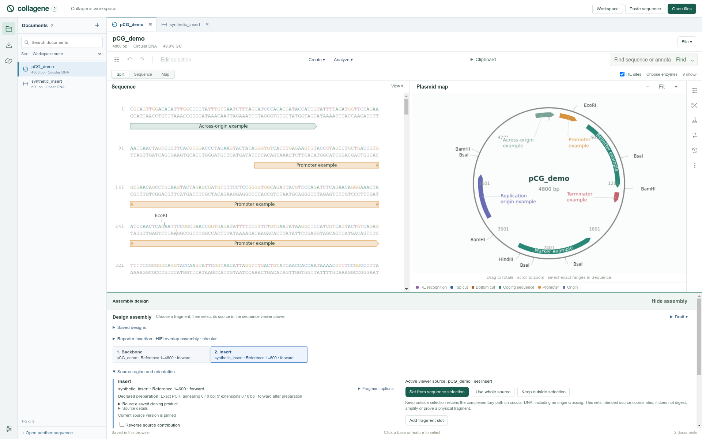

# Collagene 2

A molecular cloning workspace in Rust, WebAssembly and Leptos, with WebGL2 maps and deterministic design verification. [MIT licensed](LICENSE). In active development.



*Development screenshot, 27 November 2026. Assembly example uses synthetic sequences.*

## Features

These tables summarize implemented capabilities; see the linked profiles for limitations and [implementation status](docs/IMPLEMENTATION_STATUS.md) for remaining acceptance work.

- Sequence editing, annotations, translations and synchronized circular/linear maps.
- Restriction-site filtering, virtual digests, primer design and cloning workflows.
- [Structural CDS checks, RFC10 part-format checks and oligo collection binding](docs/DESIGN_CHECKS.md).
- Independent target verification, retained intermediate products and alternative cloning products.
- Saved history, primer orders and HTML/PDF protocols.
- Protein properties, [conditional antibody numbering and North CDR regions](docs/ANTIBODY_NUMBERING.md), [sequence-liability screening](docs/PROTEIN_LIABILITIES.md), declared [RNA chemistry](docs/RNA_MODIFICATIONS.md) and imported structure viewing.
- MCP-assisted design, optional WebMCP, shared plasmid folders and offline desktop storage/sync.

### Cloning methods

| Methods | Capabilities |
| --- | --- |
| Restriction/ligation | Sticky/blunt ends, ordered fragments and alternative products |
| PCR/mutagenesis | Added primer bases, mismatch/inverse PCR and sequential changes |
| Gibson/HiFi, In-Fusion | Overlap preparation and method-specific finishing assumptions |
| Overlap-extension PCR | Source PCRs, reciprocal extension, outer PCR and reusable products |
| Golden Gate | Type IIS preparation, fusion design and construct libraries |
| Gateway, TOPO | BP/LR, selected MultiSite profiles and explicit strand-transfer chemistry |
| TA/GC, end processing | Tails, phosphate treatment, blunting and oligo annealing |
| Domestication | Checked substitutions with inverse-PCR or overlap-extension preparation |

### File formats

| Formats | Support |
| --- | --- |
| GenBank/ApE, FASTA, EMBL | Import/export |
| GenPept, UniProt | Annotated protein import/export |
| SnapGene DNA/protein, XDNA v0, GCG | Selected import/export profiles |
| ABIF, SCF | Trace import, original download; SCF regeneration |
| JPEG, PNG, TIFF/BigTIFF | Documentary workspace attachments, previews and exact-original download |
| Original Collagene XML | Import and original download |
| PDB, mmCIF coordinates | Source-preserving import, 3D view and original download |
| Aligned FASTA, CLUSTAL, Stockholm, PHYLIP, MSF, NEXUS, PIR, GDE, SELEX | Alignment import/export; no external aligner |
| FASTQ, GFF3/GTF/BED, primer CSV/TSV | Quality, annotation and oligo exchange |
| SBOL 3.1 JSON-LD | Selected structural profile |
| Native Collagene 2 | Documents, workspaces, designs and history |
| HTML/PDF, SVG/PNG | Protocols, maps and predicted gel export |

[Format profiles and limitations](docs/FORMAT_DELIVERY_MATRIX.md) · [NCBI/Addgene URL imports](docs/URL_IMPORT.md)

### Platforms

| Platform | Delivery |
| --- | --- |
| Windows, macOS, Linux browsers | Leptos/WASM web application with WebGL2 |
| Windows, macOS, Linux desktop | Tauri; CI produces portable `.exe`, macOS installer/app and `.deb` ([packages](docs/DESKTOP_PACKAGING.md)); installed GUI review pending |
| Shared lab server | Rust service with authenticated plasmid folders |
| Mobile | Deferred |

## Install and start

With Rust installed:

```sh
rustup target add wasm32-unknown-unknown
cargo install trunk --locked
trunk serve
```

Open **http://127.0.0.1:8080**.

[Application guide](docs/APPLICATION_GUIDE.md)

[Desktop installation/build](docs/TAURI_DESKTOP.md) · [Server setup](docs/SERVER_LIBRARY.md)

[Implementation status](docs/IMPLEMENTATION_STATUS.md) · [Product plan](docs/PROJECT_PLAN.md)
