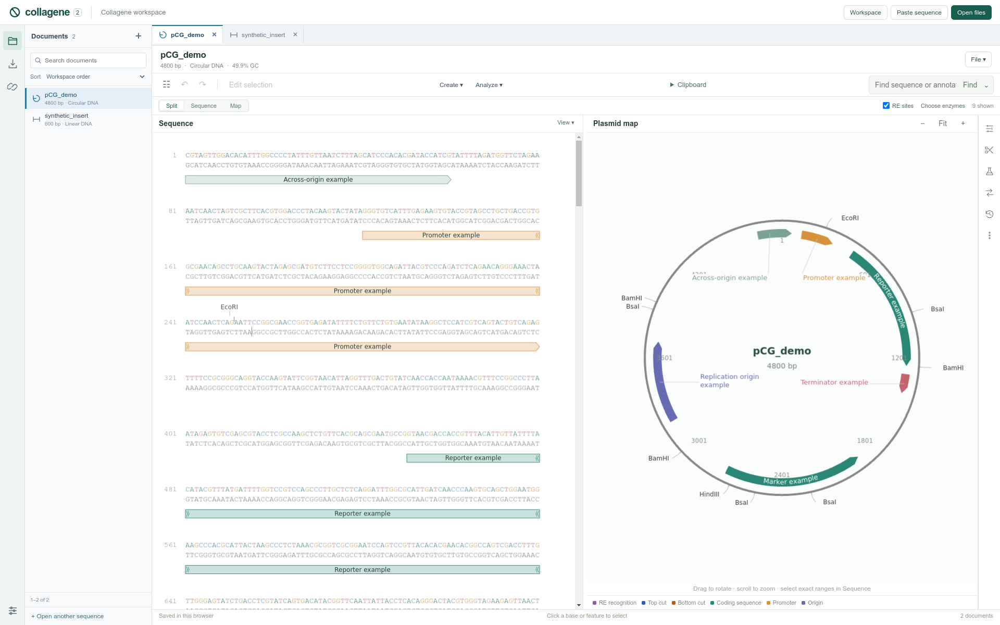

# Collagene 2

A molecular cloning workspace in Rust, WebAssembly and Leptos, with WebGL2 maps and deterministic design verification. [MIT licensed](LICENSE). In active development.




*Development screenshots, 27 November 2026. Assembly example uses synthetic sequences.*

## Features

- Sequence editing, annotations, translations and synchronized circular/linear maps.
- Restriction-site filtering, virtual digests, primer design and cloning workflows.
- Independent target verification, retained intermediate products and alternative cloning products.
- Saved history, primer orders and HTML/PDF protocols.
- MCP-assisted design, optional WebMCP, shared plasmid folders and offline desktop storage/sync.

[Cloning methods, supported file formats and platforms](docs/FEATURES.md)

## Install and start

With Rust installed:

```sh
rustup target add wasm32-unknown-unknown
cargo install trunk --locked
trunk serve
```

Open **http://127.0.0.1:8080**.

[Desktop installation/build](docs/TAURI_DESKTOP.md) · [Server setup](docs/SERVER_LIBRARY.md) · [Application guide](docs/APPLICATION_GUIDE.md)

[Implementation status](docs/IMPLEMENTATION_STATUS.md) · [Product plan](docs/PROJECT_PLAN.md)
