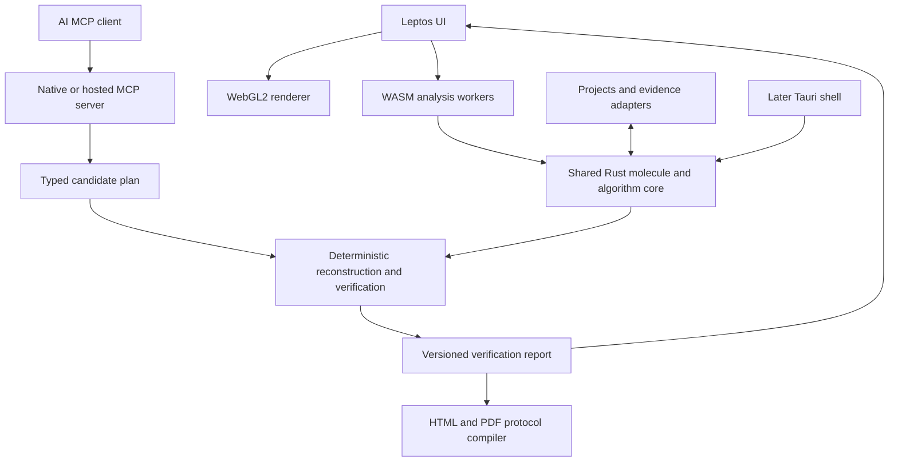

# Collagene 2 product and architecture plan

Planning baseline: 23 November 2026.

Related research: [Open source molecular cloning software comparison](OPEN_SOURCE_LANDSCAPE.md). The survey is retained for context; its projects are not implementation foundations.

Current progress: [Implementation status](IMPLEMENTATION_STATUS.md). Local build and example workflows are described in [README](../README.md).

Collagene 2 will be a Rust molecular cloning and sequence design application, delivered first through Leptos and WebAssembly in the browser, followed by a Tauri desktop application. Its distinguishing workflow is to let an AI propose a design through MCP, reconstruct that design with deterministic algorithms, inspect the evidence interactively, and export reproducible cloning instructions as HTML and PDF.

The foundation comprises shared `collagene-model` document/location types, a Rust scientific core, a WebGL2 sequence renderer, background analysis workers and versioned binary application messages. Existing libraries supply parsing, alignment primitives, UI infrastructure, and serialization. The molecule model, cloning chemistry, annotation transformations, design verification, and interactive sequence layout require substantial application code.

This is a target specification and implementation proposal. Priority controls delivery order within the agreed scope. Library candidates below need dependency, license, target-build, and correctness checks before adoption.

## Implementation workflow — user instruction, 24 November 2026

Keep the full product objective and all existing scope constraints. Change the
execution order and validation workflow as follows:

- **27 November execution update: use larger coherent implementation batches.**
  Finish related core, schema, transport, UI, caller and fixture edits together
  before compiling. Use static caller/enum searches to catch integration omissions.
  Parallel patches belong to one batch, not separate build checkpoints. Run focused
  native/WASM verification for the completed batch, collect actual failures, and
  repair them together before a recheck. Reuse unchanged passing evidence and
  keep Cargo package/features consistent; do not add compilation or test cycles
  merely to keep intermediate code green. Required final correctness checks remain.
- **Do not run browser checks until the in-scope code is complete.** This applies
  to automated browser suites, browser smoke checks, screenshots, browser
  performance checks and GUI acceptance runs during implementation. Completion
  means the full in-scope product implementation, not an individual checkpoint.
- Run compiler checks in the background while continuing useful coding. Do not
  stop implementation to wait or poll for compilation, or repeatedly rebuild
  optimized WASM after individual fixes. Batch release compilation and broad regression
  validation after implementation; final scientific/native/WASM verification
  remains part of completion.
- Prefer focused, quick scientific checks for new algorithms over repeated full
  regression runs. Existing passing checks are evidence for unchanged code;
  compilation and testing must not displace feature implementation.
- Prioritize usable editor functionality over further pane/layout polish:
  visible restriction-enzyme recognition ranges and strand-cut positions in
  sequence and circular/linear maps; enzyme filtering by site count; pointer
  range selection; keyboard selection and direct sequence typing/deletion with
  undo/redo and annotation updates. Share the selected enzymes and site evidence
  across the editor views. Keep uncertainty and incomplete scans explicit.

These instructions change the working method and immediate priorities; they do
not remove outstanding features or weaken the final completion requirements.

## Current execution order — cloning first, 24 November 2026

This order supersedes the older milestone order and any format-first expansion.
Keep the full agreed scope, existing feature IDs and scientific architecture;
finish the cloning application before extending peripheral analysis. Existing
modules remain available, but their presence does not give them priority.

| Order | Work to finish | Concrete outcome |
| --- | --- | --- |
| 1 | Everyday sequence workspace: F01–F06, F19 and the simple document library in F29 | Open, find, edit and annotate constructs; choose enzymes; inspect recognition/cut sites, fragments and ends in synchronized sequence/circular/linear views; preserve edits and history |
| 2 | Complete ordinary cloning design: F07, F08, F12, F14 and relevant F21 conditions | Select actual source fragments, choose orientations, define PCR primers/tails/mismatches, assemble by restriction/ligation or overlap, inspect junctions and reconstructed products, and check against the intended target |
| 3 | Finish the end-to-end design workflow: F09–F11, F22 and F23 | Manually authored and AI-proposed designs use the same deterministic verifier; source revisions, intermediate products, alternatives and unresolved assumptions are inspectable; save/reopen and HTML/PDF instructions retain the same design and evidence |
| 4 | Complete cloning methods and cloning libraries: F13, F15 and cloning-related F27 | Finish Golden Gate, Gateway/TOPO, TA/GC, end repair and method-specific preparation/composition; support practical multi-part and batch cloning with explicit physical rules and product alternatives |
| 5 | Finish supporting molecular-biology workflows: F16–F20 and cloning-related F33 | Sanger traces, pairwise construct verification, translations/fusion frames, feature/primer reuse, diagnostic digests/gels and Addgene/NCBI imports support a coherent cloning workflow |
| 6 | Deliver the portable application and remaining agreed features | Finish native/offline Tauri delivery on Windows/macOS/Linux, remaining sharing/review, CRISPR, codon design and other agreed advanced work after the cloning workflows above; keep existing exclusions and deferrals |
| Last | Further BAM/BAI work and related high-throughput alignment/index expansion | Resume only after the rest of the software is implemented; do not start more BAM/BAI features, indexed browsing, index formats or alignment-host integration now |

The next implementation work must close a concrete gap in source selection,
cloning preparation/assembly, product/junction inspection, deterministic checking
or retained protocol/history. Prefer complete user workflows over accumulating
standalone scientific crates or additional file formats. Keep common cloning
controls accessible in the main workspace and advanced analyses secondary.
Parallel workers should work on independent cloning deliverables in this queue;
spare workers are not a reason to expand deferred BAM/index work.

BAM/BAI is explicitly postponed by the user until the rest of the software is
done. Existing BAM/BAI/CSI code is retained without further feature development.
Other NGS/large-reference/variant expansions also sit behind the cloning work;
necessary fixes to shared code that blocks cloning remain permitted. This changes
execution priority, not the full goal's completion criteria. Browser checks stay
deferred until all in-scope implementation is complete, and compiler checks run
in the background while coding continues.

26 November update: resume the remaining file-format adapters in parallel with
cloning and desktop delivery, as explicitly requested. Independent workers can
implement annotated protein exchange, additional alignment exchange and the
selected SBOL design profile while integration continues. The next independent
batch adds reviewed SnapGene DNA/protein export, explicit GCG/Wisconsin
single-sequence exchange, and an opt-in original Collagene lower-strand-only XML
migration profile. Keep core adapters, application integration and observed
interoperability separate in the delivery matrix; a parser alone is not full
format support. Format support still
requires explicit read/write fidelity, original evidence, loss reporting and
portable Rust adapters. BAM/BAI, OpenGel and external alignment engines remain
deferred/excluded as above.

## Shared lab library in server mode — user requirement, 26 November 2026

Server deployments must provide a persistent joint database accessible to all lab
members, with folders for organizing plasmids. F29 now explicitly includes this
requirement. It belongs with the everyday sequence workspace and server delivery;
it does not wait for advanced concurrent editing, comments or review in F30.
The current port8082 deployment is a static preview with browser-local documents;
shared persistence is required implementation work, not a current capability.

- Keep the main editor directly accessible. A shared library tree supports folder
  browsing, import, open, save, rename and move without requiring projects or
  organization dashboards. Folders organize sequence documents, not physical
  samples, freezer locations or reagent inventory.
- Use one authoritative server database for the lab, accessed through the Rust
  host and compact versioned binary messages. Keep the storage adapter separate
  from the scientific core, browser workspace cache and future Tauri local files.
  An embedded transactional database is sufficient for the initial single-server
  lab deployment; do not require an external database executable for normal use.
- Store stable folder/document identities and immutable document revisions,
  retaining native document/history, annotations, cloning provenance and format
  evidence. Saving against an outdated revision must report a conflict and retain
  both work streams rather than silently overwriting another member's changes.
  Sharing a plasmid includes its declared dependency/history closure, not unrelated
  private documents from the browser workspace.
- Authenticate lab membership at the host boundary. All members initially access
  the shared lab library; client-supplied lab/user IDs grant no authority. Keep
  server persistence inside operator-configured storage, and provide backup and
  restore with schema migrations. Database-backed access does not expose arbitrary
  server filesystem paths. Do not publish database writes anonymously on8082.
- Acceptance includes two independent clients seeing the same folders/plasmids,
  persistence across restart, atomic save/conflict behavior, folder-cycle and
  cross-lab isolation checks, backup/restore, and unchanged native/WASM scientific
  results. Browser acceptance remains deferred under the existing instruction.

Storage and binary service contracts are suitable independent parallel work.
Host integration and the library sidebar follow those contracts; existing local
workspaces remain useful for standalone/offline use.

## Tauri local library and database synchronization — user requirement, 26 November 2026

The desktop application must work fully offline, with local plasmids, folders,
annotations, cloning plans/history and embedded scientific computation. Shared
server storage is one deployment mode; desktop use must not depend on a server,
network login or an always-available database. Tauri should behave like a local
repository with configurable remotes, rather than a thin wrapper around the web
server.

- Users choose which shared database/remotes to connect and which plasmids or
  folders to bring into their local library. Keep remote configuration and
  credentials outside exported biological documents; credentials belong in the
  native credential store. The storage/service abstraction must allow independent
  database deployments and later backend adapters without changing the science
  model or hard-coding one lab server.
- Support explicit clone/import, pull and push, with visible local modifications,
  pending uploads and remote updates. Connection loss must leave local editing,
  analysis, design verification, exports and history usable. Failed synchronization
  must preserve unsent local revisions for retry. Creation retries also require
  durable mutation receipts or stable client creation identities: a correlation
  ID alone cannot safely deduplicate an import whose response was lost.
- Retain stable native identities, immutable revisions, ancestry and all selected
  dependency/run-capsule evidence. Distinguish a local document from its bindings
  to each remote library/document and last common synchronized revision. Matching
  DNA sequence or display name does not establish shared identity or ancestry.
- Synchronization exchanges bounded versioned binary records and compares revision
  ancestry. Push uses atomic expected-head updates; pull never silently overwrites
  unpublished local work. Divergence remains explicit, retaining both versions
  for review/merge or save-as-copy. Do not implement last-writer-wins for DNA,
  annotations or cloning evidence, and do not fabricate physical authority during
  merge or replay.
- Transfer the required immutable revision/dependency closure and preserve folder
  structure, including offline folder changes and destination conflicts. Track
  synchronization separately for every configured remote. The initial shared
  library import/CAS API is groundwork; it is not evidence of completed offline
  synchronization or multi-remote support.
- Acceptance includes disconnected startup and ordinary cloning workflows,
  reconnect after local/remote changes, interrupted push/retry, two diverging
  clients, remote selection/switching, history/provenance preservation, and native
  Windows/macOS/Linux parity. No external Git installation or scientific process
  is required at runtime.

F31 includes this local repository and synchronization workflow; F29/F30 provide
shared library and conflict primitives. Desktop and sync implementation remain
active deliverables, not optional replacements for a fully offline application.

## Workflow review follow-up — 25 November 2026

The user's requested parallel checks of official Benchling workflows are recorded
in [assembly](BENCHLING_ASSEMBLY_WORKFLOW_CHECK.md),
[PCR/primers](BENCHLING_PCR_WORKFLOW_CHECK.md) and
[editor/supporting workflows](BENCHLING_EDITOR_FOLLOWUP_CHECK.md).
Use documented interaction patterns as references while keeping our document/workspace
organization simple. These are static source/documentation comparisons; usability
acceptance remains deferred, and undocumented Benchling behavior is not a requirement.

For remaining uncertain interactions, delegate independent public-documentation
reviews in parallel before designing another workflow. Start from the current
implementation and prior reviews so completed connections are not reopened as
gaps. Record the documented user actions, unresolved questions and our adaptation
separately, with primary links. Prefer the existing sequence-centred dock, source
selection, preparation, product review and output routes over another wizard.
This reference work does not introduce Benchling's project hierarchy or excluded
laboratory administration, nor does it authorize borrowing implementation code.

The latest parallel follow-ups cover [remaining cloning methods](BENCHLING_METHODS_FOLLOWUP.md),
[editing and translation semantics](BENCHLING_EDITING_FOLLOWUP.md) and
[verification/output continuity](BENCHLING_VERIFICATION_FOLLOWUP.md).
They preserve existing engines and identify public-evidence limits rather than
turning undocumented behavior into requirements. Their decisions are consolidated
in [workflow follow-up](BENCHLING_WORKFLOW_DECISIONS.md#latest-review-policy).

Three further parallel reviews consolidate the remaining decisions in
[workflow follow-up](BENCHLING_WORKFLOW_DECISIONS.md): distinguish creating a primer
from attaching/comparing an existing oligo, keep failure recovery local, complete
computed-comparison context/exports, and add genuine source-alternative bins after
the ordinary route. Saved read checks and explicit discrepancy review are already
implemented; old gap tables must not reopen them.

Recent implementation closes annotated reference transfer, saved paginated pairwise
comparisons, exact historical-event navigation, selection-relative restriction
filtering and persistent named enzyme choices. Older review tables describing those
as absent are historical. Continue the existing cloning-first queue through these
concrete connections:

- Golden Gate reaction pool/substrate/topology/search settings are now retained in
  assembly drafts without restoring stale successful evidence
  ([implementation](GOLDEN_GATE_POOL_SETTINGS.md)). Continue with the connected
  preparation and product review work below.
- Keep ordinary source capture, preparation, junction/product review and named outputs
  continuous in the existing assembly dock. Preserve explicit Apply and selective
  regeneration rather than silently replacing intentional primers/edits.
- Applied pair comparisons and selected exact/mismatch PCR geometries now feed
  synchronized source overlays ([details](PCR_OVERLAYS.md)). Explicit domain/tail
  boundary preview/accept and circular anchor migration are now implemented
  ([details](PRIMER_DOMAIN_EDITS.md)); continue local binding-failure recovery and
  the remaining ordinary cloning interactions. Literal-preserving reference capture,
  explicit selected-hit transfer to either pair slot, full returned-hit paging and
  local domain/policy/rerun controls are now connected
  ([details](PRIMER_REFERENCE_RECOVERY.md)). Continue the remaining ordinary cloning
  connections without adding a second primer or assembly workflow.
- Annotation list/bulk operations and exact-event display preferences are now
  implemented ([details](ANNOTATION_MANAGEMENT.md)). Exact selected translation,
  source-linked protein outputs, review-required CDS proposals and full ORF
  selection are now connected ([details](TRANSLATION_REFERENCE.md)). Named digest
  setup/history and a pinned-source gel route are now implemented
  ([details](NAMED_DIGESTS.md)). Computed pairwise search, mapped annotation/CDS
  context and direct aligned/printable outputs are now connected
  ([details](PAIRWISE_PRESENTATION.md)); continue remaining ordinary cloning
  interaction work and the alternative-source design layer below.
- Genuine alternative source bins, selected construct rows, stable recipe identities
  and per-construct editable preparation/junction state now extend the same dock
  ([details](COMBINATORIAL_SOURCE_DESIGN.md)). Selected batch evaluation/cancellation,
  immutable historical evidence and six MCP operations are now connected
  ([details](COMBINATORIAL_BATCHES.md)). Continue matrix-owned run/output provenance,
  fresh bulk release, product inspection, reaction-pool composition and library
  topology editing.
  Reaction-product enumeration alone does not complete combinatorial cloning.
  Inspectable fusion-end proposals and intentional
  domestication remain distinct planned work.

The named-digest/gel connection now retains complete catalog geometry/options
and exact source events ([implementation](NAMED_DIGESTS.md)). The preimplementation
constraints below remain the design contract: Current gel digest lanes resolve starter-enzyme names and
current document indices; adapting saved setups through those names would silently
lose identity. Add a pinned-catalog lane that freshly inspects the retained event,
uses fragments only when the scan is complete/products determined, and explicitly
keeps the gel's 1,024-fragment bound. Reopen historical evidence without moving heads;
mutable continuation uses an explicit fork. Do not silently repin an old catalog
selection or alter saved digest options to fit a gel.

No new wizard, parser, primer engine or export engine is implied by these findings.
Broader kinetic/mixture modeling mentioned in research is not an added delivery gate.
Keep the current scientific contracts, independent target checking, source-event
identity, uncertainty and explicit resource limits. ELN, inventory and organizational
workflow remain excluded; deferred tools and browser checks stay deferred.

## Scope constraints

Collagene 2 is licensed under [MIT](../LICENSE). Implement its application, UI, cloning algorithms and verification engine independently. Do not fork, copy, translate or borrow application/scientific code from the surveyed cloning projects, or treat their output as an authoritative correctness oracle.

Existing format specifications and representative files are the primary sources for interoperability. When a format is undocumented, narrowly inspect another project's parser to understand byte layout, fields or compatibility quirks. Record the source and observations, then write our own implementation and validate it against independently constructed fixtures and real files. This exception does not authorize copying parser code or importing unrelated algorithms or UI designs.

Established standalone libraries for infrastructure and bioinformatics primitives remain candidates, subject to review of license compatibility, implementation correctness and native/WASM portability. Their use does not replace independent validation of Collagene's scientific behavior. New UI and interaction design should follow Collagene's requirements rather than the surveyed applications.

Benchling screenshots and public UI documentation are an approved visual and interaction reference. Use its sequence workspace as inspiration while implementing our own UI and simplifying document organization as described below.

Support Windows, macOS and Linux. Deliver the browser application first and the Tauri desktop application later; keep the scientific core portable across all three operating systems and browser WASM.

Prioritize the desktop browser interface and desktop workflows. Mobile product design, feature scope, dedicated controls and acceptance testing are deferred until the desktop product is finished and the user has reviewed and edited it. Decide a limited set of mobile workflows then; full control parity is not a mobile requirement. Existing responsive behavior is incidental support, not a current delivery gate.

All scientific processing and report generation must use embedded libraries or application code. Do not invoke external executables, shell commands, sidecars or installed scientific tools. Native/server execution means running the shared code in that process. Browser print-to-PDF uses the browser's built-in print facility; deterministic PDF export uses an embedded library. MCP exposes Collagene functionality to AI clients without launching those clients. Network data sources and MCP clients are integration boundaries, not substitutes for embedded scientific algorithms.

Excluded from the product scope: ELN, inventory/freezers, sample management, barcodes, reagent stocks, instrument/automation interfaces, workflow scheduling and organizational reporting. Protocol material lists and reagent quantities remain part of cloning instructions, without stock tracking.

Deferred pending a future scope decision:

- Mobile product scope, dedicated interaction/layout work and mobile acceptance testing, until desktop completion followed by user review and edits; select limited mobile workflows afterward.
- OpenGel integration, predicted-versus-observed comparison, and OpenGel file formats including `.gel.zip`.
- Primer3 integration or translation, including its bindings and derived thermodynamics ports. Basic primer annotation, PCR simulation and independently implemented calculations remain in scope; advanced design/thermodynamics requiring this work are deferred.
- MAFFT/MUSCLE/Clustal-style multiple alignment engines or translations. Pairwise alignment and alignment file exchange remain in scope. Future Rust translations can be evaluated separately and must satisfy the embedded-code requirement.

## Product baseline and scope

[Benchling molecular biology](https://www.benchling.com/molecular-biology) establishes expectations for DNA/RNA/protein design, bulk assemblies, CRISPR, alignment, registration, traceability, and collaboration. The comparison targets molecular biology functionality within the scope constraints above.

[SnapGene](https://www.snapgene.com/features) establishes expectations for cloning simulations, primer design, sequence verification, gel visualization, and retained experimental history. Support should ultimately cover restriction/ligation, overlap assembly, Golden Gate, recombination-based cloning, TA/GC and TOPO workflows, mutagenesis, and oligo assembly. Pairwise alignment, Sanger contigs, methylation/end-state checks, and clear graphical provenance belong in the target as well; deferred engines are listed above.

The [original Collagene README](https://github.com/mahogny/collagene#readme) provides the legacy baseline: smooth linear/circular views, rotation/zoom, origin-spanning features and sites, origin relocation, translation, ORFs, primer attachment and PCR products, restriction digests, buffer suggestions, gels, and sequence properties. It lists GenBank/ApE, FASTA, DNA Strider/Serial Cloner, native XML, and SCF support. Several advanced cloning wizards and PDF export are marked TODO; they must not be treated as completed legacy behavior. Migration needs a source/schema audit and representative original documents in addition to this README-level inventory.

## Immediate desktop MVP delivery gate

The desktop MVP baseline is viewer, GenBank import and virtual restriction digest. The cloning-first execution order above now controls further implementation. [Architecture and scientific interpretation](MVP_DESKTOP.md). Complete remaining editor/digest gaps and proceed through the cloning workflows above; defer browser validation under the current implementation instruction. Existing implemented modules remain available behind a secondary tools entry; the main workflow should not require users to navigate them. The complete feature inventory remains the long-term target.

The user has reviewed the early preview and considers the GUI unfinished, particularly the left side. Complete the functional desktop workspace alongside cloning controls before requesting another GUI review: compact functional navigation, a searchable document explorer, document switching tabs, and a coherent editor toolbar and inspector. Use Benchling's navigation and sequence workspace as visual references while retaining simple document organization. A working viewer and passing scientific tests alone do not establish GUI readiness. Keep mobile design deferred.

The cloning interaction should follow the sequence-centred Benchling assembly pattern: method, backbone/insert slots populated from source selections, preparation and primer review, junction/product preview, then outputs. The dedicated draft and source-view connections remain required; numeric forms alone do not satisfy this workflow. [Interaction design and reviewed reference sources](CLONING_INTERACTION_DESIGN.md).

The MVP must satisfy these acceptance conditions:

1. Open a real GenBank sequence directly, with explicit import errors and retained original evidence. Preserve topology, IUPAC calls, both strands, compound/origin-spanning annotations and supported qualifiers through native save/reopen and declared-loss exports.
2. Inspect circular and linear maps and a virtualized sequence view with consistent feature/base selection, visible coordinates, rotation, zoom and smooth scrolling. Scientific coordinates remain integer-based and independent of rendering geometry.
3. Choose enzymes from a data-driven catalog and run a virtual digest against the exact current document. Show recognition sites, both strand cut boundaries, fragment sizes and supported end structures. Distinguish uncut molecules, one-cut circles, multiple cuts, ambiguous sites and unsupported cleavage geometry. Laboratory cleavage and methylation assumptions stay explicit.
4. Keep analysis source/role/revision bound. Document switches, edits or enzyme changes invalidate obsolete results. A preview does not modify its source; opening/exporting a derived fragment is explicit and preserves its source relationship and supported annotation/evidence semantics.
5. Retain native save/load, autosave/recovery, cancellation and useful failure feedback. Validate the workflow in native scientific fixtures and the actual desktop WASM application, including deliberately wrong inputs and stale asynchronous responses.
6. Preserve architectural extension points: the scientific document/location model, format adapters, enzyme data, restriction/physical algorithms, typed worker jobs/results, renderer scenes/cameras and UI workflow components remain separate. Reuse those foundations for later cloning, other formats, catalogs and MCP/Tauri. Do not hardcode demo coordinates, couple biology to display pixels, fabricate certainty or introduce MVP-only data types that require replacing the core later.

Mobile design, feature selection and acceptance remain deferred until the finished desktop product has been reviewed and edited by the user. Broader P0/P1/P2 work resumes after this MVP gate; passing it does not complete the full product goal.

The current prepared-overlap implementation connects original source documents to
explicit PCR/digest/end-repair steps and ordered Gibson/HiFi/In-Fusion profiles in
both the UI and MCP. Existing deterministic plan verification and HTML/PDF exports
consume that same graph. [Current workflow](ASSEMBLY_WORKFLOW.md). This is progress
on cloning priorities 2–3 above; broader physical preparation/composition,
alternative-product handling and the remaining product scope are still required.

Ordered multi-fragment ligation now shares the same original-source preparation
compiler, adding explicit terminal treatments, orientation and nick policy. Fresh
physical ends/junctions come from the verifier's live material state, and method
candidates retain exact source-event bindings for later history capture.
[Current ligation workflow](LIGATION_WORKFLOW.md). These ordinary cloning paths
remain the priority over deferred alignment/index expansion.

Explicit junction review now reconstructs the actual plan before displaying DNA
flanks, shared homology, requested local reading frames and available CDS coding
windows. Independent-target mismatch, retained physical nicks and uncertain
annotation/function remain separate findings. [Junction review](ASSEMBLY_JUNCTION_REVIEW.md).
Clipped display flanks at known sequence ends are a normal bounded view, not a
reason to fail otherwise complete junction inspection.

An explicit original-source terminal hypothesis is now available for eligible
intact linear duplex references. It is a recorded preparation step, not a default
inference from files or imported physical summaries, and it enables ordinary
whole-fragment ligation when the operator supplies the required terminal groups.
[Declaration scope](DECLARED_SOURCE_TERMINI.md). Existing unknown inputs and
unsupported physical intermediates keep their previous restrictions.

Source-derived overlap-primer suggestions now select anchored domains from explicit
original-source intervals and synthesize only the requested neighboring homology.
The web route includes source-selection capture, separate oligo review and explicit
application before fresh verification; MCP uses the same engine. This advances
ordinary assembly setup while the dedicated sequence-centred assembly workspace
and region-defined intent remain required. [Planner model](OVERLAP_PRIMER_DESIGN.md).

The first dedicated assembly dock now pins exact source events, captures selected
regions or circular complements into named slots, builds an expected reference
independently of reaction simulation, and connects existing preparation/primer
controls to that fixed target. Draft declarations survive document switching and
native workspace/autosave restore; fresh evidence is recomputed. Integrated actual-product/junction editing remains required; direct cut-pair
selection and atomic output choices are now connected. [Interaction state](CLONING_INTERACTION_DESIGN.md).

Fresh catalog digest fragments can now populate the active assembly slot with
original-source event, full enzyme identity/geometry pin and explicit preparation.
Reversed sticky fragments use the actual bottom-strand source interval for intended
top DNA. Fresh overlap/ligation evidence also has an actual-product sequence/map
view with local selection and optional fresh junction inspection. Integrated primer/junction editing remains required. Direct cut selection and
atomic output choices are now implemented.
[Catalog preparation](CATALOG_DIGEST_PREPARATION.md) · [Actual product review](ASSEMBLY_PRODUCT_REVIEW.md).

Direct restriction-boundary choices now connect the sequence/map viewer to fresh
physical-fragment selection, including circular complement and linear source-end
cases. Reviewed assemblies can export exact primer order sheets and HTML/PDF
steps without leaving product review. Source/event/choice and plan/target/options
remain bound; partial or unavailable orders are explicit. [Cut choice model](DIGEST_CUT_SELECTION.md) · [Order extraction](PLAN_OLIGOS.md).

Parallel reviews of Benchling's public restriction/Golden Gate, primer/mutagenesis
and verification/history workflows are complete. The immediate UI work is the
persistent assembly draft, source-selection/slot connection and central product/
junction/primer review; reuse the existing engines. Supporting review and history
connections follow in the cloning-first queue. The reviewed patterns and exact
source links are consolidated in [the interaction design](CLONING_INTERACTION_DESIGN.md#implementation-order).

## Feature inventory and delivery priorities

P0 is the foundation and first usable cloning release. P1 supplies everyday molecular biology workflows. P2 extends scale, specialized workflows, collaboration, and desktop delivery. P3 covers advanced molecular analysis. Each row is an implementation backlog item, not a claim about an existing Collagene 2 feature. Feature IDs are retained when rows are removed.

| ID | Priority | Expected capability | Acceptance evidence |
| --- | --- | --- | --- |
| F01 | P0 | DNA/RNA/protein documents; circular/linear topology; IUPAC ambiguity; strand identity | Alphabet validation; ambiguity is retained; topology survives save/reopen |
| F02 | P0 | Sequence editor with insertion/deletion/replacement, reverse complement, undo/redo and clipboard | Editing remaps features and selections correctly; operation history replays |
| F03 | P0 | Circular map, linear map and virtualized sequence view with synchronized selection | Rotation, scrolling, zoom and selection remain responsive on benchmark fixtures |
| F04 | P0 | Features, primers, enzymes, translations and ORFs as configurable tracks | Origin-crossing and compound features select and render correctly on both strands |
| F05 | P0 | Search by sequence, reverse complement, ambiguity, annotation, enzyme and primer | Both strands and circular origin are searched; results give stable coordinates |
| F06 | P0 | Restriction analysis, single/double digests, end structures and fragment sizes | Independent small examples confirm cut coordinates, ends and fragment lengths |
| F07 | P0 | PCR simulation and primer collection with tails and intentional mismatches | Products include introduced sequence; alternative binding sites are reported |
| F08 | P0 | Restriction/ligation and Gibson-style overlap assembly with an inspectable intermediate graph | Exact reconstructed products, junctions, topology and alternatives are available |
| F09 | P0 | MCP tools for reading documents, proposing plans and running deterministic checks | An external MCP client can propose, inspect and verify without bypassing checks |
| F10 | P0 | HTML protocol export and browser print-to-PDF | Every step and product links to the same plan revision and verification report |
| F11 | P0 | Native project save/load, import/export, autosave and recovery | Reload preserves all supported semantics; format loss produces an explicit report |
| F12 | P1 | Basic primer selection/reuse, annealing oligos, GC/Tm calculations and binding checks | Embedded calculations have reference cases and recorded conditions; advanced thermodynamics/design engines remain deferred |
| F13 | P1 | Golden Gate/Type IIS and combinatorial assembly libraries | Cleavage outside recognition sites, overhang orientation and recutting are checked |
| F14 | P1 | Site-directed, inverse-PCR and overlap-extension mutagenesis | Intended substitutions/indels and junction translations match the target |
| F15 | P1 | Gateway, In-Fusion cloning, Gibson/HiFi-style overlaps, TA/GC, TOPO and end repair | Each method has explicit rules, test fixtures and unsupported-state diagnostics; In-Fusion has its own preparation/annealing/host-rescue interpretation |
| F16 | P1 | Sanger chromatograms, quality trimming, reference alignment and consensus | Trace peaks and quality align to calls; low-quality and uncovered regions stay visible |
| F17 | P1 | Pairwise alignments, whole-plasmid verification and sequence differences | Rotation and reverse-complement equivalence are handled; coverage gaps are reported |
| F18 | P1 | Translation, alternative genetic codes, fusion frames and protein properties | CDS phase, stop codons and compound locations are respected |
| F19 | P1 | Automatic annotation and reusable feature/part libraries | Matches carry source, version, identity and coverage; uncertain calls remain distinct |
| F20 | P1 | Gel simulation, diagnostic digest selection, ladders and predicted PCR bands | Band sizes derive from products; co-migration and topology assumptions are visible |
| F21 | P1 | Enzyme catalog, supplier sets, methylation sensitivity and digest compatibility | Versioned data supports unknown methylation and supplier-condition provenance |
| F22 | P1 | Graphical cloning history, branching designs and sequence/plan comparison | Any retained product can be traced to inputs, edits and transformations |
| F23 | P1 | Deterministic PDF generation and publication-quality map exports | Pagination, vector maps, fonts and report contents pass export fixtures |
| F24 | P2 | Sanger contig assembly and dot plots using embedded algorithms | Algorithm/version/options and consensus evidence are retained; multiple alignment engines remain deferred |
| F25 | P2 | CRISPR guide design, nuclease rules, off-target search and editing templates | Reference genome/build, search completeness and scoring model are explicit |
| F26 | P2 | Codon optimization, reverse translation and synthesis constraints | Optimized DNA translates to the required protein and satisfies declared constraints |
| F27 | P2 | Bulk cloning, batch analysis, plate layouts and combinatorial libraries | Jobs are cancellable; stable identifiers connect designs, oligos and outputs |
| F28 | P2 | Whole-plasmid/NGS/long-read validation and large reference browsing | Coverage, variants and structural discrepancies are distinguishable from consensus |
| F29 | P1 | Searchable sequence library; server mode joint lab database with plasmid folders; local standalone documents | Lab members browse/open/save the same persisted folders and plasmid revisions across browsers; restart persistence and explicit concurrent-save conflicts; no mandatory project creation |
| F30 | P2 | Sharing, permissions, comments, review and concurrent editing | Revision conflicts are explicit; scientific verification survives only valid revisions |
| F31 | P2 | Tauri desktop with full offline local plasmid library, embedded compute/MCP, and git-like pull/push to chosen database remotes on Windows/macOS/Linux | Offline startup/design/export; explicit per-remote ancestry and divergence; interrupted-sync recovery; native/WASM parity and all three OS delivery; no external executables |
| F33 | P2 | Remote/local sequence sources, embedded sequence similarity search and data connectors | Accession/version, source and retrieval time accompany imports; search uses embedded algorithms |
| F34 | P3 | RNA modifications, antibody/protein analysis and structure visualization | Specialized semantics and imported structure data have explicit provenance; computation uses embedded code |
| F35 | P1 | Import by Addgene plasmid URL/ID, NCBI nucleotide/GenBank URL or accession.version, and direct sequence-file URLs through source adapters | Imported sequence/topology/features are validated by the same parsers; canonical source, accession/version, retrieval timestamp and evidence hash survive save/export; missing authentication, multiple sequence choices and fetch failures remain explicit |

Accessibility is a cross-cutting requirement: keyboard navigation, readable labels, a DOM representation of selected sequence/features, high contrast, and reduced motion. Browser storage limitations, interrupted tasks and unsaved changes need clear recovery behavior.

### In-Fusion cloning — explicit required workflow

In-Fusion is included in F15 and the cloning-first delivery queue. Deliver the
complete design workflow in the existing assembly dock, worker/MCP interface,
saved history and HTML/PDF protocols; a generic overlap-length screening option
alone does not complete this requirement.

- Support a linearized vector and one or multiple inserts, with explicit fragment
  order/orientation, source events, PCR or digest preparation, and terminal overlaps.
  Use manufacturer guidance of15-bp overlaps for a vector plus one insert and
  recommended20-bp overlaps for multiple inserts as visible design guidance;
  retain exact overlap evidence and diagnostic findings instead of treating a
  preferred length as a guarantee of experimental success.
- Propose ordered primers with independently visible annealing domains and5′
  homology tails. Preserve user-declared added bases, linkers, reading frames and
  junction edits. For restriction-linearized vectors, account for actual ends:
  manufacturer guidance counts5′ overhang bases toward homology and excludes3′
  overhang bases. Internal matching sequence cannot replace terminal homology.
- Keep the method distinct from the existing5′ resection/polymerase/ligase
  assembly model. In-Fusion's documented3′ exonuclease exposes5′ overhangs,
  followed by annealing and rescue in E. coli. Retain the annealed strand/nick/gap
  state and the explicit downstream host-rescue assumption; a matching reference
  must not silently become a covalently closed reusable material product.
- Freeze the intended circular construct from original source contributions and
  literal edits before preparing or selecting products. Deterministically check
  actual source ends, both terminal junctions, orientation, repeated/alternative
  homologies, introduced DNA and requested fusion frames. Retain uncertainty and
  alternatives through save/reopen, batch processing and AI proposals.
- Export vector linearization, PCR primers/products, fragment order, overlaps,
  assembly and transformation/rescue steps with the exact design and verification
  evidence. Independently authored acceptance cases must cover single/multi-insert
  cloning, blunt/5′/3′ restriction ends, reverse inserts, added junction bases,
  competing overlaps and a wrong independent target across native/WASM paths.

Existing source has an In-Fusion overlap profile and separate generic3′
resection/annealing kernels. Their presence does not establish the complete
connected In-Fusion workflow or proprietary reaction performance. Close the
remaining method-specific integration in F15 without adding an external runtime.
Primary references: [experiment planning](https://help.takarabio.com/36168/kb/article/109886/how-should-i-plan-my-in-fusion-experiment),
[primer and restriction-end guidance](https://help.takarabio.com/36168/kb/article/109895/what-are-pcr-primer-design-considerations-for-compatible-with-infusion-cloning).

## File formats and migration

The resumed parallel format queue now covers regenerated XDNA v0 reference
export, SCF export from actual retained trace channels/calls/qualities, and a
single typed MCP annotated-sequence export surface over the existing nucleotide
and protein writers. Each adapter remains independent of the scientific model,
declares its supported profile and export losses, and retains original evidence
separately. No sequence-to-synthetic-trace conversion is authorized. These are
implementation tasks until their focused fixtures and native/WASM checks pass;
they do not establish broad vendor-container compatibility. Further BAM/BAI,
OpenGel and external alignment-engine work retain their existing deferrals.

Import and export must be tracked separately. A format parser is only one part of support: feature locations, chemistry, primers, history and metadata need explicit fidelity tests. [SnapGene's supported extensions](https://support.snapgene.com/hc/en-us/articles/10242726896020-What-File-Extensions-does-SnapGene-support) show the breadth of migration users may expect, while its [developer guidance](https://www.snapgene.com/features/convert-file-formats) offers a route to information on native SnapGene files.

| Format family | Delivery | Read | Write | Fidelity and implementation plan |
| --- | --- | --- | --- | --- |
| GenBank/DDBJ `.gb`, `.gbk`, `.gbff`, `.genbank` | P0 | Yes | Yes | Primary annotated exchange; use `gb-io` behind adapters; multi-record, topology, qualifiers and locations |
| ApE `.ape` and GenBank application qualifiers | P0 | Yes | Yes | Preserve feature colors, labels and unknown qualifiers; test against actual files |
| FASTA `.fa`, `.fasta`, `.fna`, `.faa` and plain sequence | P0 | Yes | Yes | DNA/RNA/protein and multiple records; no claim to preserve annotations or history |
| Native Collagene 2 `.cg2workspace` archive; `.cg2` single document | P0 | Yes | Yes | Versioned archive of sequences, metadata, plans, revisions and original attachments; single-document export is distinct from the full workspace |
| Oligo/primer CSV and TSV | P0 | Yes | Yes | Column mapping, units, modifications, names, 5′→3′ sequence and order sheets |
| SnapGene `.dna`, `.prot` | P1 selected profiles | Yes, selected profile | Yes, reviewed reference profile | Independent packet/XML adapters retain original input; fresh reference export reports unsupported feature/metadata loss and refuses physical-state laundering; compressed data/history and broad application parity are not implied |
| Original Collagene native XML | P1 | Yes | Optional | Audit Java serializers and real documents; convert chemistry, annotations and retained workflow data |
| DNA Strider/Serial Cloner `.xdna`, `.xdgn`, `.xprt` variants | P1 | Yes | Later | Legacy migration; sniff content and validate exact variants against original parsers |
| ABI/ABIF `.ab1`, `.abi`; SCF `.scf` | P1 | Yes | Original attachment; derived FASTA/FASTQ | Four channels, calls, qualities, peak positions, orientation and trimming; SCF required for legacy parity |
| FASTQ `.fq`, `.fastq` | P1 small data; P2 scale | Yes | Yes | Preserve quality encoding; stream larger datasets and keep import limits visible |
| EMBL/ENA `.embl`, `.emb`; GenPept/UniProt text | P1/P2 | Yes | Yes, explicit profiles | Independent annotated protein adapters retain source records and coordinate uncertainty; synthetic export requires declared identifiers/date where needed |
| Aligned FASTA, CLUSTAL `.aln`, Stockholm; native `.cg2aln` | P1/P2 | Yes | Yes | Preserve gaps, identifiers and alignment metadata where expressible; explicit alphabet, original bytes, typed retained collections and export-loss review; no alignment engine |
| GCG/Wisconsin single sequence `.gcg`, `.seq`, `.pep` | P2 selected profile | Yes, explicit alphabet | Yes, explicit ID/date and loss review | Validate declared type, length, checksum and numbered rows; preserve original bytes; no annotation/topology/history fidelity claim |
| PHYLIP, MSF, NEXUS, PIR, GDE, SELEX | P2 | Yes, explicit profiles | Yes, explicit profiles | Exact identifiers/gaps and native originals; opt-in PHYLIP truncation; unsupported missing/topology/tagged variants are refused; see alignment profile contracts |
| GFF3, GTF, BED | P2 | Yes | Yes | Independent GFF3/GTF/BED profiles implemented; explicit reference identity and coordinate conversion are mandatory; GTF rows retain attributes without inferred transcript assembly |
| Large reference `.cgref` | P2 foundation | Yes | Yes | Separate streamed packed IUPAC blocks and bounded hash manifest; canonical DNA/readback verification, global coordinates and portable links; no imported coverage authority |
| SAM/BAM/CRAM, VCF/BCF and their indexes | P2 | Yes | Selected/derived | Independent bounded SAM/BAM exchange and source-bound inspection implemented; VCF/BCF exchange, bounded browser/MCP inspection and explicit REF/ALT-to-DNA design checking implemented; bounded BAI/CSI readers and source-bound retained-BAM selection are implemented; CRAM and streamed indexed browsing remain pending; [workflow](READ_ALIGNMENT_WORKFLOW.md) |
| SBOL3.1 structural JSON-LD | P2 | Yes, selected profile | Yes, selected profile | Typed component/sequence/feature/constraint graph and original evidence; explicit native projection and omissions, no hierarchy-to-DNA synthesis; broader RDF profiles and subset sharing remain active work |
| Benchling sequence exports and API data | P1 files; P2 connector | Yes | Standard exchange/API later | GenBank/FASTA for sequence transfer; permissioned API adapter for richer records; do not assume a complete workspace export |
| Clone Manager, Vector NTI, Geneious, CLC, Lasergene, MacVector and other legacy containers | P2 migration backlog | Target by demand | Usually standard exchange | Classify exact format/version; accept intermediate GenBank/FASTA when native fidelity is unavailable |
| HTML, PDF | P0 HTML/print; P1 native PDF | Attachments | Yes | Human-readable cloning plans, evidence, step sheets and material lists |
| SVG, PNG; gel/photo TIFF/JPEG | P1/P2 | Attachments | SVG/PNG maps and gels | Vector maps for publication; image input is evidence rather than sequence data |
| gzip and ZIP | P0/P1 | Yes | Native archive/batch exports | Bound decompression, entry counts and nesting; distinguish container support from its contents |

The [INSDC feature table specification](https://www.insdc.org/submitting-standards/feature-table/) is the reference for location and qualifier semantics. The [SBOL specification](https://github.com/SynBioDex/SBOL-specification) is a separate design-exchange target.

Every import returns a structured report: supported fields, preserved opaque data, normalized values, unsupported constructs and potential loss. Preserve the original attachment and its hash. Never silently flatten `join`/`complement`, discard ambiguous bases, invent circular topology, or treat a filename extension as definitive. Recognize that `.dna`, `.seq` and `.xml` are ambiguous extensions.

Round-trip acceptance compares molecule/annotation semantics, not whitespace or field ordering. When a destination cannot express information, show an export loss summary. Original opaque chunks may be retained as attachments, but must not be emitted as current sequence-linked metadata after edits without validating them.

The proposed native archive contains a small JSON manifest with schema versions and hashes, binary sequence/analysis chunks, versioned document metadata and plan records, and original evidence files. Sequence bytes can initially be IUPAC ASCII; packing can follow profiling. Durable archives and transient RPC use independently identified current schemas. Reject unsupported development encodings and update implementation and callers directly. Browser IndexedDB and native/server databases store the same logical records through platform adapters. Server mode requires a persistent joint lab database and shared plasmid folders, rather than isolated per-browser storage; see the server library requirement below.

## Rust libraries and implementation ownership

The entries are candidates, not a dependency lockfile. Pure Rust does not by itself establish browser compatibility: filesystem APIs, random-number sources, native compression, threading and transitive dependencies must be checked under `wasm32-unknown-unknown`. Keep native dependencies out of the scientific core through crate boundaries and feature flags.

| Area | Candidate and primary reference | Reuse and remaining work |
| --- | --- | --- |
| Application UI | [Leptos](https://docs.rs/leptos/latest/leptos/) | Use client-side rendering initially; implement scientific panels, state transitions, shortcuts and virtualization |
| Browser bindings | [web-sys WebGL2](https://docs.rs/web-sys/latest/web_sys/struct.WebGl2RenderingContext.html), `wasm-bindgen`, `js-sys` | Rust access to canvas and browser APIs; small generated/bootstrap JS is expected; handwritten TS should be exceptional |
| Background compute | [gloo-worker](https://docs.rs/gloo-worker/latest/gloo_worker/) or direct `web-sys` workers | Worker lifecycle, typed jobs and cancellation; measure serialization/copies for large buffers |
| Graphics | Direct WebGL2 first; [lyon](https://docs.rs/lyon/latest/lyon/) for tessellation | Build map/sequence/trace scene layout, text atlas, batching, selection and hit testing |
| Alternative graphics backend | [wgpu](https://docs.rs/wgpu/latest/wgpu/) | Supports WASM WebGL2/WebGPU and native APIs; benchmark complexity and bundle size before replacing the direct backend |
| Bioinformatics primitives | [Rust-Bio `bio`](https://docs.rs/bio/latest/bio/) | Pairwise alignment, alphabets, pattern search, indexing and ORF primitives; wrap with circular/strand-aware semantics |
| Annotated exchange | [gb-io](https://docs.rs/gb-io/latest/gb_io/) | GenBank reading/writing and annotated extraction; adapt to richer internal molecule semantics |
| High-throughput formats | [noodles](https://docs.rs/noodles/latest/noodles/) | Select only required format crates; indexed readers and compression require browser-specific I/O adapters |
| FASTA/FASTQ performance alternatives | [seq_io](https://docs.rs/seq_io/latest/seq_io/), [needletail](https://docs.rs/needletail/latest/needletail/) | Benchmark only if existing parsers become a bottleneck; avoid maintaining duplicate default stacks |
| SnapGene and traces | Independent adapters using format specifications and fixtures; narrow format references: [bio_files source](https://docs.rs/crate/bio_files/latest/source/src/lib.rs), [openreadout-ce](https://docs.rs/openreadout-ce/latest/openreadout_ce/) | Consult existing parsers only for undocumented format details; implement and validate our own adapters without borrowing parser/application code |
| XML migration | [quick-xml](https://docs.rs/quick-xml/latest/quick_xml/) | Parse original Collagene XML; write schema-specific conversion and diagnostics |
| Basic primer calculations | Custom Rust code based on published equations and independently checked fixtures | Implement basic GC/Tm and binding checks with explicit assumptions; advanced Primer3-related work is deferred |
| Graphs | [petgraph](https://docs.rs/petgraph/latest/petgraph/) | Graph representation/traversal; chemical transformations and constrained assembly enumeration remain ours |
| Serialization | [Serde](https://docs.rs/serde/latest/serde/), [Postcard](https://docs.rs/postcard/latest/postcard/) | Shared Rust DTOs and binary serialization; envelope, compatibility and bounded decoding remain ours |
| MCP | [official `rmcp` SDK](https://github.com/modelcontextprotocol/rust-sdk) and `schemars` | Native server, tools, resources and schema generation; implement scientific contracts and authorization |
| HTTP service | [Axum](https://docs.rs/axum/latest/axum/), Tokio | Optional hosted projects, MCP, job execution and connectors; CPU work needs bounded background execution |
| Browser persistence | [rexie](https://docs.rs/rexie/latest/rexie/) | IndexedDB adapter; implement autosave, quota errors, recovery and export |
| Desktop | [Tauri Leptos integration](https://v2.tauri.app/start/frontend/leptos/) | Reuse Leptos assets and core; add native files, local MCP and embedded compute on Windows/macOS/Linux |
| Reports | Rust HTML templates; [typst](https://docs.rs/typst/latest/typst/) and [typst-pdf](https://docs.rs/typst-pdf/latest/typst_pdf/) | Shared report data with separate HTML/PDF renderers; native PDF initially avoids increasing the browser bundle |

Additional infrastructure candidates are `blake3` for content hashes, `uuid` for identities, `thiserror` for typed errors, `tracing` for diagnostics, `zip`/`flate2` for containers, and `proptest`, `cargo-fuzz` and `wasm-bindgen-test` for validation. Evaluate these when the relevant crate is introduced.

Enzyme, vector, feature, ladder and supplier-condition databases require versioned provenance and redistribution terms; a library license does not license its underlying datasets. Do not freeze supplier buffer/temperature recommendations into unversioned code.

Sequence similarity search and specialized guide/off-target analysis require embedded Rust implementations or suitable embedded libraries. Do not provide subprocess or remote executable wrappers as a fallback. Record algorithm versions, options, reference data and job limits. Defer any capability whose embedded implementation is unavailable.

### Components to implement

The largest custom components are the molecule/coordinate model, sequence editor, annotation remapping, end chemistry, restriction/PCR/assembly engines, verification rules, constrained plan search, graphical scientific renderer, import fidelity layer, history graph, and protocol compiler. There is no assumption that a general bioinformatics crate supplies these as a coherent cloning application.

The original Collagene Java serializers can provide migration knowledge for its native files. Implement the new application and scientific behavior independently, using documented requirements, published algorithms and independently checked fixtures.

## Shared data model and crate boundaries

Use internal zero-based half-open ranges, with UI/export conversion at boundaries. Preserve explicit circular spans and compound location trees; a whole circle, an empty interval and a range crossing the origin must be distinguishable. Separate display rotation from actually changing the molecule's sequence origin. This follows the indexing convention described in the original Collagene README while giving users familiar one-based displays.

Core entities:

- `MoleculeRevision`: immutable sequence, alphabet, topology, strand structure, annotations, provenance and revision hash. Stable document IDs remain distinct from content hashes.
- `FeatureLocation`: range/compound/complement semantics, fuzzy endpoints and remote references; unsupported extraction returns a diagnostic rather than an invented range.
- `Fragment`: paired strand content, explicit ends/overhangs, nicks, phosphorylation and methylation/other modifications, including unknown state. One string plus a circular flag is insufficient for all intermediates.
- `Primer`: full ordered sequence, annealing domain, tail, modifications, binding evidence and calculation conditions; all reported oligos have a clear 5′→3′ orientation.
- `Operation`: typed inputs, parameters, outputs and assumptions. Operations include PCR, digest, ligation, overlap assembly, mutagenesis, end treatment and verification.
- `DesignPlan`: a directed acyclic graph of material transformations with intended targets, constraints and scoring preferences. Experimental cycles can be expanded into separate planned operations.
- `VerificationReport`: input/plan hashes, engine/rule/data versions, findings, reconstructed products, alternatives, completeness and assumptions.
- `Evidence`: sequencing reads, gels and other observations linked to a design revision and optional user-provided labels. Physical sample management is outside scope.

Start with clear module boundaries; split crates when dependencies or target builds justify it. Proposed eventual layout:

```text
crates/
  model/       molecule, locations, revisions, chemistry, plan types
  algorithms/  embedded search, digest, PCR, assembly, translation, alignment
  verify/      independent checks, rule profiles, evidence reports
  formats/     import/export adapters and fidelity diagnostics
  protocol/    versioned application messages and job contracts
  scene/       map/sequence/trace layout shared with static export
  render-web/  WebGL2 backend and browser interaction
  reports/     protocol data and HTML/PDF adapters
  app-web/     Leptos application and platform adapters
  worker/      WASM analysis worker entry point
  service/     server-mode lab library, authentication and binary API; optional hosted jobs
  mcp/         native rmcp server and tool contracts
  desktop/     later Tauri shell and native adapters
```

The scientific crates must compile and run without Leptos, WebGL, Tokio or Tauri. The same core is invoked by UI actions, native jobs, CLI fixtures and MCP tools. Shared verification runs locally for feedback and again at any trusted persistence/verified-export boundary.

Native filesystem access must be confined to operator-configured folders through directory capabilities, with no tool-controlled scope expansion or unchecked ambient paths. Managed MCP data now uses an existing `--storage-root` and a private generated session child; future Tauri file-open/save operations must reuse the same boundary and declare read/write permissions explicitly. Test traversal, symlinks/junctions, replacement and cleanup ownership on Windows/macOS/Linux. Public web previews serve only a read-only compiled-asset snapshot and expose no host filesystem API; browser file selection remains an explicit client-side action. [Current storage policy](LOCAL_STORAGE.md).



## AI design planning and deterministic verification

AI translates goals into candidate parts, constraints and operations. It may propose alternatives and interpret diagnostics. The authoritative sequence and material outputs are computed by algorithms using referenced source revisions; model prose and model-supplied checksums cannot establish correctness.

The intended target must be bound separately from the proposed plan. For an exact target, retain its sequence revision/hash; for a declarative goal, retain independently reviewable constraints. A candidate cannot redefine its own target to obtain a pass. Any new synthesized sequence is an explicit input with provenance and constraints.

Retaining a reconstruction records an immutable plan, separately bound target event, explicit source-event choices and one product event per step. Parent edges follow actual operation inputs; identical sequence content never selects a causal source implicitly. Capture replays the complete plan and requires a matching target, with explicit consent for incomplete assessments. Archive loading preserves historical producer claims without restoring verification authority; a current replay compares products, engine and status. This is computational design history, not an ELN. [Implemented profile](RUN_LINEAGE.md).

### Verification pipeline

1. Resolve every input by ID and immutable revision. Reject missing or changed inputs, malformed sequences, impossible coordinates, invalid units and cyclic material dependencies.
2. Reconstruct each operation from its inputs. The caller's claimed product is only a comparison target. Enumerate competing products where the model supports doing so.
3. Check physical sequence consistency: both strands, cuts, compatible ends, overlap identity, consumed/reused sequence, fragment orientation and product topology. Synthesis and end treatment must be explicit transformations.
4. Check method rules. PCR includes annealing domains, 3′ matching policy, tails, intentional mismatches and alternative priming; restriction includes staggered cuts, methylation assumptions and origin-spanning sites; ligation includes phosphorylation/nicks; Type IIS includes recognition-site survival and recutting; overlap assembly includes ambiguous overlaps and orientation.
5. Check the intended target. Compare exact sequence or declared constraints, expected features, coding frames, scars, orientation and forbidden motifs. Circular targets are compared modulo rotation; reverse-complement equivalence is allowed only when the goal's orientation semantics permit it. Report coordinate mappings back to the displayed target.
6. Evaluate empirical feasibility separately: Tm/secondary structures under recorded conditions, repeat/GC constraints, supplier compatibility, off-target reference coverage and material availability. Unknown evidence is retained as unknown.
7. Produce an explanation with precise locations, intermediate products, alternative products, diagnostic digests and suggested sequencing coverage. Bind it to engine, data and rule-profile versions.

Checks return `pass`, `fail` or `unknown`, with severity and evidence. Overall states distinguish `invalid`, `consistent_under_assumptions`, and `incomplete`; experimental confirmation is recorded separately. Passing sequence checks does not guarantee an experimental result. Unsupported chemistry, unknown methylation and unavailable reference data must never be converted to silent passes.

Assembly enumeration uses directed end/overlap graphs with deterministic traversal, pruning and bounded search. A targeted reconstruction may prove that a desired product is reachable; it cannot establish uniqueness if alternatives were not exhaustively searched. Search budgets, truncation, explored states and completeness belong in the report. Use explicit mismatch and off-target policies instead of implicit assumptions of perfect specificity.

The planner and verifier share the molecule model but should not simply invoke the same unchecked product-builder and compare its output to itself. Retain small independent reference implementations and external reference cases for cuts, sequence reconstruction, circular equivalence and thermodynamics. Test adversarial plans with plausible descriptions and deliberately incorrect junctions.

A deterministic planner should also generate/rank simple candidate strategies without AI: enumerate permitted methods, search reusable parts/primers, solve overlap/end compatibility, and score material cost, oligo length, number of steps and diagnostic strength. This supplies a baseline and makes the core useful offline.

### Sequence comparison and dot plots

F24 dot plots complement the existing pairwise aligner with source-bound window comparisons across the full reference/query coordinate grid. Retain both nucleotide orientations, original query coordinates, circular-origin spans and separate compatible-versus-certain identity counts. A complete exact-word index may prove nonmatches without visiting every cell; hash collisions must still receive full-window checks. Threshold or ambiguous-residue cases must not silently lose possible matches. Sampling and every work/index/hit/output limit remain explicit; incomplete output cannot establish absence.

The interactive view retains the full returned hit set for GPU pan/zoom and exposes exact accessible hit inspection, original-coordinate navigation and JSON/vector export. Rendering aggregation never changes the scientific report. Window similarity does not establish an alignment path, assembly, ancestral relationship or experimental correctness. [Implemented profile](DOTPLOT.md).

The initial reference-free F24 read-assembly profile now has an independent affine overlap/layout/consensus engine, quality-derived call/gap evidence, duplicate-group support, explicit branch/repeat alternatives, bounded interactive inspection, exact multi-source history and fresh replay of retained evidence. It does not require a reference or a multiple-alignment engine. The bounded model does not establish biological uniqueness, calibrated probabilities or general assembler parity; larger real caller corpora and more complex repeat/layout handling remain delivery work. [Scientific model](CONTIGS.md) · [Web workflow](CONTIGS_UI.md) · [Native evidence](CONTIG_HISTORY.md). Multiple-alignment engine ports retain their explicit deferral.

### Codon design and synthesis constraints

Reverse translation and synonymous optimization bind an exact protein or concrete complete coding-DNA source to an explicit genetic code. The checker derives the required amino-acid sequence from that source; a generated candidate cannot replace it. Initial support uses the audited internal-codon assignments for codes 1, 2 and 11, without silently recoding initiation or discarding terminal stops. Unresolved residues and unsupported translation exceptions need explicit diagnostics.

Versioned synthesis options include declared integer codon preferences, forbidden IUPAC motifs on both strands, fixed junction contexts, whole-CDS GC bounds, homopolymer limits and optional full-window GC bounds. Context is checked at junctions and remains separate from the coding output. Codon preference is a declared mathematical objective, not evidence of expression or organism fitness. An independent candidate checker validates translation and every declared constraint before output is usable.

Embedded deterministic search reports work/beam limits and distinguishes a feasible candidate, an exhaustively impossible constraint set and an incomplete search. A pruned search must not claim global optimality or prove unsatisfiability. Retain source/options/candidate revisions and model identity in portable evidence. Broader constraint types, curated host data and expression models remain part of F26 rather than implicit properties of this initial profile. [Implemented model and limits](CODON_DESIGN.md).

### Restriction catalogs, methylation and conditions

The independent `collagene-enzyme-catalog` crate now supplies the versioned geometry/documentary-evidence foundation; the established digest model remains separate. `collagene-protocol-units` supplies exact typed reaction-volume and declared-model DNA-ratio arithmetic for later protocol planning. These libraries do not establish supplier compatibility or experimental reaction success. See their workspace READMEs for bounds, sources and independently checked fixtures.

F21 requires versioned enzyme facts and supplier identities, explicit source-bound methylation assumptions and condition provenance. Recognition alone cannot establish cleavage. Dam, Dcm and CpG states remain separate; unknown, hemi-modified or mixed material cannot silently become unmodified. Context-dependent effects must inspect actual flanks, both strands and circular origins. A profile may conclude permitted under its declared methylation rules, blocked, impaired or unknown; permission is not experimental success or complete reaction compatibility.

The initial assessment profile covers the starter enzyme set with independently curated supplier citations and explicit unsupported combinations. It must not substitute HF/v2 formulations for an ordinary enzyme name. Published “some overlapping combinations” are insufficient to predict a particular context unless that context is supported. Each report binds source revision, options, profile/version/hash, per-site recognition/cut coordinates, overlapping motifs and potential modified-base strand/positions. Limits cannot establish absence. Imported producer reports require fresh computation for scientific use.

The assessment remains a source-generation context model. The implemented tracked-strand foundation separately binds positional N6-methyladenine and 5-methylcytosine states and retains them through supported physical operations. Rescanning a product for complete methylase motifs cannot recover modifications that survived after a motif was cut. Basic digest operations and gel predictions remain explicitly conditional; declared modified or uncertain material requires the appropriate tracked-state checks before a complete-cleavage conclusion. Supplier buffer/temperature/star-activity compatibility, richer catalogs, source strain presets and empirical condition validation remain required F21 work.

The physical implementation wraps `Duplex` in `TrackedDuplex`; current internal encodings are updated directly when their representation changes. It stores chemical identities and explicit modified/unmodified/unknown coverage in bounded strand-local 5′→3′ coordinates. Generation assumptions expand once against the original immutable input and retain that provenance. Geometry mappings must slice/concatenate/rotate modification coverage with each actual strand; annotation projection is not a substitute. Existing end-repair `StrandMapping` provides a useful copy-versus-synthesis primitive.

Propagation coverage includes reverse, circular and linear digest, ligation with bottom-strand order/origin realignment, terminal treatments, retained versus synthesized repair bases, tailing, PCR and supplied oligo annealing. Newly synthesized bases require explicit nucleotide/primer assumptions and do not inherit template methylation. Newly formed ligation motifs are not automatically methylated. Sequence-only overlap products retain unavailable physical state until a supported mechanism supplies strand mappings. Independent cases must retain a modified base after its original motif is split and then assess a newly formed junction.

Checked digestion requires curated positional chemical susceptibility predicates, not reuse of source-generation motif results as descendant authority. It must retain blocked sites, cut permitted sites, preserve an entirely blocked circular substrate as circular, and treat unknown/impaired sites as incomplete without choosing an arbitrary partial-digest mixture. Keep per-enzyme evidence at coincident cuts. The current `DeclareSourceModifications` and `CheckedDigest` operations retain exact generation declarations and catalog selections. Assumed-complete digestion remains an explicit scientific model; it does not establish positional chemical susceptibility. Reconstruction binds every public sequence product to its private tracked physical product; producer metadata never substitutes for that state. Golden Gate preparative cuts, initial cleavage and candidate recutting inspect actual positional strand state under exact catalog/profile identities. Unknown cleavage withholds the undetermined pool; blocked material survives. See [checked Golden Gate](CHECKED_GOLDEN_GATE.md) for the current model and limits. Retained runs, MCP, protocols and workspace gates preserve exact source/history and current-engine replay checks. [Implemented positional profile](MODIFIED_DUPLEX.md) · [Checked web workflow](CHECKED_RESTRICTION_UI.md).

### CRISPR guides, reference scope and editing templates

F25 requires source-bound guide/PAM geometry, explicit nuclease rules, reference genome/build provenance, off-target search completeness and editing-template checks. The initial embedded profile provides SpCas9 NGG/20-nt and a declared Cas12a TTTV/23-nt planning profile, plus explicit custom sequence geometry. Nominal cut coordinates are advisory; heterogeneous cleavage and physical products are not inferred. GC/homopolymer rules are declared filters rather than empirical efficiency scores.

Off-target evidence searches both orientations and circular origins using bounded ungapped Hamming distance and the selected PAM. A pigeonhole seed index must preserve all supported matches; ambiguous reference sequences require a complete compatible fallback rather than seed-based omission. Reports retain min/max mismatch counts, PAM certainty, every original span, exact reference roles/revisions, build/accession labels and work/index/output limits. Intended-site tagging requires the exact named reference, revision, guide/PAM coordinate vectors and orientation. Identical DNA elsewhere remains evidence. Complete search of selected records does not establish whole-genome coverage or biological specificity.

Editing donors derive from the original source and literal replacement, with nonoverlapping homology arms, explicit strand/origin rules and a separately supplied intended target. An independent supplied-donor checker must reconstruct the edit without copying the target or invoking the designer. Source events are design parents; target requirements are bound separately. Fresh source/target/guide checks are required before release, and restored metadata cannot restore a positive check. [Guide/search profile](CRISPR.md) · [Donor model](EDIT_TEMPLATE.md).

The initial F25/F28 large-reference foundation uses separate streamed `.cgref` stores with packed IUPAC blocks, exact manifest and canonical content identities, global `u64` coordinates, bounded interval targeting and cooperative whole-manifest Hamming/PAM search. Native and browser hosts retain bulk data outside plasmid documents and workspace archives. Every owner block and full canonical contig hash must pass a private live cursor before exhaustive manifest coverage; a complete declared expected-component set is a separate requirement. A serialized checkpoint or build name cannot grant coverage authority. [Reference format](GENOME_FORMAT.md) · [Genomic guide/search model](GENOME_CRISPR.md).

The full F25 scope still requires provider-derived assembly manifests and streamed remote references, persistent scalable whole-genome indexes and larger real build/performance corpora, variant/bulge models, additional nuclease profiles, calibrated scoring datasets with appropriate licenses, global edit-patch validation and broader editing mechanisms/templates. Selected-record searches, streamed ungapped manifest searches and literal local homology designs are initial deliverables, not substitutes for these later capabilities. Genome names or accession labels alone cannot prove coverage.

### MCP contract

Use `rmcp` for a native server: stdio for local AI clients and Streamable HTTP for hosted clients. A browser tab cannot act as a normally reachable external MCP server by itself. Web-only projects need a hosted service or an authenticated local bridge; browser-local edits must be synchronized to an explicit revision before external planning, and returned plans must be checked against the tab's current revisions.

Suggested tools and resources:

| Tool | Contract |
| --- | --- |
| `search_parts`, `list_primers`, `read_sequence_region` | Bounded reads returning source IDs, revisions and coordinates |
| `analyze_restriction`, `simulate_pcr`, `simulate_assembly` | Typed scientific jobs returning computed products and diagnostics |
| `propose_plan` | Save a candidate operation graph and separately bound target; no verified status |
| `verify_plan` | Reconstruct/check a specified plan revision and return structured findings |
| `compare_to_target`, `design_diagnostic_digest` | Return exact differences or discriminating fragment predictions |
| `render_map`, `export_protocol` | Produce artifacts from an explicit revision/report; drafts remain visibly marked |
| `apply_plan` | Transactional project mutation under scoped write authorization and expected base revision |

Resources expose immutable molecule revisions, plans, catalogs and verification reports by URI. Large sequences/alignments use paginated regions and artifact references, rather than filling model context. Long-running jobs expose cancellation/status. Treat imported feature notes as data; they cannot grant tool privileges. Remote service access requires project authorization; local bridges require origin checks and scoped authentication. Apply stale-revision checks and idempotency keys to writes.

#### Optional WebMCP adapter

Add a thin, feature-detected WebMCP adapter for agents interacting with the open
browser workspace. It exposes current document/selection and draft context,
reviewed design proposals and navigation through the same Rust commands, typed
contracts and deterministic verifier used by the UI and ordinary MCP. Keep
JavaScript glue minimal; do not duplicate scientific logic or add an independent
planning engine. Bind every response/apply to exact source and draft revisions,
and preserve existing review, authorization and stale-result checks.

Ordinary MCP remains available for external clients, unattended jobs and native
use. Unsupported browsers retain the full application without WebMCP. Check
Tauri webview availability separately. Acceptance requires live unsaved-context
handling, selection-aware proposals, stale-result refusal and the same verification
outcomes as ordinary commands. The first working implementation exposes live context, bounded reference reads
and exact pinned range navigation. Design proposal/reviewed apply remain open;
compiler and runtime acceptance are recorded separately in [WebMCP scope](WEBMCP.md).
See the [official comparison](https://developer.chrome.com/docs/ai/webmcp/compare-mcp)
and [experimental browser availability](https://developer.chrome.com/docs/ai/webmcp).

MCP uses standard UTF-8 JSON-RPC over its standard transports, as specified in the [MCP transport documentation](https://modelcontextprotocol.io/specification/2025-11-25/basic/transports). The application's binary protocol is a separate interface.

## Sequence import from URLs

URL import is an explicit required everyday workflow (F35), brought forward from the broader F33 connector work. Support Addgene plasmid page URLs/IDs, NCBI nuccore/GenBank URLs and accession.version identifiers, then direct supported sequence-file URLs and additional provider adapters. Resolve catalog pages to actual sequence records; never feed HTML or a login page into a DNA parser. A plasmid with multiple deposited/Addgene-verified sequence records presents those choices and their provenance instead of silently picking one. Incomplete or partial sequences stay visibly distinct from complete plasmids.

Use embedded Rust HTTP/adapters in native/server builds and browser fetch where CORS permits. Web imports that need protected provider access or lack CORS use an authenticated local/native or hosted adapter. Tauri later reuses the same adapters; no external downloader, shell command or installed scientific tool is invoked. Keep credentials in the relevant credential store/session, never in molecule metadata, exported URLs, logs or shared snapshots. Bound downloads, enforce timeouts/rate limits, respect retry hints and cache by canonical identifier plus content hash. Test redirects, expired links, absent records, multiple sequences, partial downloads and provider schema/page changes.

Every imported document records the canonical provider URL, provider identifier, accession/version or provider sequence ID, retrieval time, actual file format and fetched-content hash. Retain the original sequence evidence. Re-import creates a new revision rather than overwriting an existing design without review.

Addgene currently provides a [documented read-only catalog API](https://developers.addgene.org/access-options/) with approved scoped access tokens and JSON sequence data, plus an [official MCP connector](https://help.addgene.org/hc/en-us/articles/48534756585869-How-do-I-use-the-Addgene-MCP-Connector) that can issue temporary GenBank download URLs. Prefer these interfaces, including user-supplied credentials where required. Its website currently [requires login for sequence access](https://help.addgene.org/hc/en-us/articles/44210206209549-Are-there-any-requirements-for-viewing-plasmid-sequence-data-on-the-Addgene-website). A compatibility page adapter may be independently implemented if a required format/route is undocumented; isolate it behind fixture-tested provider code, keep normal authentication intact, and report changes explicitly.

NCBI retrieval uses documented [E-utilities EFetch](https://www.ncbi.nlm.nih.gov/sites/books/NBK25499/) for `nuccore`, requesting GenBank records rather than scraping rendered nucleotide pages. Keep versioned accessions when supplied and record the actual returned accession/version. Accept an optional per-user API key/contact identity, throttle within the documented limits and avoid persisting credential-bearing request URLs. Broader sources remain extensible through typed adapters rather than assumptions about arbitrary website layouts. Subsequent provider candidates include ENA/DDBJ accession records and public plasmid collections such as iGEM and SEVA, using documented APIs or published sequence exports where available. Large chromosome/build imports must stream into the separate reference store rather than raise plasmid-document limits; add a streamed remote-reference adapter after the bounded local-store workflow is validated.

F35 acceptance includes pasting a provider page URL directly into the application, resolving it to a selectable sequence record, and opening that record as an ordinary editable document. Exercise the same workflow through MCP and the later native application. Test Addgene records with both deposited and verified sequences, complete versus partial records, missing/expired access, and a provider response that changes between imports. Test NCBI versioned and unversioned accessions, replacement/withdrawal responses and accession mismatches. Additional repositories can add adapters without changing the scientific document model; supporting a file format alone does not imply that arbitrary catalog pages for that format can be imported.

## Binary application communication and persistence

Start with Serde and Postcard for Rust-to-Rust worker and application service messages. Postcard has a [documented stable wire format](https://docs.rs/postcard/latest/postcard/); our DTO schema still needs its own compatibility policy. This is an initial engineering choice, not an established speed advantage on Collagene workloads.

Use explicit bounded binary message types with namespace, schema, payload length and checksum headers and typed request ID/revision bodies. Each namespace supports one current encoding. Reject unsupported versions before decoding. Change the current schema identifier whenever layouts change, update implementation/callers/tests directly, and preserve source, integrity and resource bounds.

Use binary HTTP request/response bodies for ordinary operations and binary WebSocket frames when bidirectional synchronization/progress justifies a socket. Worker messages carry compact job metadata and transferable buffers. Sequence chunks, quality arrays and traces should stay binary; avoid base64 and retransmitting whole documents after edits. Bound payload sizes, allocations, decompression and concurrent jobs; support chunking, cancellation, backpressure and stale-result rejection.

Transferable `ArrayBuffer`s can avoid browser message cloning, but WASM memory extraction and ownership changes may still copy. Measure end-to-end costs. Shared memory and multithreaded WASM are later options requiring cross-origin isolation and deployment/browser validation. A single dedicated analysis worker is the baseline.

Serialization alternatives to benchmark:

| Option | Fit | Decision criterion |
| --- | --- | --- |
| Postcard | Compact shared Rust schemas; little integration code | Default if realistic parse/allocation and transfer costs meet budgets |
| [FlatBuffers](https://flatbuffers.dev/) | Schema evolution and access without unpacking | Prefer if large random-access payloads or other-language clients justify generated schemas |
| [rkyv](https://docs.rs/rkyv/latest/rkyv/) | Rust archived data with validated direct access | Evaluate for versioned caches; alignment/layout and validation need explicit handling |
| JSON | MCP, diagnostics and interoperable administrative APIs | Retain where standards/readability require it; exclude from bulk sequence traffic |

Benchmark representative sequence documents, feature arrays, trace arrays, plan graphs and alignment blocks. Measure encoded bytes, encode/decode time, allocations, peak memory, compression cost and full browser round-trip latency. Neither binary encoding nor GPU rendering alone guarantees a responsive interface.

## GUI direction and simple document organization

Benchling is the preferred GUI reference for molecular editing. Its [official product sheet](https://assets.ctfassets.net/kzeezny59h5p/3okzYhjHMd4YqQXA0Zp3QP/faba7fac36596b05ed04d933b10b598e/Benchling_MolBio_ProductSheet.pdf) includes molecular biology interface screenshots, and its [educator page](https://www.benchling.com/educators) provides additional screenshot references. These illustrate a scientific workspace rather than a requirement to reproduce Benchling's appearance exactly. Public screenshots may show different product versions.

Benchling's [sequence-view documentation](https://help.benchling.com/hc/en-us/articles/39110680274189-DNA-and-RNA-sequence-overview) describes split workspaces, movable view tabs, selection statistics and toggles for annotations, primers, cut sites, complement and translations. Adapt these interaction patterns to Collagene's simpler document model.

Proposed workspace:

- A compact top bar for opening/importing, saving/exporting, undo/redo and sequence search. Show the active document's name and save state clearly.
- Document tabs above the main scientific canvas. Within a document, switch between sequence, linear map and circular map, with a resizable split view for simultaneous inspection.
- Synchronized selections and feature colors across views. Selecting a feature should reveal its sequence and relevant details without navigating away from the construct.
- One contextual inspector for annotations, primers, restriction analysis, alignments and document information. Provide visible labels or tooltips and keep uncommon settings out of the main canvas.
- A compact status bar for coordinates, selection length, GC content and applicable calculated properties. Maintain readable typography, generous canvas space and clear track hierarchy.
- A collapsible recent-files/library panel. Keep the active editing workspace useful with that panel closed.

Opening a sequence must immediately open the editor. Do not require creating an organization, workspace, project, registry entry or folder first. Documents can stand alone; tags and shallow collections are optional conveniences. Saving a cloning plan should retain its inputs and provenance without asking users to recreate the operation graph as folders.

Keep documents, cloning plans and view layout as distinct concepts. Users can open several constructs, compare them, save a plan and export protocols through direct actions. Any later collaboration model should preserve this simple local workflow. Avoid dashboard-first navigation and repeated metadata dialogs for ordinary sequence work.

Initial GUI acceptance: a user can open a GenBank file, inspect its map and bases together, select a feature, find a restriction site and export the document without configuring a project. A cloning workflow can add inputs directly from open documents or files. Remember panel sizes and view preferences without making them scientific document edits.

## Smooth scrolling and scientific rendering

Use Leptos for controls, forms, document navigation and accessible inspectors. Render dense maps, sequence glyphs, annotation tracks, alignments, chromatograms and gel views through a dedicated scene/renderer interface. Avoid a DOM node per base and avoid routing each animation-frame transform through application reactivity.

The first renderer uses WebGL2 through Rust browser bindings. Keep scene geometry independent of the backend so `wgpu` or static SVG/PDF adapters can reuse layout. Tauri initially uses the same canvas in its webview; a native GPU surface is a separate architectural choice.

Interaction implementation:

- Draw using `requestAnimationFrame`; pan, zoom and rotate by updating view transforms and uniforms. Rotating a plasmid does not trigger restriction analysis or sequence mutation.
- Virtualize sequence rows and annotation tracks; cull invisible geometry and cache meshes. Use interval indexes for visible features and IUPAC-aware indexes for sequence queries.
- Use instanced glyphs/marks and a cached text atlas. Recompute label placement after structural changes; preserve stable labels during dragging to avoid jitter.
- Switch detail by zoom: summary arcs and feature density at wide views, bases/translations only when legible. Keep a linear sequence viewport for readable detailed inspection.
- Use document offsets and local viewport coordinates to avoid loss of GPU float precision on chromosome-scale sequences. Perform authoritative coordinate calculations with integers on the CPU.
- Handle device-pixel ratio, resize, pointer capture, desktop pointer/wheel input, canvas context loss/restoration, and selection around the origin. Provide a reduced-detail fallback when WebGL2 is unavailable.
- Keep analysis in workers, coalesce incremental edits, cancel superseded work and attach revision IDs to results. Preview movement stays local; expensive layout/analysis never runs per pointer event.
- Begin with the canvas on the main thread and analysis in workers. Move rendering to an OffscreenCanvas worker only after profiling and browser/webview support checks.

Proposed performance acceptance targets, to be measured on named reference hardware and browsers:

| Workload | Initial budget |
| --- | --- |
| 20 kb plasmid with 200 features and multiple tracks | Continuous pan/zoom/rotation at 60 Hz with p95 frame duration at most 16.7 ms |
| 1 Mb sequence with 10,000 features | 60 Hz viewport interaction using culling/virtualization; analysis can finish asynchronously |
| Pointer movement to visible selection/transform update | p95 below 50 ms while analysis is running |
| Ordinary plasmid restriction/PCR job | Aim below 100 ms worker time after warmup; larger jobs show progress/cancellation |
| Supported 10 Mb fixture | Bounded memory through chunking/virtualization; no promise of rendering every base at once |

Benchmark Chrome, Firefox and Safari, then WebView2/WKWebView/WebKitGTK for Tauri. Record bundle download/compile/startup cost, long tasks, GPU memory and heap as well as frame times. Report cold-start and steady-state results separately. These are targets, not measured claims.

## HTML and PDF cloning protocols

Compile a typed `ProtocolDocument` from a saved plan, its reconstructed products and a bound verification report. Both HTML and PDF consume that data model, so step order, names, sequences and evidence agree. AI may help explain rationale; computed material lists, lengths, units and junctions come from the core.

Each export includes the goal and target revision; input constructs and provenance; an assembly diagram; numbered transformation steps; oligos with tails/annealing regions; materials and quantities with units; expected products, fragment sizes and gel lanes; junction/frame checks; validation strategy; unresolved assumptions; and engine/data/report versions. Link recorded experimental evidence to the design when available.

Separate sequence transformations from laboratory execution details. Reagent-specific conditions come from versioned protocol templates or explicit user settings. Missing concentrations, volumes or supplier conditions remain marked as missing; the software must not fabricate them. Unit-aware calculations should catch inconsistent totals and impossible dilutions.

P0 generates standalone escaped HTML with embedded SVG maps, print styles and browser print-to-PDF. P1 requires embedded deterministic PDF rendering with fixed fonts/assets and reproducible pagination on native and WASM targets. The initial implementation uses pdf-writer and bundled font metrics to provide this directly, rather than requiring a native-only Typst path. Richer document layout/shaping, including an embedded Typst option, can be evaluated against bundle and memory costs. Keep fonts and assets bundled or hash-addressed; disable arbitrary file/network access from report templates.

Draft exports are allowed with visible unresolved findings. A verified export requires a current report for the exact plan, inputs and target under a named rule profile. Any relevant edit invalidates that status. Never use a WebGL screenshot as the sole publication-quality map representation.

## Validation strategy

Scientific correctness needs stronger checks than UI snapshots. Build a licensed fixture corpus with known sequences, manually derived cuts and junctions, legacy documents, origin-crossing features, ambiguous bases, staggered ends, methylation states, repeats, mutated primers and multiple assembly products.

Use property tests for reverse-complement involution, circular rotation equivalence, coordinate conversion, extraction/annotation remapping, and sequence accounting across chemical transformations. Use independently calculated reference cases and checked-in reference outputs with documented provenance and settings. Validation must not require invoking external scientific tools. Thermodynamic results require numerical tolerances and recorded parameter tables; sequence/coordinate results should be exact.

Run the same scientific fixtures natively on Windows, macOS and Linux and in browser WASM. Add a CI build/test matrix for all three operating systems and the WASM target; verify desktop installation and OS webview behavior on each supported platform. Fuzz parsers and binary decoders with limits on memory, input sizes and decompression. Add external-import and export-loss tests, malformed plan tests, cancellation/stale-result tests and graphics interaction benchmarks. Test the verifier against wrong AI plans as well as correct ones. Desktop browser workflows are the current UI acceptance target; mobile-specific validation follows the deferred scope decision after desktop completion and user review.

## Delivery sequence and completion gates

| Milestone | Deliverable | Gate before expanding |
| --- | --- | --- |
| M0 | Independent model/algorithm design, dependency/format/renderer spikes and legacy format audit | Confirm MIT-compatible dependencies, target builds, independently checked scientific fixtures, parser fidelity and performance |
| M1 | Shared molecule model, GenBank/FASTA/native I/O, Leptos viewer and autosave | Origin-crossing fixtures survive edit/save/reopen; rotation and scrolling meet the initial plasmid budget |
| M2 | Restriction, PCR, ligation/overlap operations and verification reports | Exact products and deliberate error cases pass native/WASM reference tests; alternative/incomplete results stay explicit |
| M3 | MCP design workflow and HTML/print reports | External client proposes a plan; core verifies it; UI inspects it; export records the same revisions end to end |
| M4 | Everyday workflows: Addgene/NCBI URL import, basic primer tools, Golden Gate, mutagenesis, traces, pairwise alignment, gel prediction and embedded PDF | Migration corpus and representative laboratory workflows work without undocumented loss or manual sequence repair |
| M5 | Remaining cloning methods and bulk design first; CRISPR, optimization, NGS and collaboration follow the execution queue above | Method-specific validation and bounded large-job execution are established; further BAM/BAI work waits until the rest of the software is implemented |
| M6 | Tauri local library, full offline workflows and synchronization to chosen database remotes on Windows/macOS/Linux | Offline startup/design/export, remote divergence and interruption recovery, cross-platform parity and real installation checks; no external Git/scientific executables |

M0 spikes should produce concrete measurements: a GenBank/ApE origin-spanning round trip; SnapGene and trace parser fidelity reports; a rotating/scrolling Leptos-WebGL2 stress view; binary protocol comparisons; portable core builds on Windows/macOS/Linux and WASM; and one typed MCP plan checked by a small deterministic simulator. Audit runtime dependencies for external executable calls. These are bounded experiments before committing to the full dependency stack.

The desktop viewer/GenBank/virtual-digest MVP remains the foundation. The current cloning-first execution queue governs implementation across M1–M6, with browser validation deferred until implementation is complete. M1–M3 expand the end-to-end workflow to target definition, proposed or manually authored cloning plans, deterministic reconstruction/checking and inspectable protocols. These later milestones retain their original scope and build on the same scientific and architectural boundaries.

Open product decisions for implementation are the supported browser/device baseline, minimum supported Windows/macOS/Linux versions, availability of representative legacy files, and database redistribution sources. Until those are resolved, favor portable scientific crates, local browser editing, optional hosted services and explicit dataset provenance.

The independent [two-site recombination crate](../crates/recombination/README.md) and [application workflow](RECOMBINATION_UI.md) are an initial F15 increment: explicit BP/LR reference exchanges, versioned full-site contexts, reciprocal products, source annotation projection, typed plans/history, binary workers, MCP and HTML/PDF exports. Fresh reconstruction checks the selected component against the independent target; reference-only chemical incompleteness remains sticky. Completing F15 still requires the remaining physical chemistry, broader Gateway profiles/reactions and method coverage above. These reference designs do not substitute for that scope.

### Reviewed assembly output checkpoint

The dock finalizes a named construct, optional complete primer collection and
optional preparation visibility. Full reconstruction/history is retained, edited
outputs survive repeated creation, and intended-reference/candidate/output changes
publish together after durable storage. Worker 39 / MCP 120 expose the same core
operation. Integrated primer/junction editing, Golden Gate PCR preparation and
remaining cloning workflows remain active priorities. See [outputs](CLONING_OUTPUTS.md).

### Next connected cloning workflows

Ordinary exact-PCR now retains all returned geometries for explicit output review.
Multiple geometries require selection; named product and optional declared oligo
collection creation are separate choices, with CSV/TSV for the literal named pair.
Fresh worker reconstruction checks the original preview revision before the host
atomically installs outputs bound to the exact template event and unchanged draft.
This is reference construction, without an invented independent target or physical
verification claim. Worker50 appends only this output job/result. Inverse-PCR now
also preserves source/target events through review and uses the existing actual
product viewer, shared output chooser and order/protocol exports. Its finalizer
reconstructs from exact original events without creating another expected reference.
Mismatch-PCR now has paged geometry/substitution review, fresh selected-reference
and optional oligo output, while standalone analyzed primers and ranked pairs can
export CSV/TSV or retain collections. Worker51 appends the mismatch output request
and result; no new chemistry operation or independent-target claim is introduced.
Saved cloning runs now open exact target/source/product events in a shared
read-only reference viewer. Explicit forking retains the selected parent event
without rewinding original heads or replacing unfinished drafts. Role membership,
event identity and host epoch are checked separately from DNA equality. Ordinary
pairwise comparison now retains exact source events, pages all columns/differences,
navigates insertion/deletion carets and offers explicit native origin/strand
policy. Reopened records stay historical until recomputed. Integrated
reference/read/trace navigation and remaining core cloning/editor work stay active.
[Run UI contract](RUN_LINEAGE_UI.md) · [Comparison contract](PAIRWISE_REVIEW.md).

The editor now has an annotated reference clipboard with biological ordered-part
copy, explicit paste preview, final-destination feature projection and one
undoable source/destination-parent edit. It does not infer prepared chemistry.
The next everyday-editor connections are selection-relative restriction filters,
named enzyme choices and annotation-list operations, alongside remaining actual
cloning preparation/composition work. Reuse the shared scan/catalog and document
history; avoid another scanner or clipboard chemistry engine.
[Reference transfer](REFERENCE_TRANSFER.md).
[Selected PCR outputs](PCR_OUTPUTS.md).

The latest source-aware workflow reviews supersede older gap lists where those
connections have since been implemented: [PCR and selected outputs](BENCHLING_PCR_OUTPUT_REVIEW.md),
[sequence editing and restriction controls](BENCHLING_EDITOR_WORKFLOW_REVIEW.md),
and [history and sequencing verification](BENCHLING_HISTORY_VERIFICATION_REVIEW.md).
Use public Benchling documentation to resolve interaction questions, with parallel
reviews for independent workflows. Distinguish documented interactions from our
adaptations and unknown scientific semantics; do not introduce project management
or excluded scope merely to mirror its interface.

Keep ordinary PCR's explicit selected-product review and output/order route as
the foundation for the next primer-led output connections, ahead of further
Golden Gate optimization or domestication. Preserve alternative
binding geometries, named oligos, original source events and separate intended-target
checking: a simulator-derived PCR preview is not an independently verified design.
Reuse the existing output and oligo-export machinery where its contracts fit;
do not invent an intended reference merely to satisfy an assembly-only finalizer.
Inverse-PCR now reaches general candidate review with exact source-event
preferences, fresh verification, actual-product inspection and the shared output
chooser/order exports. Keep those bindings through later workflow refinements
rather than duplicating its existing candidate tools. Existing editor selection, keyboard
edits, enzyme cut-count filters, saved read checks and human review decisions
must not be rebuilt from stale gap descriptions.

The follow-up [interaction audits](CLONING_INTERACTION_DESIGN.md#follow-up-workflow-audits-25-november-2026)
prioritize a shared directional primer-pair editor, source-bound mutation handoff,
and Golden Gate preparations that actually emit PCR followed by Type IIS digestion
and assembly. Reuse the persistent dock, fresh product/junction views and output
chooser. Preserve explicit oligo application and independent intended DNA. Supporting
trace verification should attach to exact construct events; this does not reopen
BAM/index, ELN or inventory work.

### Directional primer pair checkpoint

A session-local shared pair editor now connects selection, saved oligos and
mismatch-PCR with explicit Apply, named domains/tails, anchored mismatch display
and exact source-event invalidation. Ordinary primer evidence now retains its
originating event for annotation/navigation. Persisting unfinished pair drafts,
sequence-centered mutation/junction transactions, and Golden Gate PCR→digest
preparation remain required. [Pair draft](PRIMER_PAIR_DRAFT.md).

### Connected Golden Gate preparation checkpoint

The persistent dock now exposes ordered Golden Gate preparation/ligation with
mixed existing pinned Type IIS digests and original-source PCR→catalog digest
rows. Source-bound primer proposals retain inspectable tail segmentation and
require explicit Apply; actual reconstructed ends/product/junctions and the output
chooser reuse the existing route. The shared preparation compiler and MCP expose
the same operations. Reverse rows use actual opposite-strand geometry, SapI uses
three-base ends, and circular source intervals remain explicit. Worker40/MCP121
version transport; scientific operations remain science-14. Automatic fusion/end
optimization, domestication, full prepared-pool alternative enumeration and bulk
cloning remain required beyond this first connected single-design route.
[Scientific scope](GOLDEN_GATE_PRIMER_DESIGN.md).

### Sequence-centered mutagenesis intent checkpoint

A contextual source selection/caret now seeds a declared mutation. Source-only
reference editing previews literal deleted/inserted/intended DNA and circular
origin changes before explicitly opening an independent target. Exact source-event
parentage and native intent evidence are retained without replacing the original
source or manual oligos. Existing inverse PCR then designs and reconstructs against
that reference; a separate imported target remains supported. Worker41/MCP122 expose
the same separation. Integrated assembly junction/oligo edit transactions, native
unfinished-draft persistence and richer mutation geometries remain required.
[Reference intent](MUTATION_INTENT.md).

### Construct-owned sequencing evidence checkpoint

Read validation now pins the construct independently of active read viewing,
requires exact native source events, and navigates paginated discrepancies and
columns to original chromatogram calls/samples. Saved checks retain full options
and exact historical inputs, remain historical on load, and explicitly replay with
the current engine. Capture uses a fresh worker reconstruction and durable atomic
workspace recovery; MCP record/list/replay share the same core. Worker42/MCP125
version transport. Explicit per-discrepancy review decisions and evidence-parented
derived-reference proposals remain required; this does not reopen BAM/index work,
MSA engines or ELN/inventory scope. [Read checks](READ_CHECKS.md).

### Sequencing review and derived-reference checkpoint

Saved checks now support explicit keep/unresolved/observed-allele decisions after
fresh replay, bounded edit preview, durable record-only or derived-reference commit,
and historical decision reopening. Expected alleles/calls/boundaries prevent silent
index reinterpretation. Original reference/read heads remain intact; proposed new
references retain all exact source events and require fresh read checking. Optional
notes receive factual provenance defaults. Worker43/MCP128 expose the same path;
science-14 and native archive1 remain unchanged. Integrated assembly junction/oligo
edit transactions, unfinished-draft persistence and the remaining cloning/bulk
workflows stay in the active queue. [Decision scope](READ_REVIEW.md).

### Coherent junction intent and oligo transaction checkpoint

The assembly dock now previews declared source-core trims plus literal junction DNA
and proposes actual original-source PCR/overlap oligos with complete-tail analysis.
Explicit Apply updates target declarations, primers and overlaps together; safe Undo
will not overwrite later edits and never restores scientific authority. Draft reload
retains declarations/oligos and requires fresh intent/method computation. Edited
intent is typed separately from pure source concatenation and retains exact native
source parents when staged with a candidate. Worker44/MCP130 expose the same model.
This first transaction route regenerates all rows as PCR-overlap preparations;
selective edits preserving unaffected manual/mixed preparations and Golden Gate
junction editing remain required. [Core scope](ASSEMBLY_JUNCTION_EDIT.md).


### Selective preparation and workflow review checkpoint

Junction proposals now preserve every unselected preparation exactly, including
manual oligo names/domains/tails and catalog digest pins/repair. Users choose
which original-source PCR rows to regenerate; each junction retains its explicit
overlap length. Preview and Apply bind the same independent source/edit target,
recipe and retained-row list. Retained incompatible preparations require correction
and fresh complete-recipe verification; preserving a row does not certify it.
Worker45/MCP131 expose this advisory path. Golden Gate junction editing and broader
connected workflow polish remain pending. See [selective design](SELECTIVE_JUNCTION_EDIT.md).

Public Benchling workflow reviews guide interaction priorities without copying
implementation: [assembly](BENCHLING_ASSEMBLY_WORKFLOW_REVIEW.md) and
[primers/mutagenesis/read validation](BENCHLING_PRIMER_VALIDATION_WORKFLOW_REVIEW.md).
Prioritize an ordinary backbone/insert route, contextual row/junction diagnostics,
preserved user choices, and continuity through product review, creation and exports.
Documentation cannot establish undocumented gestures or scientific correctness.
No Collagene browser checks are authorized before in-scope implementation is complete.

The next interaction pass should reuse the existing assembly dock, shared primer
pair draft, actual-product view and output chooser. Localize invalid preparation
and junction feedback before adding more disconnected tool panels. Sequence
validation then needs a shared reference/read/trace cursor and persistent
previous/next discrepancy navigation. Inline primer-domain boundary edits should
feed the same explicit proposal/Apply transaction. These are workflow refinements
using current native engines; they do not reopen Primer3, MSA, inventory or mobile.


### Local preparation recovery and saved primer pairs

The existing preparation evidence now derives typed row, step and junction
locations from the bound current-engine compiler/verifier receipt. It separates a
failed operation, downstream blocked work, a final target mismatch, and complete
operation execution with an overall incomplete assessment. It does not parse human
finding strings or infer ligation compatibility from available end summaries.
The dock provides direct Edit preparation and original-source navigation, preserving
other rows and requiring fresh computation after changes. Existing overlap/ligation
MCP responses include the same additive diagnostic report. See
[diagnostic scope](ASSEMBLY_DIAGNOSTICS.md) and [MCP contract](ASSEMBLY_DIAGNOSTICS_MCP.md).

The shared primer pair now persists unfinished text and exact selection anchors in
the native workspace and browser autosave. Restoration checks retained historical
source events and their actual oriented bases; mismatched edited domains remain
explicit. Applied pairs, PCR results and positive scientific authority are not
restored. [Draft contract](PRIMER_PAIR_DRAFT.md). These changes leave worker45,
MCP131, candidate11, plan9, science14 and archive1 unchanged. Remaining work includes
Golden Gate junction editing/optimization, broader method/form draft persistence,
the synchronized reference/read/trace surface, output continuity and the rest of
the in-scope delivery gates. No browser acceptance is claimed.


### Golden Gate junction edits in the assembly dock

The same junction-edit transaction now supports explicit selected Golden Gate
PCR→Type IIS preparations. Independent trimmed original cores plus literal inserts
remain the target declaration. New tails distinguish clamp, motif, spacer, fusion
and synthetic inserted bases; original-source PCR and real digest/end reconstruction
check the proposed material. Reverse rows retain correct strand geometry, and
three-base SapI and four-base profiles keep their own cut dimensions. Retained
preparations remain exact; Apply updates only selected oligos/pins together with
the target declarations and recipe. Undo does not overwrite subsequent edits.

The edited route reuses the dock's source selection, method configuration,
actual-product/junction review, local diagnostics, output chooser and exports.
Fresh complete-recipe verification remains mandatory; a retained preparation may
be incompatible with the edited intent. Worker46/MCP132 expose the advisory model
without changing existing scientific operations or native schemas. This closes
the explicit single-design Golden Gate junction-edit gap; fusion optimization,
internal-site domestication, exhaustive mixture/cycling and bulk cloning remain
required. [Core contract](GOLDEN_GATE_JUNCTION_EDIT.md).


### Prepared Golden Gate alternatives and candidate handoff

The Golden Gate dock now inspects the declared pool of selected prepared roles
using fresh raw strands from the same native preparation pass. Existing bounded
complete-digest/one-copy enumeration reports self/subset backgrounds, competing
paths, recutting and independent target correspondence. Missing required physical
preparation withholds the pool; state/product limits retain incomplete-search
labels. Candidates and recut sites remain accessible through paging.

An exact parent context/index/key selection preserves original sources and all
preparation/treatment steps, changing only final ordered ligation to the existing
GoldenGate operation. The result goes through the normal fresh verification,
product review, output and protocol routes. The same inspection/selection contract
is available in worker47/MCP134. No saved pool duplex grants physical authority.
This covers the explicitly selected prepared pool; original whole-template/
amplicon one-pot mixtures, discarded material, broader cycling, fusion optimization,
domestication and bulk design remain in scope for subsequent work. See
[prepared pool model](PREPARED_GOLDEN_GATE.md).

The existing actual-product map/sequence and fresh verifier support the selected
GoldenGate plan. The junction-window adapter currently covers ordered ligation
and overlap final steps; adding the selected GoldenGate path's exact junction
windows remains required. Its current unsupported-method result must not be
presented as complete junction inspection.


### Actual selected Golden Gate junction windows

The shared junction inspector now uses the actual selected Golden Gate digest
path captured in the same native verifier pass. It reports true raw source cuts,
reverse-strand contributions, output spans, adjacent ends, circular closure and
actual local DNA/frame/CDS windows. Path positions are distinct from recipe rows.
The existing product review and MCP junction tool expose those records without a
second pool search, target-derived boundaries or recovered metadata authority.
Wrong targets and capped searches retain their original assessments; failed final
assembly supplies no windows. Worker48 adds only a nested method selector.
This closes the previously recorded selected-path junction adapter gap; broader
one-pot reaction, optimization/domestication, bulk cloning and remaining delivery
gates stay active. [Inspection contract](ASSEMBLY_JUNCTIONS.md).


### Explicit whole-reaction Golden Gate substrates

The dock now shares its alternatives viewer between selected prepared pools and
explicit reaction inputs. Users can supply an entire circular/linear original,
a complete PCR amplicon or a selected preparation for each role. Every digest
piece of whole inputs and uncut circular carryover remains represented. The
reaction can be inspected before ordered-method computation; it does not require
inventing an isolated fragment first. Original primer/preparation fields remain
unchanged, while each substrate choice states which operations apply.

One native pass captures preparation and actual enumeration even when diagnostic
probe index0 is unavailable or recuttable. No probe becomes a saved winner. Exact
candidate selection preserves sources/material steps, and fresh verification and
actual-path junction/output/protocol review remain the normal route. Worker49/
MCP136 expose this composition without new physical operations. Complete-cleavage,
one-copy bounds remain explicit; partial/kinetic cycling, repeated-copy mixtures,
fusion optimization, domestication and bulk cloning still require work. Broader
unfinished reaction-form persistence also remains required. [Reaction scope](GOLDEN_GATE_REACTION.md).


### Fresh atomic combinatorial outputs

Selected saved batch declarations now feed a fresh private finalizer, actual
staged product/target review and an all-or-nothing named-output publication.
Immutable manifests retain exact per-construct source, independent target, run,
product and primer links. Saved positive statuses never authorize release.
Selected GenBank/FASTA/primer CSV/TSV and HTML/PDF outputs form a bounded ZIP
with loss/provenance review; protocol requests use current native verification.
Worker58 and four additional MCP tools expose the same contracts. Full reaction
batch composition, library topology editing and remaining delivery work stay
active. [Detailed contract](COMBINATORIAL_RELEASE.md).


### Continued parallel workflow checks

Further official-source reviews clarify bin-local preparation, topology versus
method changes, contribution versus display orientation, construct diagnostics,
review/finalization, output history and selected sequence/primer exports.
[Evidence and adaptation decisions](BENCHLING_WORKFLOW_DECISIONS.md#further-setup-review-preparation-topology-and-recovery)
separate documented interactions from our independent scientific and transaction
contracts. Matrix status filtering and easier construct-to-construct review remain
useful refinements. Public inverse-PCR and detailed BP/LR recovery evidence remains
incomplete; do not invent matching behavior or replace existing scientific models.


### Per-construct whole-reaction candidate checkpoint

The source matrix now composes the existing finite Golden Gate reaction model,
with whole-source/complete exact-PCR/selected-preparation inputs, explicit native
candidate discovery and event/geometry-bound consent. The new key-bound operation
checks the chosen index and both identities during one fresh verifier enumeration.
Independent targets and wrong-target failures remain separate from candidate
choice. Existing batch records, atomic outputs and HTML/PDF/sequence ZIP exports
retain these typed operations end to end. Draft3 and worker59/candidate12/plan10/
science15 isolate new semantics; MCP147 exposes discovery using immutable sources.
[Detailed scope](COMBINATORIAL_POOLS.md).

Library topology editing, further method coverage, optimization/domestication and
remaining delivery/acceptance work stay active. This closes the finite reaction
composition gap, without claiming kinetic cycling, experimental yield or real
mixture exhaustiveness.


### Reviewed library bin editing and recovery checkpoint

Library insertion/removal/reordering now uses explicit before/after proposals,
per-construct impact review and one durable recovery/replacement transaction.
Source IDs, manual preparations and literal settings survive; changed adjacency
invalidates relevant junction/overlap/candidate intent. Raw snapshots retain unsaved
work, and restoration is a new reviewed edit with full event attestation and a
monotonic allocation highwater. MCP149 provides read-only recovery data access.
[Detailed contract](ASSEMBLY_LIBRARY_EDITS.md).

Broader cloning methods, optimization/domestication, recovery retention management
and remaining delivery/acceptance work stay active. Current library restoration
requires the same design identity and never restores scientific verification.

### Signed fusion-placement and supplied-count checkpoint

Golden Gate junction review now searches signed placement windows while retaining
the original independent intended DNA. Explicit candidate materialization uses
original-template PCR, declared primer-added prefixes/suffixes and pinned Type IIS
digests. Fixed manual preparations survive unchanged; circular closing shifts
retain the directed target policy. Native work/candidate caps and incomplete
searches remain visible, and Apply still leads to fresh complete-recipe review.

Optional supplied 3/4-base directed ligation-count matrices carry conditions,
provenance, licensing and canonical revisions. Missing observations remain unknown;
the explicitly named count model is separate from exact compatibility and does
not claim experimental efficiency. Worker60 and MCP152 expose the proposal and
scoring paths. Existing candidate12/plan10/science15 operations remain unchanged.
[Contracts and remaining scope](GOLDEN_GATE_FUSION_DESIGN.md).

Broader biological optimization constraints, curated/licensed empirical data and
ranking, internal-site domestication with physical mutagenic preparation, richer
cycling mixtures, unfinished cloning methods and delivery/acceptance remain part
of the active full plan.

### Source/CDS domestication checkpoint

Internal-site design now composes positional constrained codon search with exact
source, feature and catalog pins. Protected bases and wanted recognition sites
remain distinct from scoped unwanted sites. The independent checker rescans full
physical DNA and affected CDSs, preserving original phase/code/initiation/stop
semantics and annotation coordinates. Uncertain CDS coverage cannot silently
escape protection. Conservative per-feature search does not claim joint optimality.

An explicit original-template inverse-PCR route encodes every selected change
through actual bounded primers, phosphorylation and ligation against a target
frozen beforehand. Reference-only opening and physical-plan opening stay separate,
with exact event ancestry and the existing verification/output/protocol route.
Worker61/MCP156 append these interfaces without changing candidate12/plan10/science15.
[Contracts, limits and remaining scope](DOMESTICATION.md).

Joint overlapping-frame search, broader translation/preparation profiles,
multi-round or other physical routes, curated empirical profiles and all remaining
cloning/delivery/acceptance milestones stay active.


### Published-data ranking and directional preparation checkpoint

Five explicitly attributed Pryor2020 experimental profiles now support conditional
fusion-set ranking and detailed pair review. Both bundled and supplied-data paths
separate intended junctions from literal free-end competitors; linear terminal
orientation is resolved in shared Rust. Explicit selection/materialization and fresh
physical verification remain separate. No empirical profile is inferred from a
generic enzyme name. [Contract and remaining F13 scope](PUBLISHED_LIGATION_PROFILES.md).

Directional CACC TOPO now shares source-backed preparation compilation with TA.
An explicit primer-tail proposal must be reviewed and applied; actual primer/PCR
calls and declared activated vector strands feed the existing physical engine.
A displaced flap remains visible and can withhold a paired contour. This does not
complete repair, graph composition or broader F15 chemistry. MCP160 / worker62
append these interfaces; plan/candidate/science versions remain unchanged.

Focused official Benchling reviews confirm connected preparation/primer/junction/
product review and row-specific diagnostics. Public documentation does not settle
every retained-edit gesture or physical chemistry guarantee. Existing flows should
be refined around those interactions; no project administration is introduced.
The full implementation and deferred final acceptance remain active.


### Explicit TOPO downstream ligase treatment

Source-backed TOPO transfer graphs now support an explicitly requested downstream
nick-sealing step, with actual exposed termini and continuous-template geometry.
Every original source call, displaced flap and coupled component remains accounted
for. The desktop review and MCP use the same fresh native reconstruction; no
imported graph restores physical authority. Worker63/MCP161 append the interfaces
without changing existing plan/candidate/science versions.
[Contract and remaining F15 work](TOPO_NICK_SEALING.md).

Accounted flap processing, graph-to-duplex composition, durable graph-only handoff,
broader methods and remaining delivery/acceptance work remain active.


### Fresh processed contour and faithful duplex bridge

Explicit TOPO nick treatment now feeds a source-seeded contour proof over the
actual treated graph, sharing the private contour algorithm with the original
TOPO path. Native duplex construction preserves representable strand/end/nick
state; unsupported chemistry withholds the bridge, and internal modifications
remain unknown. Source-coordinate annotations and complete parent/treated graphs
stay available. The desktop review, worker64 and MCP162 use fresh reconstruction.
[Contract and remaining end-to-end work](TOPO_PROCESSED_PRODUCT.md).

Typed-plan/run/protocol consumption of processed material, accounted directional
flap processing, broader chemistry and all remaining delivery/acceptance work
remain active. Imported sequence views still cannot restore physical authority.


### Processed material in retained cloning plans

ProcessedTopo now reconstructs original source declarations and supplies actual
private tracked duplex material to downstream operations, while retaining full
typed graphs on success or withholding. GUI opening is declaration-only with
exact source/target events; Verify/stage/finalize retains existing atomic ancestry.
HTML/PDF and MCP expose the same fresh steps and evidence. Retained processed runs
atomically add historical graph attachments without restoring scientific authority.

Worker65/candidate13/plan11/science16 introduce the new operation and typed evidence.
Explicit converters preserve all nine old report-bearing wire paths; prior
operation/StepReport/RunRecord/RunReceipt layouts stay intact.
[Detailed contract and remaining scope](TOPO_PROCESSED_PLAN.md).

Accounted directional flap processing, broader upstream tracked-material recipes,
durable graph-only reviews and all remaining method/delivery/acceptance milestones
remain in scope. No browser checks precede completion of the in-scope code.


### Ordered source-conserving physical processing

The directional-flap milestone now has explicit ideal anchored hydrolysis followed
by ordered templated nick sealing. Every original call remains in the full graph,
including the excised four-call fragment. Fresh native contour/duplex construction
feeds typed operation20 and downstream tracked digestion. Desktop review and MCP
share declarations, actual component/nick inspection and explicit candidate handoff.
Readable HTML/PDF and exact historical attachments retain the same evidence.

Worker66/candidate14/plan12/science17 and MCP165 append these interfaces. The new
generic typed physical-evidence slot supports later actions without a report field
per chemistry; explicit legacy converters preserve all nine old wire paths through65.
[Contract, validation and remaining boundaries](TOPO_PROCESSING_ACTIONS.md).

Broader upstream tracked-source chemistry, durable graph-only review, remaining
methods/batch work and all outstanding delivery/acceptance requirements remain
active. Public8082 remains on the preceding worker65 snapshot. Browser checks stay
deferred until the in-scope code is complete.


### Further Benchling workflow checks

Two additional parallel reviews of official public help found presentation
connections rather than new PCR/export engines. The ordinary dock now shows the
chosen method and actual per-slot preparation before intended-construct review.
The selection toolbar already connects selected DNA to the shared directional
primer editor and reports bounded selected-reference GC statistics. The next
interaction work is a compact exact-event assembly-provenance overview; do not
duplicate the existing toolbar after inspecting only SequenceView or the footer.
[Source comparison and explicit unknowns](BENCHLING_DESIGN_REVIEW_CONTINUITY.md).
Do not revive historical gap tables already closed in current source or infer
chemical correctness from public UI instructions. Further uncertain workflows
should continue to receive parallel official-documentation reviews.


### Upstream PCR synthesis and exact-event provenance

`TopoActions` can now consume a prior native product solely as the template of a
new exact-PCR preparation. The verifier requires actual aligned unnicked tracked
material, forbids mixed Prepared correspondence and preserves template state in
its own upstream product. New PCR copies do not inherit atoms/modifications.
Full evidence/history binds the exact prior retained product event. Worker67,
candidate15, plan13 and science18 introduce this capability without new DTO fields.
[Contract and remaining material/UI work](TOPO_UPSTREAM_PCR.md).

The retained run panel now adds a compact paged source → typed operation → product
view over existing exact-event navigation. It does not infer sequential edges or
restore historical scientific authority. Current source inspection also corrected
the latest review: directional selection shortcuts and bounded GC were already
present in the separate toolbar, so no duplicate controls were added.

Broader inherited-material preparation and its direct UI composition, graph-only
reviews, other unfinished cloning/batch methods and all remaining platform/delivery/
GUI acceptance continue under the full active goal.


### Dependency-safe manual plan composition

The Cloning plan panel now opens empty manual drafts and edits existing candidates
with typed ordinary preparation/ligation controls, exact original input capture and
explicit earlier-step products. This connects the existing annealer, backbone
digester and ligase into one editable plan without another scientific engine.
Core graph edits preserve producer identity through insertion/movement and reject
unsafe deletion/order atomically. Apply creates an unverified candidate and clears
old result state; existing Verify, junction/product review, finalize and HTML/PDF
routes remain the scientific workflow. [Contract](MANUAL_PLAN_EDITING.md).

The latest [Gateway scope audit](GATEWAY_MULTISITE_SCOPE.md) distinguishes the
implemented two-parent BP/LR reference model from the remaining physical chemistry
and connected multi-entry MultiSite LR workflow. Additional site numbers require
a coherent multi-parent graph and exact source contexts, not a profile-only patch
or sequential reference exchanges that lose reciprocal products. This remains
part of F15, alongside inherited-material preparation, richer method controls,
graph-only review and all unfinished cloning/batch/platform/GUI acceptance work.


The [MultiSite primary-source acquisition](MULTISITE_GATEWAY_SOURCES.md) resolves
several numbered contexts and exact vector editions. A distinguishing full L3
context remains unresolved; the printed 94-base suffix also matches P3 and cannot
safely be labelled L3 by itself. Continue source acquisition or explicit derived-BP
provenance alongside the coherent multi-parent model; do not infer missing arms.


Manual-plan delivery validation passes 15 focused native cases and a full web/worker
build. Port8082 now serves its staged immutable worker67 snapshot, retaining older
worker URLs. This is a compiled implementation checkpoint; application/browser
acceptance and the complete remaining plan are still outstanding.


### Additional source-linked workflow decisions

Parallel reviews of official Benchling assembly and recombination documentation
confirm the existing connected source → preparation → primer/junction/product
review → named outputs/history direction. Keep ordinary ordered contributions,
alternatives within a library bin, and an actual pooled reaction distinct. Preserve
manual choices and apply proposed primer changes explicitly; do not create
another wizard or duplicate the existing primer/PCR and output engines.
[Assembly review](BENCHLING_ASSEMBLY_WORKFLOWS.md) ·
[Recombination/preparation review](BENCHLING_RECOMBINATION_WORKFLOWS.md).

The public Gateway description uses generic homology with pre-existing ATT
regions. It does not establish BP/LR/MultiSite family classification or physical
TOPO chemistry. Absence from the reviewed public help remains an unknown, not a
claim that Benchling lacks a feature. Continue method-specific scientific work
and exact product-owned ancestry under the existing F15 scope.

### Whole multi-parent reference network increment

A separate finite-profile MultiSite reference engine now supports two to five
original parents and explicitly selected cognate specificities 1–16 in one graph.
It preserves every original reference base across all reciprocal and unreacted
components; selected DNA is not generated by repeated cassette exchanges that
discard intermediates. All registered families are scanned before BP/LR filtering.
Strictly contained full contexts are suppressed at a common physical core; equal
or incomparable conflicting maximal contexts are withheld and reported. This is
an explicit finite-context classification rule, not universal biochemical site
recognition. A partial all-family scan cannot authorize candidate enumeration.

The source-bound adapter conservatively projects annotations, enforces cumulative
budgets, retains unmapped original evidence and marks every output reference-only.
Typed operation21, binary worker68/candidate16/plan14/science19, three MCP tools
(count168), ordered desktop parent selection, explicit imported site profiles,
independent target checks and Plan handoff share that model. Full reference-step
history is retained separately from physical evidence and exported in a bounded
scientific-run bundle. Exact positional converters preserve old reports through
worker67, including nonempty physical evidence. [Contract](MULTISITE_REFERENCE.md).

The current default profile covers only registered manufacturer contexts for
specificities1/2. Additional real source contexts and a four-parent Tol2Kit oracle
were acquired independently; their redistribution terms have not been established,
so those complete biological fixtures are not bundled. The nested L3/P3 context
finding resolves the earlier demand for an artificial uniquely distinguishing
short L3 sequence: more surrounding registered context must participate in
classification. Broad biological profile coverage and physical recombination
chemistry remain unfinished F15 work. All other outstanding plan milestones,
platform delivery and deferred GUI acceptance remain active.


This increment passes44 focused native cases:9 network fixtures,8 adapter/typed
plan/history cases,5 worker/binding cases,21 positional legacy cases and one real
MCP SDK flow. Native web compilation and Leptos/application-worker WASM checks
also pass. These are compile/scientific checks, not GUI acceptance. Port8082
continues to serve the preceding immutable worker67 snapshot; no application
browser or HTTP smoke check was performed for this increment.


### Connected ordinary and library MultiSite reference design

Multi-parent reference exchange now joins the existing source-region → independent
intent → product/plan review → output workflow. Ordinary assemblies project a
single choice per ordered source into an ephemeral design, without requiring a
saved library. Libraries keep their actual bin/choice/construct identities. The
same `MultiSiteReference` compiler resolves exact original events, freezes
OriginalRegions/junction intent or retains an independently chosen target, and
only then discovers reciprocal networks. Component selection is explicit and pins
both the native batch and its event/geometry/target context; no target chooses a
candidate. Whole original parents are distinct from intended contribution regions.
PCR/end-treatment declarations must be explicitly cleared for this reference path.

The nine short functional contexts from original-lab228/383/302 and manufacturer
VectorII/P3 source editions are now shipped as a finite, reviewable preset with
source hashes. Whole plasmids, GenBank records and manual text remain unbundled.
The longer P3 competitor is retained; the nested L3 context cannot independently
identify an LR entry when the longer P3 context also matches. Native and MCP use
the same facts; this is neither universal kit coverage nor physical chemistry.

Worker69 adds the connected inspection and nested method gates; candidate16,
plan14 and science19 remain unchanged. MCP169 adds library network discovery;
its resource publishes the exact preset and content revision. Existing run
capture, explicit incomplete reference release, reciprocal evidence and
GenBank/FASTA/HTML/PDF exports consume the compiled typed operation21.
[Connected contract](MULTISITE_CONNECTED_WORKFLOW.md).

Physical Gateway chemistry, broader profiles and preparation routes, other
unfinished cloning/batch features, platform delivery and deferred GUI acceptance
remain within the full active goal. This increment does not close F15 or the plan.


Connected-workflow validation passes35 focused native/model cases: core intent/
selection/release, worker69 compatibility, existing design/release regressions,
real MCP flows, finite-profile source facts and ordinary/library draft projection.
The web/worker WASM check passes. The preceding3a834a7 checkpoint also completed
Linux/macOS/Windows/web CI successfully. No browser/application or HTTP smoke
checks were run; public8082 still serves its previous immutable worker67 build.


### Viewer graphics and command hierarchy take priority

User screenshot review on2026-11-25 identified fundamental presentation defects.
Viewer drawing and compact controls now take priority over further chemistry
expansion: directionally correct feature bodies, inline staggered RE hover cuts,
readable radial map labels, actual overlap lanes and stable cross-view hover.
The command surface uses a fixed right-hand tool rail with floating cards and
grouped File/Create/Analyze/selection dropdowns. Circular map dragging defaults to
rotation; exact range selection belongs in the sequence editor rather than the
coarse overview. [Implementation contract](VIEWER_VISUAL_REWORK.md).

Additional user/official screenshots distinguish the ordinary assembly method
picker and bottom dock from the separate combinatorial document. Use that visual
hierarchy for subsequent assembly presentation without duplicating the existing
scientific compilers. [Wizard reference](BENCHLING_ASSEMBLY_WIZARD_VISUAL.md).
Native numerical fixtures and a full web build cover this increment; browser
checks remain deferred under the user's instruction and GUI acceptance remains
outstanding. The full original in-scope plan and exclusions remain intact.

### Ordinary assembly dock presentation

The source stage now shows an ordered fragment strip and one active editor rather
than full forms for every source. Exact pinned identity, source coordinates,
orientation, preparation and source navigation remain available. Name/method/
topology, row management, source alternatives and intended junction edits expand
in context. The existing explicit intended review and fresh method verification
continue to own scientific evidence. A new draft starts with an explicit method
choice, while captured drafts resume directly. Compact product review remains
subsequent presentation work; this checkpoint does not establish visual acceptance
or completion of the assembly interface.

This presentation checkpoint uses the existing binary/scientific contracts and
adds no algorithm or external runtime dependency. The WASM compiler check and
format/diff checks pass. No browser checks were run.
Public8082 remains on the preceding published viewer graphics checkpoint until
a later compiled preview includes this source-stage change.

### Active fragment preparation

The ordinary assembly source strip now drives the existing preparation editor.
Only the selected row is mounted; all declared rows remain in the scientific
request. Active-row navigation is separate from method configuration and evidence
identity. Diagnostic correction links switch rows before deferred focus, guarded
against changed workspace/settings/selection. Intended-source links select the
corresponding row as well. Source capture and intended-junction detail collapse
after intended review; warnings remain visible. Primer settings expand locally
while proposals and explicit Apply retain their original contracts.

The actual-product viewer groups reconstruction status and outputs, moves exact
coordinate navigation into a disclosure, and keeps Sequence/Map/Split controls
compact. Split view puts sequence at left and rotation-only plasmid navigation at
right. Complete annotations remain accessible when map lanes/labels omit drawing
geometry. Engine/version, immutable source history and verification findings are
retained; invalid/incomplete and historical-state messages remain visible.

The combined source/preparation/product-view code passes the full web/worker
WASM build. Geometry fixtures from the preceding viewer checkpoint remain
unchanged. Publication validates static references, integrity hashes, exact
stylesheet bytes and preservation of old versioned workers. No browser or HTTP
smoke checks were run; user visual acceptance and the full remaining scope are
still outstanding.

### Working draft replacement and compact primer review

The dock now provides reviewed New assembly and Switch to previous draft actions.
They replace only editable declarations, cancel stale review work and require
fresh intended/method evidence; finalized products and recorded plans remain.
One previous draft is retained temporarily at app scope across dock hiding, but
is cleared by workspace replacement/updates or session end and is not serialized.
The current working draft continues to use the existing workspace archive. This
unblocks repeated ordinary designs without claiming a persistent multi-draft
collection or closing that remaining delivery requirement.

Overlap and Type IIS primer proposals use compact fragment tables with guarded
preparation navigation, actual existing metrics/ends, visible warnings and
expandable complete oligo/annealing/tail domains. Applying proposals and exporting
evidence retain their existing guards. GUI acceptance and the full remaining
scientific, desktop and product-delivery scope remain outstanding.

This increment passes the integrated WASM compiler check and format/diff checks.
It changes presentation and editable-draft lifecycle only; scientific worker and
archive schemas remain unchanged. No browser or HTTP checks were run. Public8082
continues to serve the preceding0a229ad assembly build pending the next bundled
preview update.

### Physical end diagrams over existing reconstruction

The active ligation fragment, prepared-fragment/junction inspection and Type IIS
primer-chain review now use small physical-end diagrams from existing typed
receipts. Side/polarity control the protrusion and terminal-group placement;
bottom display reverses only, preserving actual own-strand letters. Missing
physical state is not inferred from a source reference or enzyme label. Interior
geometry/nicks are not drawn; full physical metadata and positions remain
accessible. Long ends use bounded explicit elision and horizontal scrolling.
This changes presentation only; it adds no compatibility verdict or operation.
Four native fixture groups pass, including nonpalindromic orientations and
malformed/bounded data. Worker/science/archive contracts remain unchanged.

The end-preview integration passes the WASM compiler check and format/diff checks.
No browser or HTTP checks were run. The preceding0a229ad published assembly
checkpoint and5a10568 source-stage checkpoint have completed all CI jobs
successfully. Public8082 remains on0a229ad until the next bundled preview; current
source changes do not establish visual acceptance or full-goal completion.

### Repeatable static preview publication

The staging script now optionally verifies generated index references, declared
integrity hashes, complete versioned analysis workers and WASM headers before
creating a new snapshot. It writes a static evidence manifest without executing
assets or making browser/HTTP requests. Four offline staging tests cover broken
bundles, exact old-worker retention and refusing overwrite. This promotes the
previous publication checks into a reusable tool rather than adding application
filesystem access. [Publication procedure](PREVIEW_PUBLICATION.md).

The accumulated draft lifecycle, primer tables and physical-end diagrams are
being bundled together for the next public8082 snapshot. Interactive/visual
acceptance and the full remaining original plan remain outstanding.

### Working document tabs separate from retained workspace contents

The explorer and working tabs now have separate view state. The explorer retains
its search/sort/history-visibility catalogue; tabs contain only explicitly opened
or navigated document IDs in working order. X, Delete and middle-click close a
view without deleting its document or source events. Active closure selects a
neighbor, and last closure shows a usable empty view rather than a hidden last
sequence with editing controls. Opening from the explorer or navigation restores
the corresponding tab, including the same-index last-closed case.

Finalized products open alongside surviving working source tabs. Workspace-frame
changes prune missing IDs, and a new session opens the recorded working document;
open-tab state is not yet part of the archive schema. The scientific catalogue,
exact source bindings, retained history, layouts and current assembly declarations
remain independent of closing a tab. Four pure-model fixture groups pass; visual
acceptance, persistent view-state expansion and the full original scope remain
outstanding.

The integrated WASM compiler check and format/diff checks pass. No browser or HTTP
checks were run. Public8082 still serves the preceding compiled cloning-review
snapshot, including draft switching, primer tables and physical-end diagrams;
closable tabs will be included in the next bundled preview.

### Clipboard routing follows the focused sequence viewer

Window-level class-based shortcut routing has been removed: it could select the
active source while the user focused an inline read-only reconstructed product.
Each sequence canvas now handles native clipboard events with its own displayed
molecule and read-only/locked policy. Copying a product cannot use another source;
read-only cut/paste cannot mutate the source. Menu operations share the same
reference-part guards and normalization, with selected parts included in their
asynchronous freshness context. No new toolbar controls or molecular engine are
added. Four pure fixture groups pass; browser acceptance remains deferred.

Clipboard scoping passes the four native fixture groups, integrated WASM compiler
check and format/diff checks. A parallel source review found no concrete routing
blocker. The next public bundle combines this fix with closable working tabs.
The native event path uses the documented browser clipboard-event interface;
interactive acceptance remains deferred under the user's instruction.

### Bound the large dialog view type

One type-erasure boundary around the existing modal child limits the large
concrete dialog type's propagation through the parent App view. All markup,
callbacks, lazy mounting and scientific/source guards remain in the same place.
The full existing web/worker build passes. Generated WASM name data drops by
10,736,133 bytes; the shipped module changes by only9,359 bytes. No runtime speedup
or isolated compile-time improvement is claimed from this single comparison.
[Measurement and tradeoff](WASM_VIEW_TYPES.md). Public8082 remains on6d78c69; this
internal refactor does not establish UI acceptance or complete the full goal.

A source audit identifies the next ordinary-cloning gap: TA/GC tailing exists in
the scientific/advanced route but does not yet use the persistent two-slot dock.
Work should reuse explicit pinned preparations, separate declared junction intent,
the full tailing/ligation plan and fresh verification/product/output routes.
Neither simulated product DNA nor enzyme-name substitutions may replace the
independent intended target or a retained catalog pin. Library tailing remains a
separate typed-preparation extension. The unused ta_request compatibility wrapper
is not evidence that the existing TOPO route is disconnected.

### Ordinary TA/GC assembly dock

TA/GC cloning uses the ordinary two-source assembly draft, exact captured source
roles/events and shared preparation rows. Pinned catalog digest and PCR/catalog
preparations remain typed requests; legacy enzyme text cannot replace their pins.
The user declares intended junction DNA separately before freezing the target.
Tailing bases are never copied from a simulated product into that target.

The native `tailing_recipe` compiler emits the existing preparation, `Tail3Prime`,
optional terminal treatment and `Ligate` operations. Its fresh verifier preview
supplies oriented physical ends and junctions, independent-target findings and the
actual reconstructed product. The dock reuses product inspection, candidate review
and the existing finalization/HTML/PDF path. Source/settings/event changes invalidate
positive evidence. Tail base/treatment choices travel with their sources when rows
move. Ordinary tailing requires two sources; combinatorial/library tailing remains
a separate typed-preparation gap and is not enabled by this increment.

Worker schema70 adds an appended typed tailing-preview job/result; candidate16,
plan14 and scientific19 remain unchanged. Browser/application checks remain
explicitly deferred. This increment does not establish completion of the full
project plan or replace outstanding GUI acceptance.

Linear TA/GC intent also exposes an explicitly declared final outer 3′ suffix.
The shared reference-intent builder accepts that linear terminal edit without a
wrapped downstream trim, preserving source and synthetic annotation boundaries.
Its intent engine is now `assembly-junction-edit-2`; the serialized DTO is
unchanged. Primer and fusion-design APIs retain their existing internal-junction
limits and reject terminal edits until their preparation models support them.
MCP `propose_tailing_assembly` exposes the same source-bound compiler and fresh
verifier, with candidate and complete evidence retained atomically (170 tools).

Validation for this increment:40 targeted core tests,8 native web-model tests and
3 MCP SDK tests pass. The MCP test reads the generated HTML tailing instructions
and validates the decoded PDF header, terminator and byte count. A complete offline
Trunk build succeeds for the frontend and worker70. Static publication checks do
not execute the app or replace deferred GUI acceptance. The next ordinary workflow
handoff to connect is annealed oligo pair + digested backbone ligation; existing
native operations cover the chemistry, while two-original-source slot capture and
composition still need implementation.

### Annealed oligo inserts in ordinary ligation

An ordinary ordered-ligation slot can now declare an annealed pair of actual
5′→3′ oligo sources. Capture its top contribution and its separately pinned
bottom original before freezing intended DNA, then inspect antiparallel offsets
and choose a geometry explicitly in the active preparation card. The existing
catalog digest and terminal-treatment controls prepare the backbone and insert.
The full candidate retains all three original inputs/events while the independent
reference contains only the declared backbone and top-strand contributions.
Fresh native reconstruction checks pairing, ends, orientation and ligation;
reference previews never become physical stock. Shared product review and named
HTML/PDF outputs retain the original parents.

The shared preparation enum adds `AnnealedOligos`; no new chemistry operation is
needed. Worker71 gates this preparation and its recipe-preview capability while
keeping candidate16, plan14 and science19. Paired drafts use attachmentv4; existing
v1–3 drafts remain readable and ordinaryv3 output omits unused additive fields.
Exact source/event, annealing-policy and engine changes clear the documentary
geometry pin. Paired-source library projection remains explicitly unsupported
until its own bin/preparation model can bind both originals. No browser or HTTP
application checks are authorized at this checkpoint; GUI acceptance remains
outstanding and the full original project goal remains active.

Validation:35 targeted core cases,14 native web model/staging cases and2 MCP SDK
cases pass. Coverage includes two contributions with three original parent events,
paired-draft save/restore, source/policy changes clearing the geometry choice,
failed-anneal diagnostics, and actual ordered-oligo HTML plus decoded PDF content.
A full offline frontend/worker71 Trunk build succeeds. Saving ordinary non-library
drafts preserves custom source IDs, and workspace restore checks secondary oligo
captures as well as primary contributions.

Next ordinary interaction gaps are a plain literal-intent editor for ligation
(current junction editing is tied to PCR redesign in other methods), and explicit
swapping of captured oligo roles for reversed paired inserts. Swapping must carry
the full strand chemistry, reset the independent contribution to the new top,
clear the old candidate/junction declarations and reconstruct downstream ligation.
These are UI/source handoffs to existing native operations, not new chemistry.

### Plain ligation intent and ordered oligo role swaps

Ordinary ligation and tailing share a compact independent-intent editor for
upstream/downstream reference trims, literal junction DNA, circular closure and
linear final suffixes. It stores only existing Edit declarations, retaining the
source preparations, primers, terminal treatments and explicit annealing choice.
Review intended construct freezes these values before native reconstruction;
a wrong literal goal cannot create a verified named output. PCR redesign remains
a separate interface for the methods that actually model it.

A paired source slot offers an explicit ordered-oligo role swap. It exchanges the
actual captured top/bottom events and their complete declared terminal chemistry,
resets the intended region to the full new top strand with forward orientation,
and requires fresh geometry selection. Only the incoming/outgoing junction edits
are cleared; unrelated literals/trims and other source preparations are retained.
The ordinary reverse checkbox directs paired inserts to this source-based action;
existing reverse flags can still be cleared. Native tests compare asymmetric
swapped oligos against Duplex::reverse and stage/finalize the independent new-top
target while preserving all three original source parents. No new scientific
operation, worker version, recipe format or MCP tool is needed.

Validation:19 targeted native web cases pass, including independent literal goals,
wrong-target refusal, named-output staging/finalization with all three source
events, asymmetric swapped geometry and preservation of unrelated four-slot edits.
The full offline frontend/worker build succeeds. Worker71, candidate16, plan14,
science19 and MCP170 are unchanged. Browser and HTTP application checks remain
deferred. The next common cloning UI gap is inspecting/selecting PCR-product
catalog-digest fragments by actual lengths/ends instead of guessing an index.

### PCR-product catalog digest fragment picker

The active PCR→catalog-digest preparation now offers searchable multiple-enzyme
selection and a bounded, paged list of reconstructed fragments with actual strand
lengths, cut-relative coordinates and physical ends. Original source, exact primer
domains/extensions, catalog identities, source events and workspace epoch bind the
inspection. Applying a fragment updates only that row's declared fragment index;
the independent intent and other preparations are retained. Existing Type IIS
proposal pins remain usable, with manual index entry under an advanced disclosure.

The native inspector reuses exact PCR reconstruction and existing restriction
recognition/digestion. Only a uniquely reconstructed PCR product receives freshly
established ideal PCR duplex chemistry; its outer termini stay5′OH/3′OH while
restriction cuts supply5′ phosphate. Imported preview metadata never supplies
physical state. Competing or absent PCR geometries and incomplete product sets
withhold selectable fragments. Comparison counts and named limits remain visible.
Complete assembly verification freshly reconstructs PCR/digestion from originals.

Worker72 appends inspection job157/result149. MCP inspect_pcr_digest exposes the
same bounded inspection and immutable report artifact, without creating material,
a candidate or a target (171 tools). Candidate16/plan14/science19 remain unchanged.
The ordinary restriction inspector retains its existing behaviour; a private fresh
substrate entry point preserves PCR chemistry for this native-only composition.
Browser and HTTP application checks remain deferred and the full project goal
is unchanged.

Validation:31 targeted core tests,4 web-model tests and1 MCP SDK test passed;
the full offline worker/frontend Trunk build completed successfully. Formatting
and whitespace checks passed. No browser or HTTP application checks were run.
The right-hand circular overview remains rotation-first; precise base ranges
are selected in the left-hand sequence pane.

### Saved-product material reconstruction foundation

The next ordinary cloning gap is serial reuse of a named finalized product in a
new PCR/digest/assembly. `run_material` now discovers exact documentary origin
choices and reconstructs a selected run against its original independent target.
Only the newly reconstructed private tracked material supplies chemistry; original
inputs/outputs and the complete name-only event path are checked. Actual strand
modifications and generation provenance are retained rather than dropped by the
older duplex-only replay adapter. No report or imported metadata restores state.

The native handoff is intentionally not serializable. Ordinary web source
selection, persisted continuation declarations and worker/MCP integration remain
to be connected; this increment does not claim that serial cloning works in the
GUI yet. Preserve origin reconstruction boundaries for revision-pinned physical
graph operations instead of blindly concatenating plans. Full project scope,
existing binary schemas and the public preview remain unchanged by this foundation.

Validation: 6 new saved-material integration tests passed, plus 13 existing output
and positional-modification regression tests. Literal fixtures cover PCR hydroxyl
ends, four retained modified CpG positions, both unsealed nicks in a 40 bp circle,
exact event/name-only ancestry and rejection of reference-only or forged-summary
material. The initial all-hydroxyl circularization fixture correctly failed for
lack of any sealable bond and was corrected to explicit partial phosphorylation;
production chemistry was unchanged. The WASM core check with JSON schemas passed.
No frontend rebuild, browser check or HTTP application check was performed.

### Durable saved-product continuation plans

A typed `ReconstructRunProduct` operation now keeps an originating candidate and
independent target intact, freshly reconstructs its selected material and feeds
existing downstream operations. This preserves context-pinned physical graph
selections, actual nicks/termini/modifications and all incomplete findings. Complete
originating reports remain bounded documentary evidence in retained runs and
HTML/PDF output. New orders exclude already-prepared origin primers.

Worker 73/candidate 17/native plan 15/science 20 gate the appended operation and
evidence variant. Nested candidate decoding is iterative with aggregate bounds;
JSON uses compact base64 and worker communication retains raw binary bytes.
Workspace adoption checks the exact selected parent event and every retained
origin source/target/product, independently of a standalone scientific verdict.
Ordinary preparation source selection and dedicated MCP discovery/build tools
remain to be connected. No browser checks or public preview update are implied by
this native/transport increment; full project scope remains active.

Validation: 51 distinct targeted native tests passed across continuation, original
material replay, processed TOPO, plan editing/oligos, output capture and affected
protocol gates. The successful continuation fixture additionally saved/reopened
a native workspace ZIP and reconstructed its named output with retained origin
evidence. Web/worker WASM checks and the native MCP compiler check passed.
Formatting and whitespace checks passed. Existing unsupported nicked-substrate
PCR/digest paths withhold downstream products; no repair is inferred. No browser
or HTTP application checks, full frontend build or preview update were performed.

### Saved material in ordinary preparation controls

The ordinary row editor now discovers exact retained run origins and explicitly
selects one through the worker. A flat `Preparation::FromRun` wrapper compiles a
reconstruction prefix followed by the existing PCR/digest/repair/tailing/treatment
chain. Shared readonly row diagnostics account for the complete chain and retain
actual physical ends. Source events remain exact, the independent target remains
separate, and original-only declarations/annealing cannot replace material state.

Draft v5 persists an Arc-backed documentary recipe pin without copying its bytes
on each row edit; stale source-event pins clear on capture/sync/restore. Older
drafts remain readable. Worker 74 adds origin inspection and saved-template
PCR/digest inspection; the latter uses the same PCR document and restriction
engines after fresh tracked-template checks. Candidate 17/plan 15/science 20 remain
unchanged. MCP now has 173 tools with explicit workspace/event origin discovery
and preparation, and the existing PCR-digest inspector accepts an optional origin.
Library-choice origin projection remains deferred until per-choice bindings are
modeled; no caller-supplied summary supplies physical material.

The next ordinary-cloning handoff is direct VirtualDigest on a saved run product.
Its recognition map works, but physical fragments and both assembly handoffs still
use the ordinary-source route. Carry the origin into the exact saved-source
`FromRun::CatalogDigest` request, retaining modification/nick restrictions and
source-bound cut geometry. Existing cut-defined selection for original references
is already connected and should be reused, not rewritten. Subsequent dock gaps
include explicit mismatch-PCR row preparation and an initial TOPO setup entry;
both should reuse existing native/standalone workflows. These priorities precede
further BAM/BAI or unrelated infrastructure work.

Validation: 37 distinct targeted checks passed across native preparation/diagnostic
regressions, actual saved-source chemistry, origin-bound worker messages, two draft
persistence/source-reset fixtures and a real MCP SDK workflow. The SDK negative
case identified and closed an ownership gap: saved-run PCR inspection now requires
the exact immutable workspace and checks retained source/run/target events before
one fresh inspection. Web/worker WASM checks and the full offline Trunk build
passed. No browser or HTTP application checks were run.

The compiled preview retains earlier immutable workers for open tabs. Its bounded
static asset budget is now 384 MiB to accommodate those retained workers; it still
serves only a validated read-only asset snapshot with no host filesystem API.

### Direct saved-origin VirtualDigest and assembly handoff

VirtualDigest now chooses an exact saved origin and reconstructs its tracked
material through the existing native cleavage model. Source/per-fragment
modification summaries, source ends/nicks and inherited incomplete findings stay
visible. Cleavage remains conditional and methylation-unassessed; nicked material
keeps recognition evidence while physical products are withheld.

Both assembly handoffs retain the original saved source, scoped origin, catalog
pin/options and actual fragment geometry. Shared readonly cut selection accounts
for actual bottom-strand free endpoints, including staggered saved sources. The
real draft handler is now shared with native tests. Forward handoff does not
require a hypothetical reverse interval to fit the top reference; reverse intent
outside that reference is still explicitly withheld pending strand-aware intent
projection. Saved-origin setup/gel/GenBank/reference-installation routes remain
explicitly disabled until their native records/installers preserve origin scope.

Worker 75 appends direct saved-catalog inspection job 160/result 152. Existing MCP
`inspect_restriction` accepts optional origin plus mandatory exact workspace proof
for that route; tools remain 173 and candidate 17/plan 15/science 20 are unchanged.
The source-origin picker is now shared and remains reactive to source changes and
disappearance. Next ordinary-cloning work includes mismatch-PCR intent/preparation
and an initial TOPO dock handoff using the existing engines.

Validation: 43 targeted native checks passed, including both saved-source cut
paths, actual chemistry/modification retention, nick withholding, native draft
roundtrip/alias refusal, worker capability gates and real MCP SDK ownership/page
checks. Web/worker WASM checks passed. Formatting and whitespace checks passed.
No browser/HTTP checks or full Trunk rebuild were run for this increment; port
8082 remains on the previous compiled saved-preparation preview.


### Intentional-mismatch PCR in shared fragment preparation

Shared overlap, ordered-ligation and TA/GC recipes now offer an explicit
`MismatchPcr` preparation over original inputs or a freshly reconstructed saved
run. It compiles to the existing native mismatch-PCR operation. The independent
target is unchanged by primer settings. Actual primer domains/tails, mismatch
limits and required exact 3′ binding are retained; complete-amplicon reaction
selection preserves the mismatch policy. Drafts retain unfinished bounded text,
with scientific parsing deferred until preparation.

Worker76 adds only the nested preparation capability; candidate17, native plan15,
science20 and the173 MCP tools retain their versions/counts. Existing standalone
mismatch-PCR plans keep their historical compatibility. Validation passed:49 targeted native checks cover physical and wrong-target
fixtures, protocol compatibility, web models and an actual MCP SDK design →
verification → HTML/oligo export flow. The web/worker WASM check, formatting and
whitespace checks passed.
No browser/HTTP checks or visual acceptance are claimed. Public8082 remains on
the previously published saved-material build pending a bundled frontend build.

The ordinary dock still needs independently declared internal substitutions.
Implement that as a new source-bound reference-intent request/report, retaining
original source revisions and literal changes independently of preparation. Role
plus oriented contribution offset identifies each edit, including repeated,
reverse and circular source contributions; expected-base guards reject stale
edits, and junction trims cannot silently remove them. Preserve existing wire
layouts with additive jobs/results. Same-length edits retain annotation positions
but flag affected features and invalidate stale translations. Add explicit draft
and finalization bindings before offering this internal-edit UI. This is the next
workflow integration, not a relaxation of the original project scope.


### Independent internal substitutions in ordinary assembly intent

The ordinary dock now declares internal single-base substitutions independently
of preparation. An edit pins the fragment's stable role, original contribution
offset in construct orientation, expected base and replacement. It can use exact
single-base selection in the left sequence pane. Reordering keeps edits with the
source; source replacement, reversal and ordered-oligo swaps clear affected edits.
The right plasmid map remains rotation-first and does not provide approximate
range selection. Named roles can still gain additional ordinary source slots.

A new native reference-only builder composes the existing junction intent with
these literal substitutions, including reverse and circular contributions and
trims crossing the origin. Stale/ambiguous expected letters, duplicate positions,
unknown roles and trimmed-away edits fail. Original inputs and preparation remain
unchanged. Affected projected annotations need review and stale translations are
removed; complete original evidence remains in source documents/candidate inputs.
Finalization freshly reconstructs the full intended reference and attests its
complete target revision and all exact original workspace events before staging.

Worker77 appends job161/result153. Draftv6 persists these declarations, preserving
legacyv1–5 meaning. Candidate17, native plan15 and science20 are unchanged. MCP now
has174 tools: `build_substituted_assembly_intent` follows the existing standalone
immutable DocumentRef contract, creates an independent target and full artifact,
and explicitly claims no native workspace event ancestry. The native GUI staging
path separately checks those event parents. General internal indels, library-row
internal edits and automatic mutation-aware primer proposals remain required
future integrations. Existing explicit mismatch-PCR preparation handles manually
entered primers; primer changes never rewrite the declared target.

Validation:49 targeted native checks passed, including circular-trim literal
oracles, independent mismatch-PCR comparison, source-event staging, legacy draft
persistence and actual MCP planning. The full offline frontend/worker build passed. Port8082 now serves its immutable
worker77 snapshot, bundling saved-material digestion, mismatch-PCR preparation
and this intent editor. Static integrity checks passed for39 assets, including
all retained previous worker files; exact server process/socket metadata was
verified. Browser/HTTP application checks remain prohibited until implementation
is complete; no visual acceptance is claimed.
The full original project objective and all exclusions/deferrals remain active.


The next shared preparation gap is intentional-mismatch PCR followed by a pinned
catalog digest, including its actual amplicon inspection and fragment picker.
Append preparation variants and an additive inspection request/report rather
than changing positional wire DTOs. Reuse the same mismatch-PCR geometry,
annotation projection and tracked digest, preserve conditional incomplete-search
semantics, and keep the independently declared substitutions separate from the
amplicon. A common catalog-selection accessor must cover ordinary and saved-run
preparations in both GUI and combinatorial Golden Gate filters.


### Mismatch-PCR amplicon digestion and Golden Gate handoff

Ordinary fragment preparation now chains intentional-mismatch PCR into an exact
pinned catalog digest, optionally repairs the actual ends, and supports fresh
saved-origin reconstruction. The existing PCR/digest picker now keeps typed exact
and mismatch routes separate, shows native introduced bases and binding policy,
and applies only the chosen fragment index. Its captured context includes original
source event, saved origin, role, full PCR/search policy, catalog pin and epoch.
The intended construct remains independently declared and unchanged by inspection.

All mismatch-PCR search limits are editable advanced settings and persist with
preparation: binding hits/work, primer pairs, product count and total product
bases. A conditional singleton is selectable with an explicit persistent status;
its native search limits and unresolved-alternative evidence remain in final
verification. Multiple/ambiguous/overlapping geometries do not silently choose a
physical amplicon. Shared borrowed preparation guards run before source clones or
replay. Inspection replays an origin once and uses one native mismatch report for
geometry, annotation projection and digestion; it does not rerun PCR to choose a
more convenient product. Original sources, ordinary slot coordinates and intended
internal/junction edits remain untouched.

Golden Gate's GUI and combinatorial filters now share exact catalog-geometry
lookup across original and FromRun preparations. Literal BsaI fixtures cover the
mutant amplicon, actual ACTT/TCAG cleaved ends and independent32bp product, and
reject a different Type IIS pin. Saved PCR amplicons replay through the same
catalog route. Existing physical operations, candidate17, native plan15 and
science20 remain unchanged. Worker78 appends inspection job162/result154 and
preparation ordinals9/flat6; old exact inspection payloads remain intact. MCP's
existing inspect_pcr_digest accepts optional pcr_options, retaining its exact route
when omitted and its required native-workspace source attestation for origins.
The registry remains174 tools.

Validation:51 targeted native checks passed, including conditional-policy
persistence, actual MCP flows and regressions for exact/saved PCR digestion. The
final web/worker WASM check passed, as did formatting and whitespace checks.
No browser/HTTP checks were run.
Public8082 continues to serve53ccaea/worker77 until the next bundled preview.
The full original implementation goal and all user exclusions remain unchanged.


### Inspectable preparation prefixes and usable output choices

Ordinary product review can now inspect each reconstructed leading step, even
when a later operation yields no DNA. A shared readonly snapshot model separates
validated prefix availability from final-step availability and checks plan,
independent-target, engine and product receipt tags before exposing DNA. One
selected canvas is mounted inside a collapsed step inspector; source history
labels include mismatch PCR, annealing, tailing and saved-material reconstruction.
Unknown later steps never reuse a previous product. The existing precise sequence
selection and rotation-first map remain shared. No prefix view installs material
or changes the final output selection.

Review distinguishes a next unreconstructed operation from retained graph-only
step evidence. A full reconstruction JSON download keeps typed graphs and
annotation evidence available beside HTML/PDF and primer exports. Known-invalid
independent-target checks disable output creation with an explanation. Diagnostic
actual final DNA remains inspectable; finalization still performs fresh native
verification and exact-source attestation.

The output modal now checks actual declared oligo capabilities through the
existing readonly worker export. Complete nonempty order sets can be saved as
primer collections; empty/unsupported sets explain the limitation and leave
construct creation available without that option. Stale context clears pending
choices. Historical origin primers are not inferred as new orders.

MCP verify_plan now retains its existing full-report artifact for legacy TOPO
step/annotation evidence as well as newer processed/physical/reference reports.
Graph-only outcomes remain available without inventing a DNA product or publishing
one. Plain plans without these typed arrays retain their existing response shape.
No scientific operation, worker schema, native plan schema or tool count changed:
worker78, native15, candidate17, science20 and174 MCP tools remain current.

Eight focused native checks passed: seven review/capability fixtures and one real
legacy MCP evidence flow. The web/worker WASM, formatting and whitespace checks
passed. No browser or HTTP application checks were run. Public8082 remains on53ccaea pending a bundled
preview; the full original project goal and exclusions remain unchanged.

The next ordinary review gap is direct comparison of actual reconstructed DNA
with its independently declared target. Reuse native pairwise review through a
snapshot diagnostic adapter, without fabricating historical document events or
turning sequence agreement into experimental verification. Direct GenBank/FASTA
exports from this review can reuse the existing writers and export-loss reports.


### Direct expected-versus-actual review and sequence exchange

Product review now compares its independently intended target directly with the
actual final reconstructed DNA using the existing native pairwise worker. A
snapshot diagnostic adapter binds plan, target, final product, requested policy
and pairwise context; leading preparations cannot stand in for a final product.
No historical events or saved sequencing-verification records are fabricated.
The native cloning verdict and physical assumptions remain unchanged, including
when a reverse-complement diagnostic finds sequence agreement.

Global comparison defaults to preserving query orientation and allowing a
circular target-origin rotation. The existing exact-rotation shortcut is reused.
Native per-alignment/total-cell and origin-candidate limits are explicit advanced
settings; large nonidentical comparisons can reach those existing bounds and
report an unsupported/limited result rather than hide unaligned flanks. Alignment
and difference pages reuse cached native-coordinate indexes. Difference navigation
maps circular or reverse-oriented alignment coordinates back to both original
snapshots before opening readonly reference views. Ambiguous compatible bases,
search exhaustiveness, rotation/orientation and best-score evidence remain visible.
Paging/scrolling does not rerun the comparison.

The review export menu also prepares the actual final product directly as
GenBank or FASTA using existing writers. Native loss findings appear before an
explicit download; a bound JSON loss report is available alongside the file.
Diagnostic wrong-target products remain distinguishable from intended DNA.
Prepared files recheck full product/review identity and workspace epoch; text
exchange neither installs material nor reconstructs missing source-event ancestry.
GenBank retains supported annotations/topology; FASTA's annotation/topology losses
are explicit. Existing format codecs are reused without new scientific engines,
wire variants or schema changes.

Eight focused native fixtures passed for source-bound comparisons, circular and
reverse mappings, wrong/stale targets, prefix rejection, real constructed-product
exports, annotation/producer roundtrips and lossy FASTA behavior. The final WASM
frontend/worker build passed. Static integrity checks passed for42 immutable assets,
including retained previous worker versions. Public8082 now serves the worker78
bundle with the PCR-chain, intermediate-review and comparison/export changes.
Process/socket metadata was verified without browser or HTTP application checks.
The full original goal remains active and visual acceptance remains deferred.


The CI audit also found a real native-suite compile blocker on e258716/c78701c:
seven older test bindings assumed PhysicalProcessingEvidence still had a single
variant. Three integration fixtures now explicitly assert the expected TopoActions
variant before their unchanged scientific checks. All15 cases in those focused
suites pass locally, alongside the eight new comparison/export cases (23 targeted
native checks). The latest preceding matrix failed at compilation and canceled
other native OS jobs, so this checkpoint does not claim a fresh three-OS pass.
The correction is test-only and did not change the frozen production bundle.
Native/Tauri host integration and actual cross-platform installer/offline/recovery
checks remain required delivery work; the current static preview and MCP managed
storage already restrict their own asset/storage roots.

### General internal edits in ordinary assembly intent

The ordinary dock now declares internal insertions, deletions and replacements
against pinned original source contributions, alongside existing single-base
substitutions and junction edits. Start/end refer to the original contribution
in construct orientation before junction trimming; preceding edit length changes
do not retarget subsequent declarations. The compact disclosure accepts exact
sequence selections or one-based half-open contribution boundaries. The right
plasmid overview remains for rotation, zoom and annotation navigation.

The additive native `assembly_edit_intent` builds its reference independently of
primers and preparation. Expected original literals, stable role identities,
reverse/origin-crossing coordinates, conflicting insertion boundaries, overlapping
substitutions and junction trims are checked explicitly. Native document editing
remaps retained annotations, flags intersected features and drops stale translations.
Original inputs remain intact, including annotations deleted from the intended
reference. Coordinate-bearing qualifiers and unresolved locations retain the
existing explicit refusal rather than silently acquiring stale coordinates.

Draft version7 persists only declarations, never a restored scientific verdict.
Older versions retain their layouts. Source replacement/orientation changes clear
that role's edits; reordering preserves them. The worker79 additive binary job and
MCP `build_contribution_edit_intent` use the same native engine. Native workspace
installation rebuilds against the exact original inputs and attests source events
before atomic installation. An MCP intended reference does not fabricate native
source-event ancestry. Primer proposals that omit internal edits cannot overwrite
these declarations; preparation remains explicit and freshly verified separately.

The initial edit engine bounds requests to256 edits and100000 total removed/added
bases, within the existing8MiB source/target profile. Repeated native annotation
remapping also has an explicit128MiB serialized-copy work cap; rich large designs
may exceed it. This is an implementation limit to revisit with a batched native
annotation editor, not a claim of complete large-design performance. General
internal library-row edits and automatic indel primer design remain delivery work.
Seventy-seven distinct focused native fixtures pass across the new engine,
binary transport, real MCP client/server flow, draft persistence, exact selection
mapping and atomic source-event staging, including existing substitution/junction
regressions. A forged Protein-alphabet target with otherwise unchanged DNA letters
and receipts is explicitly rejected. The full offline web/worker build passed. Static integrity validation passed for45
immutable assets, retaining12 worker versions for open tabs. Public8082 now serves
worker79 and the general-edit disclosure, exact insertion-caret handoff, and
explicit rotation-only overview cleanup. Exact process/socket metadata was checked
without browser or HTTP application checks. Formatting passes; the only post-build
source adjustment alphabetized two independent core module declarations, recorded
as a formatting-only difference in the local source proof. Visual acceptance and
the original full project goal remain outstanding.

The next cloning workflow gap is direct preparation of a dock-declared internal
indel. Reuse existing inverse-PCR design/compile for compatible circular sources,
then retain its reconstructed run product for downstream preparation. The current
general-edit declaration does not claim an ordinary contiguous annealing pair can
remove an arbitrary internal interval. Multiple stages and source-bound review
remain explicit; no new scientific engine is needed for the initial bridge.

The preceding3d3c40d commit subsequently completed its full native Windows/macOS/
Linux matrix and web job successfully in GitHub run45757888263. That is evidence
for that exact preceding commit; the new general-edit increment requires its own
post-push matrix. A direct dock inverse-PCR adapter has been drafted in a separate,
unregistered module for the next milestone and is not part of the published bundle.

### Dock inverse-PCR preparation bridge

A collapsed preparation action now connects a frozen ordinary internal-edit
reference to the existing inverse-PCR worker. It requires one whole forward
circular source and one literal insertion, deletion, replacement or dedicated
point-substitution declaration, with no junction edits, mixed/multiple mutations,
source alternatives or prepared-run ancestry.
Other designs retain explicit preparation workflows; this first bridge does not
pretend one primer pair can perform arbitrary staged edits.

The adapter independently rebuilds the declared reference from exact original
source pins using its original general-edit or point-substitution engine, then
checks the literal mutation representation against the full frozen target. It compiles directly against that target, without changing its revision
or metadata to fit primers. The native worker does the molecular reconstruction;
UI response guards compare deterministic preparation DTOs, full source/target/
options and bounded product receipts without rerunning physics on the main thread.
Ordered primers and the explicit PCR → phosphorylation → sealed circular ligation
steps appear before an explicit candidate/output review action.

Rebinding the compiler's local `template` input to a stable dock role changes the
candidate's plan revision. The original worker verification therefore stays bound
to its original plan, with its product tags unchanged. The ordinary review and
finalization paths freshly verify the rebound candidate and attest exact retained
workspace source events. The bridge does not save a copied receipt as new authority.
Cancellation, settings changes, source/intent changes, workspace epoch changes and
unmounting invalidate pending work and prepared actions. Exact source-event
attestation precedes request, reply use and review/output actions.

Twenty-three focused native checks pass, including real insertion/deletion/
replacement and point-substitution designs, insertion-tail splits, binary worker
revision binding, rejected stale/forged receipts and retained source-event ancestry.
The finalization fixture retains ordered primers and replays the saved run against
its original inputs and independent target. Existing staging regression fixtures
remain green. The initial web/worker WASM check and final frontend check after the
point-substitution extension pass; formatting and whitespace checks pass. No
browser or HTTP application checks were run.

Public8082 remains on52aa1b7; publication of this bridge will be batched with
subsequent workflow improvements. A precise actual-junction navigation adapter
has been drafted separately and remains unregistered/uncompiled for the next
milestone. Its viewer integration must update the sequence selection without
remounting or resetting the right-hand plasmid camera. The full original project
goal and exclusions remain active.

### Precise actual-junction navigation

The reconstructed-product junction inspector now offers explicit navigation to
its native junction window or homology bases. Navigation is tied to the exact
original plan, independent target, inspection options, engine and full actual
final molecule. A leading preparation cannot substitute for a missing final
product. A wrong-target reconstruction remains available for diagnosis, without
changing the verifier's verdict. Circular-origin windows retain their biological
order as separate exact product-coordinate ranges.

The parent rechecks the native receipt and selection before issuing a private
readonly display request. The existing ReferenceCanvas updates selection/highlight
signals rather than rebuilding the molecule or renderer; repeated navigation can
revisit the same interval after manual scrolling. Map-only mode reveals Sequence
in Split view and the sequence pane scrolls into view after layout. Plasmid rotation
and zoom are preserved. The overview remains rotation-only; neither navigation nor
highlighting creates documents, physical material, history events or new authority.
Stale epoch/settings/identity and disposed owners cannot apply pending navigation.

Nine focused native fixtures pass for actual ligation/overlap windows, circular
order, homology, full-product/source/target binding, missing-final rejection and
existing product-snapshot invariants. The ligation fixture explicitly declares
its original duplex termini before phosphorylation and sealed closure. Native
product bounds and DNA alphabet checks are retained. The full offline frontend/
worker build passes, as do formatting and whitespace checks. Static integrity
validation passes for45 immutable assets, retaining the existing12 worker versions;
the active scientific worker remains79. Public8082 now serves the combined
inverse-PCR and exact-junction navigation bundle. Exact process/socket metadata
was verified without browser or HTTP application checks. The final source matches
the frozen compiled inputs; visual acceptance and the full original goal remain
outstanding.

The queued navigation frame checks both its request identity and the current
feature/range/view state before scrolling or notifying selection. A newer Clear,
Go to, feature, base-range or Map action cannot be overwritten by that frame.
Named editable design persistence and its compact controls have been drafted in
two separate unregistered modules for the next milestone; they are not part of
this published bundle and their new fixtures have not yet been compiled.

The preceding138f220 commit completed all four CI jobs successfully in GitHub
run45762136629 (native Windows/macOS/Linux and web). The new junction-viewer
increment will receive its own post-push matrix; no result is inferred for it
from that preceding commit.

### Named editable assembly snapshots

The ordinary dock now has a compact Saved designs disclosure: save the current
editable declaration under a name, list/load it, rename its display label, or
explicitly delete that saved snapshot. It is a flat workspace collection, without
project/ELN structure. Loading keeps one temporary previous working draft for the
session and clears private intended-review, method and worker state. It creates
no document, candidate or successful verification. The existing current-draft
autosave and all recorded constructs/runs remain separate.

Saved attachments use a distinct versioned kind. Captured source molecules are
replaced by exact document/event/revision references at the native declaration's
typed source paths, including library choices and paired oligos. Hydration attests
the original historical event and full source description, not an equal sequence
or another document's current head. A borrowed event index avoids scanning the
whole history for each source reference. Before copying source DNA, the loader
predicts the expanded declaration size. Closed run-origin evidence stays intact;
loading refuses silent native-codec recovery changes rather than dropping it.

The host rechecks the complete before/current workspace and permits only changes
to named-design attachments. Source documents, revisions/history, candidates,
workspace selection, active autosave and unrelated attachments cannot be changed
by this callback. UI actions pin entry hashes, epoch, draft state and proposal
tokens. An old confirm/cancel/rename handler cannot act on a newer proposal. An
orphaned saved snapshot may still be deleted without restoring its sources.
Unreadable named attachments have a narrowly hash-bound confirmed removal action.
Ambiguous imported collections with duplicate valid names/IDs or more than64
entries remain outside this schema's supported collection contract.

Limits are64 snapshots,160-byte display names,8MiB stored declaration and32MiB
hydrated declaration. Twelve focused native fixtures pass, covering versions1–7,
internal edits, source alternatives, paired strands, actual closed run origins,
source-free storage, exact historical references, hydration bounds, malformed
cleanup and attachment-only atomicity. The frontend WASM check passes. Browser and
HTTP application checks remain deferred. This saved-design feature is now included
in the science21/worker80 public preview described below; the full original project
goal remains active.

### PCR requires established intermediate template state

Audit of the remaining overlap-extension workflow found a real verifier gap:
legacy/profiled overlap operations produce sequence-only diagnostics with no
private tracked strand/modification state, but downstream PCR previously allowed
that missing state to fall back to a reference-template simulator. Both exact and
intentional-mismatch PCR now require established private tracked state for Step
inputs, before binding simulation. The existing staggered/nicked-template guards
remain. Original Input template hypotheses stay supported. Final overlap sequence
diagnostics remain available; they do not become physical intermediates merely
because their letters match the independent target.

This is science21 with worker80. No operation/recipe layout, candidate17 or native
plan15 schema changes are introduced. Current scientific receipts and recorded
runs require the new worker envelope; preceding science20 documents remain
readable as historical data. Closed material-origin packages bind full product
hashes, including engine stamps: a science20 package therefore fails closed when
replayed under21. Re-finalize the originating plan and explicitly reselect its
current-engine material before reuse. No metadata retagging, same-DNA substitution
or silent authority migration is performed.

Seventy-eight focused native checks pass across the new ancestry/version cases,
original-input PCR, real physical PCR/mutagenic-PCR/PNK/circularization, inverse-PCR,
run continuation/material reuse, real MCP material tools and44 relevant viewer/
draft/staging fixtures. Negative cases retain the valid overlap diagnostic prefix
without fabricating the requested PCR product. The final web/worker WASM check,
full offline frontend/worker build, formatting and whitespace checks pass. Static
integrity validation passes for48 immutable assets including13 retained worker
versions. Public8082 now serves science21/worker80 and saved designs; exact process/
socket metadata was verified without browser or HTTP application checks. The
compiled source matches the frozen input hashes. A proper physical overlap-extension-PCR mechanism
is still required for the common internal-mutated-insert multipart workflow; the
unsupported reference-only shortcut is not used to fill that gap.

The next physical extension geometry and bounded binary source gateway have been
implemented as separate unregistered prototypes; neither is compiled, deployed or
claimed complete by this checkpoint. The gateway reuses native download/DNS/
redirect policies and requires same-origin host/access policy; generic Direct URLs
remain rejected. Its source client/controller and hosting integration remain work.
The overlap-extension prototype derives the actual heteroduplex from two supplied
physical strands and reuses native fill-in; private tracked-state wrapping, recipe/
operation/worker integration and fixtures remain to be completed. The full original
project goal, including native safe-folder host/Tauri delivery, remains active.


### Reciprocal overlap-extension foundation — 26 November 2026

The new physical operation explicitly denatures two intact linear duplexes,
pairs the selected left top/right bottom strands and extends their paired 3′
ends. It consumes actual reconstructed material, preserves retained-strand
modifications and terminal chemistry, and marks synthesized complements as
unmodified under the declared synthesis assumption. Its geometry has no intended
target parameter. Bounded alternative terminal pairings remain diagnostic;
nonunique/incomplete searches keep the whole plan incomplete, including after
outer-primer PCR. The typed operation and retained geometry are independently
versioned through worker81, candidate18, native plan16 and science22.

This is the physical foundation for mutating an internal insert during assembly.
Automatic primer proposal, a flat preparation recipe compiler and ordinary dock
integration remain outstanding; a core operation is not completion of F14.
HTML/PDF instructions and MCP-authored typed plans use the same operation.

A native source gateway crate is registered for the browser-import CORS gap.
It reuses the existing bounded native provider client and exposes a versioned
binary same-origin route. Browser controller/hosting and Tauri integration remain
outstanding. This registration does not complete browser Addgene import.

The user reaffirmed rotation of the right circular overview: dragging rotates
its display; exact base ranges belong in the sequence pane or coordinate entry.
Visual acceptance remains deferred until the full in-scope implementation is done.


The next F14 integration must preserve the preparation graph rather than pretending
reciprocal extension is one linear PCR. One source contributes two independently
specified PCR products, followed by extension and outer-primer PCR. The existing
prepared-row ownership checker currently recognizes linear chains; extend it to
account for both PCR branches and every intermediate operation. `FromRun` adds an
explicit reconstruction prefix. Increase the bounded per-row operation budget
accordingly, keep the selected prepared source bound to the actual final PCR,
and retain original-source event pins. Primer proposals remain separate from the
independent edit intent and are checked by the same native reconstruction. Do not
repurpose a digest-repair field or a sequence-only assembly to conceal that graph.


Checkpoint validation passes 47 focused native cases: geometry/tracking,
binary plans and closed-origin archive round trips, retained uncertainty after
outer PCR, physical-template ancestry, real MCP SDK flows and seven in-process
gateway groups. The web and gateway WASM compiler check and formatting pass.
No browser checks, live provider requests, application HTTP smoke checks or new
preview publication were performed. Port8082 retains its prior immutable build.
Cross-platform CI is requested by the push; this local checkpoint does not claim
a fresh Windows/macOS/Linux CI result.


### Shared overlap-extension preparation and current map priority

The shared recipe vocabulary now includes a flat manual overlap-extension PCR
request: two independently supplied primer pairs on the same original source,
reciprocal extension and a separately supplied outer-primer pair. Saved material
adds its explicit source reconstruction prefix. Every branch and intermediate
step is owned by its preparation row; digest-repair fields retain their original
meaning. Ordered overlap, ligation and tailing compose the resulting actual
prepared material through the existing verifier and independent target.

The ordinary preparation editor keeps one active primer pair visible and retains
all six oligos. Draft8 saves incomplete oligos and numeric fields without claiming
successful preparation. Named designs retain exact historical source references,
including closed saved-material origins. Worker82 versions the new recipe
selectors, diagnostic stage and draft8; existing physical operations remain
worker81/science22/candidate18/native-plan16 compatible. Automatic mutation-primer
proposal remains outstanding; manual preparation does not complete F14.

Focused preparation/native transport/MCP and draft persistence fixtures pass,
including independent literal multipart products, reverse contributions, saved
origin reuse, uncertainty propagation and wrong-target rejection. The earlier
checkpoint91ba159 has passed Linux and web CI; macOS/Windows were still running
at the latest observation.

The user's renewed restriction-map criticism takes priority now. Replace the
current L-shaped RE leaders and visually dominant colored cut rays with short
outward stems, diagonal fan-out, compact text and subdued marks. Group only
screen-coincident sites, retain their actual coordinates, expose complete groups
and promote both hovered label and leader. See the updated visual contract.
Browser acceptance remains deferred under the original user instruction.


The revised RE renderer now uses the new native radial fan-out geometry,
compact14–16px measured rows, true-site neutral ticks, local screen-density groups
and complete cached group inspection. Default colored cut rays and label chips
are removed from the circular overview; paired cut detail remains on actual
site hover. Exact named sub-label hits override a whole-group fallback, so the
local +N area is inspectable too. Tiny-circle secondary forks are suppressed
while actual ticks remain. Rotation and source coordinates are unchanged.

Seventy focused native preparation/persistence cases and fourteen radial/density
cases pass. The preparation-only WASM check passed before the map edit. A full
frontend/worker build is now running from frozen crate/build-input hashes for
publication; visual acceptance and performance measurements are not inferred
from numeric geometry checks. No browser/application HTTP checks are authorized
at this stage.


The final full offline frontend/worker build passed and matches774 frozen build
input hashes, including embedded profile tables. Public8082 now serves the
restriction fan-out correction and manual overlap-extension preparation editor.
Static integrity validation covers51 immutable assets and14 worker versions.
The development snapshot limit increased by1MiB (384→385MiB) to retain every
previous worker URL; asset-root/path restrictions are unchanged. Exact new
process arguments/cwd and listening-socket ownership were verified. No browser
or application HTTP checks were run, so visual acceptance remains the user's
review rather than a claim inferred from the build. The full original product
objective and unfinished native safe-folder/Tauri, import-host integration and
automatic primer-design work remain active.


### Automatic overlap-extension primer proposals — native and WASM checked

The new proposal path takes original-source contribution coordinates and literal
internal edits, not a supplied candidate DNA sequence. Multiple disjoint edits
can form one bounded central bridge. Reverse contributions are remapped into
stored-source orientation; the ordinary recipe still applies its declared final
orientation. Partial and origin-wrapping regions remain explicit.

Native primer ranking retains the existing thermodynamic conditions and filters.
A bounded search checks ranked pairs against independently declared source
endpoints and native PCR geometries, then checks outer pairs on the actual
extended substrate. It does not select an outcome by comparing it with desired
DNA. Search limits and rejected/competing geometries remain evidence. A separate
four-step verification checks the proposed preparation against the literal-edit
reference. Proposed oligos remain suggestions until ordinary complete-assembly
verification against the original frozen target.

Worker83 adds job164/result156 and MCP tool176. Existing operation semantics,
science22, candidate18, native-plan16 and draft8 remain unchanged. The dock bridge
rebuilds the original typed independent intent, attests exact retained events,
preserves outer tails and material-origin capsules, and permits only the selected
row's preparation fields to change. Shared original-source declaration helpers
now serve both intent review and proposal capture. Reference-only multi-parent
exchange does not offer this PCR preparation control.

Focused validation passed: eight native proposal groups, three binary protocol
groups, one MCP SDK case, seven web capture/application groups and two commit
guard groups. Existing recipe, protocol and draft cases also passed. Native
test compilation and the WASM check passed. Fixtures exposed and corrected empty
outer-tail parsing and contribution-coordinate remapping after junction trims,
including reverse and origin-wrapping regions. No browser checks were run.
The public8082 renderer remains the published00a54e0 snapshot; these new controls
await the next batched frontend publication. Combining automatic junction-tail
proposals with internally edited OE contributions remains unfinished; ordinary
source-interval overlap primer planning already exists in core/MCP and the
cloning controls. Preparation followed by pinned catalog
digestion is connected in the next increment below.


### Overlap-extension preparation followed by pinned digestion — native and WASM checked

The next ordinary-cloning connection keeps two original-source PCRs, reciprocal
extension, outer PCR, catalog-pinned digestion and optional end repair in one
explicit preparation chain. Original-run reconstruction precedes this chain for
saved material. The fragment inspector must reconstruct the actual native
substrates without accepting a target sequence or serialized physical state as
authority. Its selected fragment remains a declaration, independently replayed
by the final assembly verifier.

Draft9 adds the compound preparation selector while earlier six-oligo editors
remain draft8. Primer suggestions preserve declared downstream catalog pins,
fragment choices and repair rather than silently replacing the route with a
whole amplicon. Named-design retention, autosave and historical capability guards
are extended together. Worker84 adds target-free inspection job165 and
result157; MCP tool177 exposes the same reconstruction. Existing candidate18,
native-plan16 and science22 semantics stay unchanged. Duplicate-active-library
checks also recognize newer ordinary draft kinds; the native library history format itself remains
version3. [Workflow contract](OVERLAP_EXTENSION_DIGEST.md).

Focused native validation passes63 cases: four compound compiler groups, five
target-free inspector groups, four new binary groups, one MCP SDK group, eight
library-history cases, six historical binary cases and35 affected web cases.
Fixtures cover literal58bp outer product and5/44/9 digest fragments, real repair
chemistry, exact saved origins, conditional terminal caps, competing PCR
geometries, stale oligos/pins, draft9 and old-format retention. The private-hash
API misuse found by compilation is corrected with bounded borrowed serialization.
Native compilation and the final WASM check pass. No browser or
application HTTP checks were run. These controls await the next batched preview
publication; public8082 remains the restriction-fanout viewer snapshot.


### Edited contributions in whole-assembly overlap primer planning — native and WASM checked

The combined proposal plans ordinary exact-PCR rows and internally edited
six-oligo preparations in the same overlap recipe. Its outgoing homology uses
the next retained contribution after literal edits, including reverse and
last-to-first circular junctions. Literal junction inserts remain independently
declared. Existing ordinary source-interval primer planning is retained; this
increment connects it with internal-edit preparation rather than replacing it.

A shared native search/material ledger spans all roles and reserves final
verification work. Optional exact originating runs remain explicit. The web
capture binds the original typed intended-reference kind and all historical
events. Applying suggestions permits only active PCR fields and the requested
uniform overlaps; active digest/paired/declared-duplex routes and conflicting
explicit tails require an operator decision. [Workflow contract](EDITED_OVERLAP_PRIMER_DESIGN.md).

Worker85 appends job166/result158; MCP tool178 exposes the same source-bound
proposal with exact per-origin workspace attestation. Existing science22,
candidate18, native-plan16 and persisted draft capability floors remain unchanged.
The proposal compiles existing exact-PCR/OE/FromRun/overlap operations.

Focused validation passes29 cases: eight new core groups, eight existing
single-contribution primer groups after the shared-ledger refactor, three binary
groups, two real MCP SDK groups, five captured web proposal groups and three host
transition groups. These cover edited downstream homology prefixes, literal
junctions, incoming trims, reverse/origin-wrapping sources, circular closure,
conditional terminal caps, exact saved origins, wrong targets, stale/mutated
reports and unchanged original typed reference receipts. Switching only the
active contribution preserves an in-flight whole proposal and current navigation;
actual declaration/settings changes still invalidate it. Native compilation
passes; the final WASM check passes. Comparison work has one100M ledger;
closed-origin replay and literal/annotation operations retain their separate
native bounds and are not misreported as part of that comparison count.

Public8082 remains the published restriction-fanout viewer; this UI awaits the
next batched publication. No browser checks were run. Remaining full-product
cloning, platform delivery and eventual GUI acceptance work stays active.


### Next ordinary-cloning gap: overlap product reuse

A read-only audit confirms that final `ProfiledOverlap` products retain sequence
reference evidence but no private tracked duplex. Existing `FromRun` and PCR
ancestry guards correctly refuse to promote them into material. Thus the ordinary
assemble/save/reuse-plasmid workflow still requires a distinct physical homology
assembly model with explicit strand resection/pairing/synthesis/sealing rules and
modification/end-state propagation. Existing Gibson/HiFi/In-Fusion advisory
profiles and whole-primer target agreement do not establish those rules. Keep
historical semantics and negative ancestry fixtures intact; reconstruct actual
material before checking the independent target. [Scope and code audit](HOMOLOGY_MATERIAL_SCOPE.md).


### Combined cloning preview publication — 26 November 2026

The frozen3d76629 source builds successfully through offline Trunk, including the
main application, worker, WASM glue, stripping and immutable worker packaging.
All793 tracked build inputs remain identical to the pre-build source hashes.
The static staged snapshot has54 assets (432651537 bytes), active worker
`d85a18f7249fbc4279155283cbaa0796a9fc2e68ab39e5d6e8e6cfa48ce4519f`
and all14 previous worker versions for open tabs. Main/worker stripped WASM sizes
are62256936/26203482 bytes. Four offline staging cases pass; referenced assets,
SRI digests, WASM headers and complete worker triples validate.

Public8082 now serves this snapshot. Exact new process arguments, working
directory and listening-socket ownership were checked without application HTTP
requests or browser checks. The restriction-fanout snapshot remains available
for rollback. The bounded static asset allowance increased385→414MiB to retain
old worker URLs; per-file/path restrictions and the absence of a filesystem API
remain unchanged. An unused pre-consolidation generated native cache was removed
after checking for live compiler references; the active lean cache was retained.

The published controls include source/edit-bound six-oligo proposals, actual
outer-PCR catalog digestion, whole-assembly exact/OE primer planning and the
navigation fix. The frozen source commit also passes all four CI jobs
(run45789901783): scientific Windows/macOS/Linux and web. This is publication evidence, not GUI acceptance. The original
full-product goal remains active. Primary literature/vendor references for the
next physical homology-material work are recorded in [sources](HOMOLOGY_MATERIAL_SOURCES.md).


### Physical homology assembly and saved-product reuse — native/WASM checked

The new append-only physical operation reconstructs ordered source strands under
explicit resection, annealing, template-supported synthesis and eligible nick
sealing. Historical `ProfiledOverlap` remains reference-only. Ordinary known
sealed products now support finalize/archive/exact `FromRun` replay into PCR and
digestion. Circular, linear, self-circularization and single-linear processing
are represented; real outer overhangs and modification mappings remain explicit.

Unsealed blocked/unknown nick chemistry cannot fit the current private nick
representation. Its paired diagnostic product and exact chemical/nick evidence
remain available, explicitly incomplete and reference-only; reusable material is
withheld. In-Fusion remains its distinct reference route, not an alias for the
5′ model. Broader nick chemistry, In-Fusion/SLIC and remaining method/platform
scope stay active. [Model contract](HOMOLOGY_ASSEMBLY.md).

Worker86 adds preview job167, operation24 and physical-evidence3 require
candidate19/native-plan17, and MCP tool179 shares the same reconstruction.
Existing science22 operation semantics remain unchanged. Draft10 retains active,
disabled and unfinished processing fields; old drafts retain their reference
route. Version fixtures preserve old18 candidate compatibility and reject old
containers for the new operation rather than weakening historical floors.

52 distinct focused cases pass, including the native circle→finalize/archive→
closed-origin PCR/digest→HTML/PDF workflow, explicit loss-of-authority negatives,
real linear ends/fuzzy annotation clipping, independent strand/modification
fixtures, old ancestry/capability behavior and UI persistence. The new negative
fixtures were corrected to the established Unsupported→Incomplete contract and
shared conservative fuzzy-feature policy; actual absence of downstream products
and material remains asserted. Native/WASM compilation and formatting pass.
Source checkpoint7b93508 also passes all four CI jobs (run45799970938):
scientific Windows/macOS/Linux and web. At this checkpoint Public8082 remained
the combined-cloning worker85 snapshot; no browser checks or HTTP smoke checks
were run. The complete original product objective remains active.


### Map selection, curved feature labels and transient menus

Circular feature names now use individually positioned tangent glyphs along the
actual feature body, excluding directional arrowheads. Text reverses its travel
on the lower semicircle to stay upright as the plasmid rotates. Cached glyph ink
metrics feed hit bounds and collision handling; short features retain external
leader labels. Restriction labels remain straight.

Selected features receive borders following their real arrow contours and lanes.
Exact circular base ranges use translucent center-to-arc sectors, including
origin crossings and separate multipart spans; linear range bands remain. Map
dragging still rotates, with precise base selection in the sequence/coordinates.
Selected external feature text no longer has an opaque background rectangle.

Toolbar Create/Analyze, File, inspector tools, selection actions and assembly
popup menus share one transient lifecycle: opening another branch, outside
interaction, choosing an action or Escape closes menus appropriately. Nested
ancestors remain open while using a submenu; Escape returns focus to its trigger.
Editable fields and intermediate draft/export preparation actions stay open.
Ordinary scientific disclosure sections remain independent.

The combined Trunk build passes (existing three warnings), and all799 frozen build
inputs remain unchanged. Public8082 now serves worker86, with57 immutable assets
(460451110 bytes) and all15 previous worker versions retained. SRI references,
WASM headers, complete worker triples and exact process/socket ownership validate
without browser or application HTTP checks. The bounded static asset allowance
increased414→441MiB based on measured total plus oneMiB margin; no preallocation,
path/per-file restrictions or filesystem access changed. The previous combined
cloning snapshot remains available for rollback. Four offline staging tests pass.
This is publication evidence, not GUI acceptance; the full product goal remains active.


### Shared plasmid library — native server and Leptos integration checkpoint

Five registered crates now separate SQLite storage, binary DTOs, exact native
publication scope, trusted document dispatch and the HTTP/static host. All lab
members initially share a startup-selected lab and access key; individual accounts
and membership/review remain F30 work. Credentials stay in a private operator file
and browser memory, not plasmid data. [Server](SERVER_LIBRARY.md),
[storage](LAB_LIBRARY_STORAGE.md), [protocol](LAB_LIBRARY_PROTOCOL.md),
[host](LAB_LIBRARY_HOST.md), [publication closure](LAB_LIBRARY_SHARING.md), and
[atomic native import](LAB_LIBRARY_IMPORT.md) record the contracts.

Browser sources now connect the server-enabled folder pane to local documents,
with search, create/rename/move, safe empty-folder deletion, revision pages, native
history open, and captured share/push using remote expected-head CAS. Only a
validated native dependency closure is uploaded. Existing local dependency heads
and unrelated documents remain; clean copies can fast-forward, dirty branches
conflict explicitly, and explicit historical checkout retains its old navigation
bookmark. Imports persist both the merged graph and remote binding transactionally
before applying App state. Remote-save receipt bookkeeping still relies on local
autosave; the durable outbox/idempotent-creation/reconnect and explicit divergent
branch resolution required for full Tauri sync are unfinished.

37 distinct focused native cases pass, including genuine nested PCR/FromRun
publication/reopen/reuse, local private-branch preservation, independent server
scope checks, archive corruption and lab isolation, DB restart and stale CAS,
protocol bounds, and in-process authenticated router checks. No actual HTTP,
listener or browser smoke tests were used. The index capability marker is injected
only in memory, without changing disk/SRI/worker assets. Independent review found
and fixed a response admission gap: a shared permit now follows both blocking work
and outgoing Bytes owners, including retained frames/clones/slices; its regression
case passes. The integrated WASM check passes with three existing warnings and one
unused unlink method; a small subsequent historical-checkout policy change is
included in the next full asset build.

Public8082 still serves the curved-map/menu snapshot e128dc1 and worker86. The new
shared-library code is not yet published there; no access key or database has
been created for public deployment. Browser acceptance remains deferred under
the user's instruction, and the complete original product goal remains active.


### Shared-library asset publication and private preview

Source814733e now passes its complete Trunk/WASM asset build, including the
final historical-checkout policy. All825 frozen build inputs match their saved
hashes. Staging retains16 worker versions with58 immutable assets/461962855bytes,
within the unchanged441MiB static limit. Active worker86 remains
`3fb7ed14ce8175df3fd728c4f1db25727c7d215d37f3321ccea3231a1a24ebff`;
referenced digests, WASM headers and complete triples validate. Public8082 now
serves these assets in read-only viewer mode. The previous curved-label snapshot
is retained for rollback.

An independently snapshotted native server binary starts the library-enabled
preview on loopback127.0.0.1:8084 against an initialized, owner-private SQLite root
under ignored `.collagene-runtime/shared-library`. Its key is generated into a
private file and has not been printed, placed in argv or committed. Operator
configuration stays beside that data; neither the key nor DB is under static
assets. Shared-lab production exposure still requires operator HTTPS/proxy
configuration; the public viewer remains read-only. Exact PID/argv/cwd/listening
socket ownership was verified for both processes without application HTTP or
browser checks. No GUI acceptance is claimed.

Reliable mutation, separate sync-wire and durable offline repository sources are
being prepared independently. They were not registered or built during this
asset freeze and do not change the published v1 service. Their native integration
and actual Tauri IPC/credential/desktop delivery remain active work.

Source814733e passes all four existing CI jobs (run45814836237). Those native
package lists predated the new library/server crates, so they are not evidence
of new server Windows/macOS execution. CI now explicitly includes all five new
crates and the server binary in the native matrix, plus the portable protocol/
sharing crates in the WASM gate. Their first expanded matrix result remains
pending; native local and integrated WASM evidence above is unchanged.


### Offline repository implementation checkpoint — 26 November 2026

The local repository now persists folders, immutable plasmid revisions, private
workspace archives and independent remote bindings in embedded SQLite. An outbox
is committed before network transfer; restarting after a lost reply looks up the
original mutation receipt before retrying the same identity. Remote conflicts
retain the local branch. Recursive folder checkout captures a complete,
generation-pinned tree before importing documents. This does not yet provide
automatic bidirectional folder publication or deletion reconciliation.

A separate bounded sync protocol and server route require the configured database
identity before any mutation. The existing browser route also requires a database
pin for writes; initial read-only connection discovers the lab identity. Identity
is a precondition, not an authentication credential. Forty-two focused native
cases pass across receipt storage, sync, repository restart/conflict, recursive
folder checkout and in-process server routing. No application HTTP or browser
checks were run.

Tauri shell, host IPC and the frontend native-storage adapter are being connected.
Native editor persistence uses a separate transactional current/recovery pair
with version checks, while browser deployments retain IndexedDB. Working-file
paths come from the native host configuration, never from a web IPC request.
Desktop packaging, native credential integration, sync controls and full
disconnected user-workflow acceptance remain unfinished.


### Native host and frontend storage checkpoint — 26 November 2026

The Rust/WASM editor now chooses native working-file persistence and a local
plasmid/folder catalog inside Tauri, without network login. Ordinary IPC requests
serialize across catalog, workspace and preference clients; cancellation bypasses
that lane. Autosaves recheck their original generation after admission, so an old
queued save cannot overwrite a newer workspace replacement. Native-origin windows
fail closed if their IPC initialization is broken, instead of silently falling
back to an ephemeral WebView database. The frontend passes its WASM compiler check.

The framework-independent native host owns fixed database paths under the
configured root, validates private Unix ownership/modes, and preserves independently
versioned current/recovery archives. Local mutation retries use stable intent-bound
receipts across restart; private run/FromRun evidence survives native persistence
and replay. Its committed-result handling keeps a completed write authoritative
when cancellation/window revocation arrives after commit acceptance. Windows
credential/file ACL and installation acceptance remain separate required work.

The integrated native batch passes61 focused cases across host persistence, IPC,
library and sync wire formats, durable receipts, repository/folder replay and
in-process server routing. Five HTTP adapter cases and three independent packaging
compatibility fixtures also pass. The asset guard rejects an old browser-only
main WASM even if a worker or stale sibling file contains native IPC strings.
Three native host unit cases also pass, including real transaction rollback and
committed-result handling after window revocation. Tauri packaging and a fresh
native-capable frontend publication remain in progress. No application HTTP/browser
checks were run.


### Native sync controls and OS credential adapter checkpoint — 26 November 2026

Native UI now contains a `Databases` accordion with configured database selection,
scoped session/remembered credentials, remote folder/search/history views, clone,
explicit saved-head push/pull, retained pending uploads and bounded tree-copy
steps. Clone/pull update the local catalog and refresh it; they do not replace the
working editor. Push/pull pin the displayed saved library revision. Unsaved working
edits require a local save first, and divergent pulls retain full branch bookmarks.
The native UI passes its WASM compiler check.

DSQ/DSR metadata-only IPC uses the same approved Tauri command and window
capability as DTQ, with separate request/admission lanes. Remote HTTPS operates
on a separate repository connection and never holds the working-state host mutex.
Local autosaves therefore keep running while remote requests wait. Shared scoped
job guards preserve accepted outcomes across cancellation and window revocation.

The real credential adapter supports Windows credentials, macOS Keychain and an
existing local Linux Secret Service. Keys remain in session memory or the native
vault, outside biological archives and repository configuration. Vaults are lazy;
startup/local work needs neither a vault nor a server. Tests use an injected vault
and native in-process library/sync routes; no live user vault was read or written.
The integrated Linux Tauri/compiler check passes with a coherent SDK cohort.

Eighty focused native integration cases and fifteen native unit cases pass. A
retained rejection summary previously attempted to validate as a fresh server
response without lab context; the fix validates the summary's exact fields and
conflict record, preserving full live-response/context checks. A dedicated
regression fixture covers this distinction. The published977ecbf checkpoint's
Windows/macOS/Linux and web jobs all pass after fixing a Windows test temporary-
folder collision; concurrency assertions remain unchanged.

Desktop build CI now produces a fresh current-worker frontend once, then reuses
that artifact to build Windows/macOS/Linux binaries independently. It performs no
GUI, browser, live-vault or application HTTP checks. Full native packaging, actual
installation/GUI/vault acceptance, embedded MCP/import-host integration and other
remaining project milestones are still required. The full objective remains active.

### Embedded native MCP and URL-import host integration — 26 November 2026

The desktop local-library/sync checkpoint `ae3c207` now passes all four scientific/
web CI jobs and builds the actual embedded-frontend desktop executable on Windows,
macOS and Linux. These are compile/build results, not installation or graphical
acceptance. The local-first requirement above remains mandatory: ordinary cloning
workflows must operate without a login, remote database, or credential service.

Native and authenticated hosted source-import clients now use the existing Rust
provider gateway through bounded binary messages. Native source requests have a
separate admission lane from local saves and synchronization. Hosted imports reuse
the existing lab login and require its database identity before reading a request
body. Bounded cancellation/catalog disposal can proceed while a provider request
occupies ordinary admission. Ordinary standalone browser imports retain their
existing direct-provider behavior.

The same desktop executable now has a `--mcp` stdio mode, selected before GUI
initialization. Optional `--mcp-document ID@REVISION` arguments preload only exact
saved local catalog revisions and their selected dependency/history closures.
MCP opens no working/recovery database, reads no remote credentials and writes no
local plasmid revisions. AI proposals remain session data until separately
imported; the deterministic scientific verifier remains the authority. The local
document menu can copy an exact MCP reference. The tool surface remains179,
SCI22/worker86 are unchanged, and native/WASM compiler checks pass. Three embedded
MCP fixture groups and all nineteen in-process server routing groups pass,
including source cancellation under saturated ordinary admission. CI now checks
the same desktop executable's stdio initialization and a synthetic virtual digest
without opening a GUI. Execution of that new command on all three platforms,
release-mode Windows stdio, full packaging and runtime acceptance remain unfinished.

### Offline divergence review and installer sources — 26 November 2026

Native pulls now begin with a clean fast-forward attempt. Divergent histories
show a separate review, pinned to the selected saved local revision and remote;
explicit checkout requires a fresh confirmation and preserves the displaced
branch. Changes to the editor's dirty state, saved revision or remote invalidate
that review. A native metadata-only `ListBookmarks` query exposes retained local
snapshot/native-navigation references without network or credential access.
Checkpoint-bound continuation prevents mixed pages during concurrent edits.
Existing local revision history remains the explicit way to open saved archives;
native branch summaries do not invent a missing local catalog association.

Six native service and seven wire fixture groups pass, including offline read,
no-write/no-acceptance behavior, exact displaced-event references, checkpoint
invalidation and page/context binding. The integrated UI WASM check passes.

An opt-in unsigned desktop packaging workflow now supports development and release
profiles: Windows NSIS with embedded offline WebView2 installer, macOS app/DMG and
Linux AppImage/deb. It pins a prebuilt official CLI, embeds a fresh frontend and
checks actual package executables' headless MCP operation where available. No
installer build/install or release signing is claimed from configuration alone;
hosted packaging, release-mode Windows stdio and real installation/runtime
acceptance remain required. See [packaging](DESKTOP_PACKAGING.md).

### Declared 3′ resection and diagnostic annealing workflow — 26 November 2026

The new `three_prime_resection` and `homology_annealing` modules implement
explicit hydrolytic shortening and ordered pairing of exposed 5′ tails. They
retain actual separate strands, source coordinates, surviving modifications,
unchanged 5′ groups, accessible 3′ termini, nicks and unfilled gaps. Selected
homology is checked against actual source strands without consulting a target;
bounded alternatives never imply exhaustive reaction-mixture uniqueness.
Eight focused scientific fixture groups pass against literal expected strands,
cut boundaries, gap/nick geometry, chemistry and modification calls. Source-count
bounds are also checked before allocating borrowed-source lists.

The mechanism is now connected to append-only `ResectThreePrime` and
`HomologyAnnealing` plan operations and `compile_annealing`/`preview_annealing`
recipe helpers. Explicit standalone shortening retains actual tracked material,
including extruded bottom5′ tails beyond the displayed top reference, and clips
annotations to the surviving top domain. Its exact saved run can be replayed for
subsequent supported physical operations. Joined complexes remain separate at
every nick/gap: independent-target agreement yields an explicitly incomplete,
reference-only diagnostic and cannot supply PCR, resection or FromRun material.
No cellular filling/sealing or proprietary In-Fusion performance is inferred.

Scientific engine23/candidate20/native-plan18, worker88/MCP180 and draft11 carry
the separate policy without rewriting old5′ assembly or In-Fusion reference
semantics. Full ordered strand/cut/gap/nick evidence, source/target events and
HTML/PDF protocol descriptions remain retained. One-source linear processing uses
the standalone operation; the new assembly operation joins2+ ordered sources or
explicitly self-circularizes one source. The eight integrated recipe groups, two transport groups and real MCP preview
fixture pass in addition to the earlier eight kernel groups. Historical 5′ and
physical-PCR receipts remain readable under their declared floors. UI/worker WASM
and native SDK checks pass; native draft11 roundtrip/migration checks also pass.
See the [scientific contract and primary sources](THREE_PRIME_HOMOLOGY.md).

### Native export acknowledgments — 26 November 2026

All export controls now use an awaited receipt or completion callback. Tauri
writes the exact generated bytes through a separate directory-capability service
under the configured root's `exports` folder; the editor and remote-sync mutexes
are not held during disk I/O. A visible receipt shows the actual saved basename.
Browser exports retain their user-gesture download path. Native mode does not
fall back to an unacknowledged WebView download.

The append-only binary request/response binds name, byte length and hash. Private
immutable intent records and atomic no-overwrite publication preserve retry
identity across restart; changed intent, incomplete output or foreign replacement
cannot be silently accepted or overwritten. Owned temporary cleanup and the
platform's flush guarantees are explicit. One active export bounds large-buffer
copies, and source/epoch guards are rechecked before admission.

Native SDK and integrated UI WASM checks pass. Seventeen focused cases pass across
the new scientific kernel, export service, wire binding and owned temporary
cleanup. The tests caught a real Linux startup bug: directory capabilities may
use `O_PATH`, which cannot be fsynced. The service now opens a readable directory
descriptor relative to the capability before syncing; persistence assertions
remain unchanged. Actual Windows/macOS execution and graphical export acceptance
remain to be checked. [Export contract](DESKTOP_EXPORTS.md).


### Parallel format exchange delivery — 26 November 2026

Following the user's instruction to resume file formats in parallel, the source
now supports GenPept and UniProt annotated protein exchange, strict/relaxed
sequential/interleaved PHYLIP, MSF, NEXUS, PIR/NBRF, GDE flat and SELEX. Existing
alignment documents, immutable original bytes, gap coordinates and native archives
are shared by the new profiles. Core, worker, UI and MCP paths use the same
adapters. Strict PHYLIP name truncation is explicitly optional, reports every
renaming and refuses collisions. Unsupported circular PIR rows, complex GDE/NEXUS
semantics and missing-value representations are explicit profile refusals.

The independent `collagene-design-exchange` crate implements the selected SBOL3.1
structural JSON-LD profile: actual Components, Sequences, features, locations,
hierarchies and constraints, with exact original graphs retained. The web dialog
requires an explicit component/sequence/topology and loss review; it never invents
DNA from a hierarchy or imports chemical/verification authority. Canonical native
export refuses unsupported physical/reference-only products. Known SO term aliases
are interpreted explicitly without rewriting original IRIs.

Selected native publication can retain an exact SBOL original only when the entire
graph belongs to the selected structural scope. Unrelated SBOL attachments do not
block ordinary publication. Alternative sequences need explicit retained native
selections; unsupported graph content is not silently published. Native revision,
event and capsule identities remain unchanged. A broader canonical subset or
reviewed omission-receipt contract is still required for other multi-component
source files. Safe scope failures remain distinguishable from network failures.

Worker87 gates the new alignment profiles, spaced display labels, native alignment
files and workspace attachments. Old format discriminants and compatible worker10
paths remain valid. Candidate19, native plan17, science22 and179 MCP tools are
unchanged. Fifty-nine focused fixture groups pass across new/legacy alignment
profiles, protein exchange, SBOL graph/alias semantics, exact native sharing,
worker compatibility and real MCP exchange. Integrated worker/web WASM checking
passes. Browser acceptance stays deferred.

The batch also fixes two actual delivery problems from the previous checkpoint:
Linux SDK setup now uses Ubuntu sources after a third-party apt feed returned403;
the unsigned package overlay uses the supported `Education` bundle category after
all three real native builds reached bundling and rejected `Science`. Neither fix
weakens package signature checks or scientific criteria. Hosted package creation
and installation still need verification.


### Reviewed SBOL subset publication — 26 November 2026

The selected-document sharing path can now prepare an explicit structural subset
when an original SBOL file contains unrelated designs. An opaque local review
acknowledgement binds the native closure, selected source pairs, explicit sequence
alternatives, original/subset hashes and omission counts. The web UI requires a
separate approval before encoding or sending that projection; source/head,
workspace, session or destination changes invalidate it. The complete original
stays local and native revision/event/capsule identities are unchanged.

Receivers independently validate canonical minimal structural scope, hash/policy
pins and complete nonoverlapping native-claim coverage. A missing-original receipt
cannot prove its derivation or omission counts and adds no scientific authority.
Unknown selected properties, forced unselected alternatives, extra public objects
and references into omitted original graph objects are rejected. Retained text is
not redacted. Broader SBOL/RDF profiles remain outside this adapter. Six structural
and ten new/legacy native sharing fixture groups pass, including actual saved-run
and fresh capsule-PCR reuse. [Contract](SBOL_DOCUMENTARY_SUBSETS.md).


### Source-based integration audit — 26 November 2026

The next connected cloning fixes are standalone3′ operation authoring, saved
native product→TOPO insert-PCR/processing, and preserving exact private source
attachments on native local save/reopen. These are implementation gaps, rather
than evidence that their existing native chemistry kernels are absent. See
[private local capture](PRIVATE_LOCAL_LIBRARY.md) and
[saved-template TOPO](TOPO_SAVED_TEMPLATE.md) for current source contracts and
validation status.

Further concrete delivery gaps remain after those fixes: explicit publication of
new unbound local folders (repository queue APIs exist, desktop transport/UI do
not); reviewed SBOL subset pushes from saved native revisions; supported backup/
restore of the local/shared database; and the planned F30 identity, comment and
immutable-revision review model. Native remote removal needs an explicit pending
outbox/binding/credential lifecycle contract. Existing CAS saves, durable retries,
resumable folder cloning, divergent checkout/bookmarks and native credentials
remain implemented. Their historical pending-status paragraphs are not a new
implementation queue. All exclusions and the BAM/BAI deferral remain unchanged.


### Native publication and operator recovery delivery — 26 November 2026

The source now connects reviewed local-folder creation/metadata/deletion and
native saved-revision SBOL subset publication to the existing durable queue and
explicit resume workflow. The host rederives descriptors or retains opaque
source-bound approval objects; a payload/hash cannot grant publication scope.
Mount placement is preserved, and deleted-folder discovery is stably paged.
DSQ/DSR2 carries only bounded metadata, choices and review IDs; old prefix commands
keep version1 compatibility while new review semantics require version2.

The native shared-library CLI implements online consistent backup, independent
verification and new-destination restore. It preserves exact archived bytes,
immutable histories, reliable receipts and repository checkpoints, and rejects
foreign lab sets, unsupported schemas and corruption before publication or restore.
It does not overwrite existing/live databases or switch a running server. Native
SDK and UI/worker WASM checks and37 focused cases pass. Committed `3077971`
also passes scientific, WASM and desktop build/MCP CI on Windows/macOS/Linux.
Desktop backup and remote-removal controls are connected in the subsequent source
batch below; controlled service cutover and the agreed F30 identities/comments/
review model remain unfinished. Earlier audit lists are historical, not evidence these new controls
are still absent. [Backups](LAB_LIBRARY_BACKUP.md) ·
[Metadata publication](REPOSITORY_METADATA_PUBLICATION.md).


### Resumed format exchange and native recovery controls — 26 November 2026

Parallel adapter work now connects selected SnapGene DNA/protein read/write,
explicit-alphabet GCG/Wisconsin sequence exchange and opt-in lower-only original
Collagene XML migration to guarded frontend controls and three MCP tools. Fresh
export packets, original source retention, typed omissions and restrictive
physical/protein-state guards remain distinct. The format delivery matrix
separates core read/write, UI/MCP integration and actual proprietary-container
gaps. Native Clone Manager, Vector NTI, Lasergene, Geneious, CLC and MacVector
containers are not inferred from standard GenBank/FASTA/GCG exchange support.
BAM/BAI, indexed alignment expansion, OpenGel and external alignment engines
retain their deferrals. [Matrix](FORMAT_DELIVERY_MATRIX.md) ·
[Controls](SEQUENCE_COMPATIBILITY_CONTROLS.md).

The native Databases pane now offers reviewed local remote removal. Pending
outbox entries and unfinished clone jobs block unlinking. Scoped credentials are
forgotten before an atomic metadata-only retirement; failure after either boundary
is reported honestly. Local designs, immutable histories, folders, bookmarks and
other remotes remain. DSQ/DSR3 adds only the new removal semantics, retaining the
old version1/2 feature floors. [Lifecycle](REMOTE_REMOVAL.md).

Saved local catalogs have a separate native backup service and frontend controls
for create/list/verify and exact-hash restore to a new managed recovery copy.
DTQ/DTR2 carries bounded metadata, never archive bytes or paths. Durable immutable
intents and receipts preserve retry identity; caches recheck selected disk
evidence. Editor working autosaves are a separate scope. Controlled active-catalog
cutover, combined catalog/editor backup and broader F30 collaboration remain
delivery work. Existing two-slot editor recovery remains available; creating a
saved-catalog recovery copy does not cover that separate working state.
[Service](DESKTOP_CATALOG_BACKUP.md) · [Controls](NATIVE_CATALOG_BACKUP_CONTROLS.md).

All64 focused format, MCP, protocol, repository, native-host and UI-model cases
pass. Native SDK and web/worker WASM compiler checks pass. Cross-platform CI for
this source remains pending; browser acceptance remains deferred and the full
implementation goal remains active.


### Cloning continuity and sequence fidelity — 26 November 2026

The active editor now preserves the caret through exact, attested local sequence
edits, including normalized paste/cut and multiple edits before a reactive tick.
Unrelated document writes preserve active selection; external edits, source/event
changes, restore epochs and successful history navigation invalidate it. Scientific
report invalidation remains separate. [Transition model](SEQUENCE_EDIT_TRANSITIONS.md).

GenBank RNA import/export now follows its declared alphabet and standard T/U
encoding, retaining original bytes and verifying citation edits against the
normalized source. FASTA import has explicit alphabet/declaration review; export
cannot let contradictory literal name markers override actual native type.
The same explicit profile is exposed through MCP.
[RNA](GENBANK_RNA.md) · [FASTA](FASTA_ALPHABETS.md).

Saved-product processing now uses generic target-free material derivations. Exact PCR and catalog digestion retain original source events, actual strands and modifications, selected geometry, inherited incompleteness and canonical records. Processing does not manufacture an independent target or positive target assessment. Selected public/private publication follows exact typed dependencies.

Saved material has two source families: targeted Run products and target-free Derived products. `Preparation::FromDerived` emits input-only `ReconstructMaterial` before downstream preparation. One iterative ancestry ledger charges all roots and descendants before decoding. Current internal encodings are required throughout; unsupported development formats have no conversion path.

The live digest workflow opens exact retained fragments through this generic route. Fixtures cover PCR after a saved fragment, subsequent assembly, restart/archive/publication replay, sticky-end and modification ancestry, wrong-event refusal and shared-budget exhaustion. The complete product goal, exclusions and BAM/BAI deferral remain active. [Saved material digests](SAVED_MATERIAL_DIGESTS.md).

### Saved digest reuse and parallel format continuation — 26 November 2026

Saved fragment opening, exact-event source selection and `FromDerived` preparation connect ordinary PCR/assembly controls to native history replay. Run and Derived ancestry use one traversal and preserve actual termini, modifications, nicks and incomplete evidence. MCP inspects either current source family through an explicit selection. Current draft14 declarations retain these source pins.

PCR on intact staggered material is limited to supported geometries contained in its known top reference. Unsupported actual-strand geometries and nicked templates refuse explicitly. Analytical PCR references supply no independent material authority; reusable exact-PCR products use native target-free derivations. Targeted assemblies keep their own independently declared expected product.
[Model](MATERIAL_PCR.md) · [Preparations](SAVED_MATERIAL_DIGESTS.md) ·
[Mixed ancestry](MIXED_MATERIAL_ORIGINS.md).

In parallel, independent workers implemented selected XDNA v0 reference export,
SCF3 regeneration from actual retained signals, and one MCP annotated-sequence
export tool for existing GenBank/EMBL/GenPept/UniProt writers. XDNA names and
unsupported annotations produce explicit loss reports. SCF does not synthesize
signal or convert scalar ABIF scores into four-channel accuracy evidence.
The protein writers now refuse metadata-only chemical state they cannot preserve.
These implementations are pending focused validation and do not imply new
frontend export controls or vendor-application acceptance.
[XDNA](XDNA_EXPORT.md) · [SCF](SCF_EXPORT.md) ·
[MCP exports](MCP_SEQUENCE_EXPORTS.md).

Committed `320adb5` passes scientific, web and desktop builds/MCP on Windows,
macOS and Linux. Its statically verified immutable frontend is now published on
8082 with only the immediately preceding compatibility worker retained. Pending
source above requires its own validation and CI. No browser or application HTTP
checks were performed; the full implementation goal remains active.

The native format and saved-material integration now passes71 focused cases
across core, protocol, native sharing, MCP and the draft model. The integration
WASM check passes. Follow-on source adds XDNA to the existing File dropdown and
SCF regeneration to a compact trace export menu, with explicit review before a
real acknowledged save. SnapGene/GCG/XDNA review and preparation now run through
one source-bound worker export facade rather than synchronous UI writer calls.
Worker90 appends jobs174–176/results164–166 for these export capabilities; this
worker version has not yet been published. Trace reviews also pin the exact
workspace epoch, document/event, orientation and precision. Options, source or
scope changes invalidate the prepared export. These controls pass fourteen
focused core/protocol cases and seven native UI-model cases, alongside the final
web/worker WASM compiler check. There are86 distinct passing cases across this
increment after excluding repeated SCF fixtures. Vendor-file corpus and browser acceptance remain
separate requirements. [Facade](SEQUENCE_EXPORT_PROFILES.md) ·
[Trace controls](SCF_EXPORT_CONTROLS.md).


Next close the standalone material loop: open an actual PCR product, save/restart,
digest it (including repeated digest of derived material), assemble it against an
independently declared target and replay the retained run. Use one generic
target-free material-derivation record with ExactPcr/CatalogDigest transformations
and the existing shared mixed-origin budget, rather than copying digest history
per operation. Parallel source for this next phase remains unregistered and
outside the verified worker90 checkpoint until its native/archive/protocol/
sharing/UI integration is complete. Also retain the explicit Golden Gate
internal-site domestication proposal gap; existing manual OE/Golden Gate engines
alone do not establish that connected workflow.

### Reusable material and independent desktop continuation — 26 November 2026

The next integrated material checkpoint implements ordinary exact PCR and
catalog digestion as target-free native derivations. Saved Run/Digest/Derived
origins reconstruct actual strands under one bounded ancestry ledger. PCR can
be saved with its newly ordered primers, reopened after archive/restart, digested
and re-digested, then used by a typed `FromDerived` assembly preparation against
an independent target. No cloning target is invented for a standalone transform.
The capability versions are worker91, candidate22, plan20, science25, draft13 and
MCP187. Focused native/model/SDK tests and web/worker WASM checking pass; browser
and application HTTP acceptance remain deferred.

Restart-bound managed-catalog adoption and rollback are implemented on main,
with exact source/target review, append-only activation generations, paused
library/sync lanes and preserved working-editor state. The single current native
Bootstrap supports editor-only recovery and exact pending-switch cancellation.
Native MCP preload uses read-only SQLite access without initialization or
migration. Existing native fixtures cover these paths; installed/offline graphical
acceptance remains open. [Current contract](TAURI_CATALOG_RECOVERY.md).

The current Ligate operation retains intended paths and bounded alternative
products, including structured verifier/history evidence and extractable
HTML/PDF output. Neither a selected path nor bounded enumeration establishes
experimental isolation or reaction probabilities.

Remaining concrete cloning gaps include multi-round/scattered internal Type IIS
domestication beyond the inverse-PCR and overlap-extension routes; internal edits
across combinatorial library rows; activated TOPO vector graph reuse; and actual
material-strand primer/library projection. Actual-strand-aware reverse sticky-
fragment intent and the protocol reaction-quantity UI are implemented below,
alongside positional checked Golden Gate, retained-run editing, generic saved
TOPO insert templates and documentary plate assignments.
Per-row keep/add TA/GC preparation, read-only fresh saved-run review and direct
saved-run protocol exports are implemented. Gateway products remain reference-only until actual
strand crossover/composition is implemented. Map SVG controls are implemented. Wider format corpus checks, GUI
refinement/user review, collaboration and desktop installation acceptance remain
open. Do not confuse these gaps with already
implemented general indel/OE primer design, fusion-fidelity ranking or TOPO
TA/CACC transfer chemistry. BAM/index extensions remain last; excluded ELN,
inventory, instruments, external aligners and mobile remain outside this work.

### Optional SciLifeLab planning provider investigation — 26 November 2026

The local `btyper_scraper` integration uses SciLifeLab OpenLLM through a native
OpenAI-compatible HTTP chat API. Reusing the service is technically feasible as
an optional Rust planning provider, while current model/schema capabilities,
account entitlement and public-web/Tauri deployment terms remain unconfirmed.
The scraper does not implement tool calling or server-enforced structured output.
Use a provider-neutral native boundary and selected exact-event handles; compile
proposals to the accepted typed DAG and verify them locally against the unchanged
independent target. No model assertion grants material authority. Keep offline
analysis independent, service secrets out of WASM/archives, and local binary IPC
unchanged. This investigation made no inference requests or biological uploads.
[Evidence and concrete integration proposal](SCILIFELAB_LLM_ASSESSMENT.md).

The ligation integration now passes44 focused native core/SDK cases, including
full JSON/FASTA retained in native history and independently extracted PDF text
and attachments. The ongoing consolidation uses one Ligate operation, with
worker95/candidate25/plan23 and science26. Focused native verification passes;
current WASM verification is pending. Whole-mixture products remain outside the explicitly bounded one-copy
all-fragment search. Further alternatives such as vector-only/self-ligation and
other copy counts must not be described as proven absent.

The Tauri continuation uses DTQ5 with one editor-only-capable Bootstrap API and exact append-only
pending-switch cancellation. A bad source, target or selector cannot prevent
working-editor startup; catalog/sync remain unavailable without a real native
context. Cancelled transitions consume their generation and preserve both
branches. Focused native recovery/host/protocol/MCP cases and integrated WASM/Linux Tauri
shell compiler checks pass. New cross-platform CI is pending; installation and
graphical acceptance remain separate, with browser checks deferred.

### Current implementation consolidation — 27 November 2026

Fix or delete obsolete development code directly. Current internal codecs accept
only one representation; external format interoperability remains in scope.
Browser persistence uses current draft14 and primer2, with no old-shape adapters.
The first focused native current-codec/sole-Ligate batch passes43 cases. Keep/add
TA/GC row choices now use the single tailing recipe compiler and its existing
worker/MCP/UI path. Generic verification and TA/GC profile
matching remain distinct assessments. Native model/desktop/MCP checks and the integrated web/worker WASM check pass.
Core callers compile with JSON-schema support and all nine corrected protocol
fixtures pass. Cross-platform CI remains pending; browser checks remain deferred.

The dedicated saved-run digest module and its operation/origin/preparation routes
are removed. Generic Saved(Run) → CatalogDigest → Derived is the single retained
digest path. Run and Derived remain distinct contracts. Caller compilation passes;
focused native/model/SDK and publication fixtures pass. Circular ligation operands
now fail as invalid, preserving the chemistry layer's known precondition. Session
and stateless routing share one current large-request selector list; map export
retains the ordinary message bound.

The current generic-digest cleanup passes417 focused native cases, all affected
core/MCP/web/host/sharing test caller checks, formatting and integrated web/worker
WASM compilation. No browser or application HTTP checks were performed. The full
project goal and its remaining cloning, GUI and installation acceptance gaps stay
active.


### Source-bound mismatch PCR and direct repair — 27 November 2026

The current implementation extends the single target-free material derivation
with explicit mismatch-PCR and end-repair operations. Actual ordered primers,
mismatch policy, source-event ancestry, physical strands, modifications and
inherited incomplete findings remain part of native replay. MCP exposes both
previews through the existing material tool, and the web app adds collapsed
reviews inside Mutagenesis and End repair. Worker96 adds two compound preview
jobs; candidate25, plan23 and science26 remain unchanged. Unsupported nicked or
staggered mismatch-PCR templates refuse explicitly; no automatic repair is
inserted. Multiple products grant no isolated-stock claim. Focused native, archive, protocol, MCP and UI-model verification passes421
distinct cases, including334 native UI-model cases. All affected native test
callers compile. The web and worker WASM check passes after correcting two Leptos event-handler
ownership errors. Formatting and diff checks pass. Browser acceptance remains
deferred.

Native workspace restoration now requires the exact retained head and navigation
events. It rejects incomplete internal histories rather than synthesizing
replacement events. External sequence imports still create their own explicit
new import root. This is a current-format invariant, without development-format
migration or a compatibility decoder.


### Generic saved-material TOPO insert templates — 27 November 2026

TOPO insert-template preparation now uses the current Run/Derived material
representation across native preparation, existing worker
job169/result159, web capture and MCP. MCP accepts a small exact-event material
selection, resolves it in the pinned native workspace and freshly reconstructs
its origin. Current worker97 carries the changed DTO; candidate25, plan23 and
science26 remain unchanged because existing reconstruction operations and physics
are reused. The test-only TA compatibility wrapper is deleted; its callers use
the current compiler directly. Prepared-vector activation/material reuse remains
open, as do unsupported staggered/nicked insert-template geometries. Focused
native verification passes354 distinct cases across core, binary, MCP
and UI-model fixtures, including five corrected current-wire regression cases.
All affected native test callers compile; web/worker WASM checking passes.
Exported TOPO JSON retains inherited origin findings and late native-file
admission rechecks exact source, target and selected evidence. Browser and
application HTTP acceptance remain deferred.


Golden Gate scientific integration uses actual positional modification
state for both initial cleavage and reconstructed-product recutting. Existing
fragment mapping already propagates modifications; broad source-generation flags
are not a substitute for checked cleavage. Unknown or impaired cuts must withhold
an undetermined fragment pool, while known blocked sites survive as intact
material. Original-source generation declarations belong before every preparative
cut. Saved origins retain inherited positions; new PCR strands use the established
standard-unmodified synthesis model. Keep explicit source/candidate checked-site
and profile evidence, one enclosing-plan work budget and the independent target.
Nested historical-origin replays have separate bounded ledgers; reported work
does not claim to include their transitive cost.
Current positional profiles do not justify an invented blocked BsaI/BsmBI example
or substituting HF/vendor formulations. Unsupported positional contexts remain
unresolved until primary-source evidence supports a rule.

CI now requests all selected native test targets before reporting failure, so a
single run reveals the complete failing-target list. Failure criteria are
unchanged. The preview's static snapshot/symlink cases remain enabled; its HTTP
case remains deferred under the repository rule until in-scope code is complete.
Five stale internal-wire tests are corrected without restoring older decoders:
current success/size checks use current headers, while unsupported headers retain
typed rejection. Their five focused runtime checks pass; current scientific assertions remain
intact. Two static preview boundary cases also pass without HTTP requests.


Preview staging now requires one current worker bundle and always validates its
static references and integrity before writing a new immutable snapshot. Older
worker-retention flags, merge logic and compatibility-only tests are removed.
Three offline staging tests pass, including rejection of a second worker version;
CI runs them with the two static preview-boundary cases. Application HTTP and
browser checks remain deferred. Port8082 now serves the CI frontend for7d5dc6c (worker99), including plate layouts,
checked Golden Gate and saved-run editing, verified through static integrity and
process/socket inspection. The newer inverse-PCR worktree is not served.


### Positional checked Golden Gate

The worktree now uses actual tracked substrates for checked initial cleavage and
candidate recutting. Original generation choices are retained in recipes and
library rows; saved whole circular sources retain Run/Derived origins, and actual
new PCR remains unmodified. Both finite GG compilers check preparative cuts before
pool enumeration. Ordered Type IIS restriction/ligation remains an explicitly
separate scientific model, with no claim to cycling. Its shared workflow replaces
the deleted standalone GG panel. Current schemas are worker98, candidate26,
plan24, science27 and draft15. All current callers are updated directly.

GG MCP saved-role inspection and selection require exact immutable native
workspace attestations. Restriction inspection now publishes one tagged complete
catalog-bound artifact; its duplicate raw artifact and compatibility key are
removed. Existing oligo/report artifacts remain distinct outputs where they carry
different data. A review found and corrected incompatible generic defaults for
checked preparative site limits, and incomplete recut scans no longer claim that
motifs were observed. Native verification covers490 distinct cases:469 initially
passed and21 corrected cases passed their exact rechecks. All affected native test
callers compile. The integrated web/worker WASM check passes, including the
saved-run editing integration below. Browser and application HTTP acceptance
remain deferred. Remaining F13 work includes internal Type IIS
domestication and library-row internal edits; this checkpoint does not complete F13.


### Retained-run editing in the existing plan editor

Saved-run review now offers an explicit Edit retained plan action. It validates
the exact native workspace, run attachment and opening epoch before installing a
separate candidate in the existing DAG editor. Original source and independent
target events remain pinned even when document heads have advanced or another
document is displayed. Cached reports and output acceptance are cleared; edits
require fresh verification. Protocol export, product inspection, output finalization
and run capture resolve the same retained target. They neither rewind heads nor
substitute an equal-content event. Recording creates a separate run. Editing
preferences are session-only; after restart, prepare the saved run again.

Eighteen focused native cases pass, including real saved-PCR editing followed by
explicit phosphorylation, HTML/PDF, new-run recording, archive restart and fresh
physical replay. Cases retain old heads, history and assessments and reject
event aliases and stale native receipts. The combined web/worker WASM compiler
check and formatting pass. No browser or application HTTP checks were performed.

Parallel F27 work is implementing documentary96/384-well protocol assignments
bound to exact planned constructs or released product events. This is not
inventory, physical-sample tracking, instrument automation or scheduling. The plate-layout patches are now integrated; focused native and WASM verification
remain pending for this increment.


### Documentary protocol plate layouts

The existing saved-batch panel now opens explicit96/384-well assignments. Users
choose planned declarations or released product events; labels never determine
identity. Replicates and optional fill require deliberate review and Apply.
Immutable capture preserves all biological heads and history. CSV, HTML and
embedded PDF retain full identities and explicit missing quantities. This initial
layout workflow does not supply reaction amounts; connecting the existing exact
mixture/volume arithmetic remains F27 work.

One MCP task family supports native preview/capture/open/export plus explicit
complete-layout publication review/projection. Ordinary plasmid publication
omits documentary layout/batch/release sidecars; complete-layout projection
follows exact dependencies, including whole indivisible records and their
nonassigned rows. It requires a separately reviewed scope hash.

Current worker99/MCP190 carry these documentary operations; candidate26, plan24,
science27 and draft15 are unchanged. Unused digest/pending-installation wrappers
are deleted, and real callers pass preflighted native requests to existing
material installers. Canonical PDF readback fixtures share one helper module.
Fifty-two focused native cases pass, including actual releases, archive restart,
scoped sharing, native/MCP binary transport, all three exports and independent PDF
text/xref readback. Existing comparison/protocol PDF and material-reuse cases also
pass. The integrated web/worker WASM check and formatting pass. No browser or
application HTTP checks.


The 9000367 Ubuntu CI run found ten stale assertions in four further targets:
raw-source Golden Gate fixtures omitted the explicit unmodified generation
declaration, and two inspection fixtures still read the removed raw artifact.
Current fixture corrections retain the literal strand/annotation/target/search
checks; a raw worker request now expects unknown cleavage and withheld products.
The tagged catalog artifact reader has no fallback. All21 cases across those
four targets now pass, giving 73 focused native cases for the plate/cleanup/CI
increment. The current web/worker WASM check passes.


### Inverse-PCR mutagenesis from saved Run/Derived templates

The existing inverse-PCR compiler, worker and MCP tool now accept an exact saved
origin. The dock and mutagenesis panel attest its retained native event and
workspace, then reconstruct actual source strands before PCR, phosphorylation and
intended circular ligation. Primer geometry comes from the pinned circular source
and literal edits; the supplied target stays independent. Newly synthesized PCR
strands are unmodified under the existing model. Neither imported summaries nor
source labels restore chemistry.

Both Run circles and Derived cut-free circular digest products survive archive
restart and can feed this workflow. Native source heads and old assessments stay
unchanged; recording creates a separate run and exports only the newly ordered
primers. Unsupported nicked/staggered circles are not automatically repaired.
Genuinely incomplete but reusable source contours preserve their findings. Capped
ligation alternatives alone do not make a known intended path incomplete.

Current worker100 extends job15/result16; candidate26, plan24, science27, draft15
and the190-tool registry are unchanged. Required nullable MCP origin/workspace
fields have no missing-field compatibility default. The current context binds
source, full origin, independent target and raw options; ordered oligos use
normalized DNA.

Forty-eight focused native workflow cases and integrated web/worker WASM checking
pass. The7d CI failures were five hardcoded worker98 assertions. They now inspect
actual encoded headers against the current schema while retaining literal tags,
source/strand assertions and rejection of noncurrent headers; all15 cases in
those targets pass. Together with the48 workflow cases, this increment covers63
distinct native cases. Formatting and web/worker WASM checks pass. [Native contract](INVERSE_PCR_MATERIAL.md) ·
[Transport](INVERSE_PCR_ORIGIN_TRANSPORT.md).

### Original-source overlap-extension domestication

The domestication designer now offers inverse PCR or overlap-extension PCR for
explicit checked substitution patches. The source/CDS/site checker freezes the
independent intended target before primer planning. Whole linear originals use
two source PCRs, actual overlap extension and outer PCR; circular originals add
explicit phosphorylation and circular ligation. The shared OE compiler supplies
real primer/search evidence without a placeholder verification report. One
canonical plan is verified against the checked target.

Primer proposal readiness remains separate from physical verification. Unresolved
source geometry retains a labelled diagnostic candidate that can be reviewed or
edited; matching target DNA does not promote it to a ready proposal. The designer,
existing binary worker and MCP retain all three pair searches and actual oligo
uses. Existing order tables, HTML/PDF and native run recording consume that plan.
Current documentary review records retain exact source/target events and the full
optional preparation through workspace archives, without restoring acceptance.
Ordinary selected-plasmid sharing omits that documentary sidecar with omission
counts while retaining the actual self-contained run and biological dependencies.

Worker101 directly replaces the current result representation; candidate26,
plan24, science27, draft15 and MCP190 are unchanged. No old decoder, wrapper plan
or migration is retained. All42 focused native cases and formatting pass,
including existing inverse-PCR and edited-assembly/OE regressions, actual MCP and
binary round trips, HTML/PDF, native archive restart and sharing omission.
The integrated web/worker WASM compiler check also passes. Browser and application
HTTP checks remain deferred under the current instruction.
Saved-material OE inputs, distant edits requiring multiple rounds, automatic
source rotation, explicit designer-evidence publication and broader Type IIS
domestication remain active scope. [Scientific contract](DOMESTICATION_OVERLAP_EXTENSION.md) ·
[Transport and sharing](DOMESTICATION_OE_TRANSPORT.md).

Public8082 now serves the independently CI-built1b7ffef frontend (worker100),
including saved-origin inverse PCR. Its scientific and desktop jobs passed on
Linux, macOS and Windows. Artifact15173175308 supplied13 static assets; staging
validated references, declared integrity hashes, the sole current worker and WASM
headers. Process/socket inspection confirmed the replacement listener. No browser
or application HTTP checks ran; private services were untouched. This preview
does not yet include the overlap-extension increment above.

### Reaction quantities for retained cloning plans

The next F27 increment connects the existing exact unit arithmetic to explicit
reaction-volume declarations for retained candidates and saved runs. Each document
pins its canonical plan, independent target and ordered source events. Candidate
pins are explicit caller declarations checked against retained snapshots; saved
run pins must match the run's actual original event bindings. Neither quantities
nor concentrations restore molecular verification or establish stock availability.

Volumes start unspecified. Named fill, mass/molar dilution and any rounding are
explicit choices; missing inputs and unallocated volume remain findings. Arithmetic
completeness applies only to declared reactions, not every operation or required
reagent. Referenced DNA must be an actual input of the selected operation. The UI
uses the native worker for preview, capture, saved-report discovery, reopening
and CSV/HTML/PDF companion export, with exact-scope guards and native save ACK.
Combined HTML/PDF also render actual cloning instructions and a declared quantity
appendix in one document. The existing renderer uses one fresh native verification;
molecular findings and quantity completeness remain separate.
Discovery metadata will not authorize material or substitute for reopening the
full record. A missing candidate must not hide unrelated saved-run reports.

This is protocol documentation, outside the excluded inventory, stock management,
automation and scheduling areas. Worker103 carries five direct quantity actions;
MCP191 adds one task family. Candidate26, plan24, science27 and draft15 stay unchanged.
Bulk plate-row quantity application, editing a saved quantity document as a new
version, and explicit broader report sharing remain further product work.
All32 focused native cases and formatting pass, covering exact arithmetic,
source/event guards, archive restart, MCP, scoped sharing, combined HTML/PDF
readback and existing protocol PDF regressions. The final web/worker WASM compiler
check also passes; browser and application HTTP checks remain deferred.
[Native model](PROTOCOL_QUANTITIES.md) · [Interfaces](PROTOCOL_QUANTITIES_INTERFACES.md) ·
[Combined instructions](PROTOCOL_QUANTITIES_COMPOSITION.md) · [Web](PROTOCOL_QUANTITIES_WEB.md).

Public8082 has since advanced to the CI-built af664a4 frontend (worker101),
including original-source overlap-extension domestication. Frontend artifact
15173712687 passed its build; all three desktop builds passed. Static staging
validated13 assets (131155545 bytes), exact integrity references and the sole
current worker. Socket/process identity confirmed the replacement listener.
No browser or application HTTP checks ran; private services were untouched.

### Actual-strand assembly intent

Reverse sticky-ended fragments require the actual stored bottom strand. For the
native21-base source whose bottom domain is [4,25), the selected bottom interval
[15,25) supplies `AATTCGTAAG`; reverse-complementing the selected top interval
supplies different DNA. The existing physical reversal kernel already preserves
the real strands. The intended-reference selector now carries the same actual source strand
through its edit, draft and source-navigation callers.

The direct refactor separates top-reference ranges from native material-strand
ranges, preserving stored5′→3′ coordinates, exact source events and material state.
One source resolver attests native origins and replays each unique binding
once for all four intent layers. Literal edits remain relative to the original
resolved contribution; target construction precedes the planned assembly.
Bottom-only calls receive no invented top-reference coordinate or annotation.

Draft16 replaces the slot layout; worker104 carries the changed intent
requests/results. Existing native physical plans/candidates and chemistry layouts
remain unchanged. Primer proposal paths require genuine reference intervals;
material-only templates and unrepresentable library choices stay explicitly
unsupported until their own models are extended. Original source captures, viewer
coordinates, history and physical preparation remain separate from intent.
Focused native validation passes242 distinct cases across the scientific core,
protocol, MCP, sharing and web models. The targeted recheck also corrected a real
circular-coordinate normalization defect in trimmed primer preparation. Original
source/event ownership, literal actual-strand expectations and privacy refusals
remain covered. Integrated web/worker WASM compilation, formatting and diff
checks pass. Browser and application HTTP checks remain deferred.

Public8082 now serves the CI-built actual-strand frontend `a9d7eb8` (worker104).
Artifact15177613579 supplied13 assets (135389310 bytes); static integrity/worker
validation and exact listener inspection passed. All three desktop CI builds
passed. Browser and application HTTP checks remain deferred. The working TOPO
refactor is separate from this immutable published snapshot.


### Saved activated TOPO graphs

The existing TOPO workflow now has one native graph record and three explicit
preparation choices: original declared vector plus new PCR insert; saved activated
vector plus new PCR insert; and continuation of a saved reaction using its existing
vector and insert strands. Continuing a one-transfer40-call graph adds neither
a second PCR insert nor a fresh copy of its consumed activation.

Capture retains the entire bounded elementary-transfer graph as a target-free native
attachment, with exact original source events, original generation declarations,
retained transfers and source/activation namespaces. Component/seed selection is
for viewing and checking only; it does not discard other components or establish
isolation. Reopen from the native recipe and fresh execution, never from a supplied
ProductGraph, metadata or an ordinary duplex that cannot encode phosphotyrosyl.
Run, Derived and graph ancestry share one aggregate origin budget. Only actual
native operation dependencies may publish graph records and their source closure.

The superseded annotated-result wrappers, generic annotation-report vector and
duplicate worker jobs are removed. One current Product/TargetAssessment contains documentary annotations and
one reference view. Current schemas move together to worker105, candidate27,
plan25 and science28; no older internal decoder or compatibility branch is added.

The initial source category retains elementary transfers. General continuation
after flap cleavage or nick sealing remains required work in the physical kernel;
these modified source graphs must refuse explicitly until their effective termini
and endpoint model can be continued faithfully. Native, MCP, sharing and web source
are integrated; graphical acceptance remains deferred.
PDF rendering now separates readable retained graph history from new requested
transfers, with current source/activation/strand mappings instead of opaque
capsule dumps. Primer exports keep saved graph PCR history as provenance and
order only PCR explicitly requested by the current operation.

Focused validation passes166 distinct native cases across the physical kernel,
scientific adapters, source/history/archive handling, binary workers, actual MCP
SDK calls, sharing and web models. Genuine capped ordinary origins and blocked
transfer histories remain incomplete even after an allowed target match;
canonical false completeness claims refuse under the same fresh scoped execution.
The final web/worker WASM check, formatting and diff checks pass after the
PDF-label and unused-code cleanup. Existing passing cases remain evidence for unchanged paths; this is not
full graphical or installed-desktop acceptance. [Native contract](TOPO_GRAPH_HISTORY.md)
· [Transport and sharing](TOPO_GRAPH_TRANSPORT.md).

Unused run-only constructor and duplicate choice validators are deleted; their
callers use current generic origins, live source/settings guards and native request
validation directly. Internal evidence fields are required rather than defaulted
when reading superseded layouts. No compatibility decoder or adapter was added.


The previous actual-strand push `a9d7eb8` passed its web CI job. Ubuntu CI found
three request-decoding failures in the fusion worker/SDK fixtures: their JSON
still used the superseded flat intent intervals. Commit `2142615` updates those
two fixture inputs to required typed selectors and explicit material bindings,
without changing scientific assertions or accepting the old shape. Its CI rerun
passes on Windows, macOS, Linux and web. The TOPO implementation is a separate
change.

### Library edits and actual-strand primer/library integration — integrated checkpoint

Each selected construct declares required substitution and indel vectors alongside
its junction edits. Coordinates and expected literals refer to the original
oriented contribution, identified by stable role. Build this independent target
before executing any physical preparation; an unchanged preparation against an
edited declaration must fail verification rather than repair itself from the target.
Existing-target declarations remain immutable references.

Retain these declarations across construct switching, draft save/recovery, batch
capture and release. Preserve edits when stable contributions are reordered;
replacement of a source event or selector must invalidate the affected literals.
New rows start without edits unless the user explicitly duplicates a construct.
Batch evaluation must retain row-local failures while continuing other rows.

An explicit primer proposal for the active construct uses the existing native
edited-overlap planner, extended directly to Run and Derived origins. Review and
apply its physical preparation separately. Bind proposals to the exact source
events, contribution selectors, declaration and request context; refuse stale
responses. No library-wide automatic PCR or target-selected physical product.

The integrated batch uses worker106, candidate28, native plan26, science29,
saved editor draft17 and192 MCP tools. Exact PCR declarations and coordinate
reports carry an explicit template strand. History retains internal-edit recovery
counts under the single current v2 record. No alternate internal decoder exists.

Library choices now use typed selectors and explicit saved-source bindings,
keeping physical preparation orientation separate from target orientation.
Primer planning consumes fresh borrowed native strand views and competing
geometries without fabricating a reference stock for bottom DNA. Actual source
coverage, completeness, annotations and work budgets remain enforced. Whole-source
geometries beyond a supported intact-strand frame remain diagnostic. Independent
target identity survives unrelated workspace metadata changes while exact current
source ownership is still checked.

Validation covers178 distinct focused native cases. The integrated web/worker
WASM check passed before the final shared-model policy guard; that guard passes
14 native projection cases. Exact-source CI remains to run after publication.
The previous commit's three native OS jobs found the same five stale fixture
expectations, corrected without changing bounds. Its web and desktop jobs passed.
Public8082 still serves the immutable443f51b frontend (worker105). Browser and
application HTTP checks remain deferred, and private library storage is untouched.

The next connected cloning batch must carry actual3′ annealing and5′ homology
processing policies through native library recipes and whole-primer finishing.
Until connected, selecting these policies produces a row-local error while
preserving the raw declaration; they are never silently dropped into a reference
preview. Complete In-Fusion still requires actual staggered-end handling,
method-bound planned host-rescue evidence and the acceptance cases above.
Standalone Derived PCR-digest and single-contribution material OE controls also
remain open. This checkpoint does not complete the full product goal.

### Connected In-Fusion and optional WebMCP — integration in progress

The next coherent source batch uses worker107, candidate29, native plan27,
science30 and draft18. The existing3′ annealing adapter now accounts for actual
5′ extensions and explicitly removed3′ tails. Native reference placement follows
real5′ termini; bottom-only contour bases cannot acquire fabricated top-source
annotations. Reversal projects original annotations through the actual strand
frame. Joined strands remain separate and incomplete.

Whole-primer requests and library methods carry the same explicit finishing
contract: reference analysis,5′ homology processing or3′ annealing. Planned
E. coli transformation/rescue is a required explicit documentary declaration for
In-Fusion's annealing workflow, retained in plan/history and HTML/PDF. It never
creates physical completion or reusable material. Existing exact ownership,
independent target, row-local failures and bounded work admission remain in force.
Independent fixtures include real EcoRI vector ends, a reversed insert and added
linker, plus a separate3′ overhang case. Native167 distinct cases and the integrated
web/worker WASM check pass;22 focused protocol rechecks repair old literal engine
assertions. A subsequent explanatory UI text edit changes no Rust behavior.
Exact-source CI remains pending;
GUI/installed acceptance and complete product delivery remain open.

The optional WebMCP adapter registers current-document context, bounded reference
reads and source-pinned range navigation through existing Rust editor callbacks.
It uses current document.modelContext with lifetime cancellation and no obsolete
API fallback. Design proposals and reviewed apply are still required to complete
the broader adapter scope. No browser/application HTTP checks were performed.

### Saved-material preparation, sequential domestication and browser review — integrated checkpoint

The next coherent batch advances only the worker schema to108. Canonical plan27,
candidate29, science30 and draft18 remain unchanged: the new workflows use the
existing exact PCR, reconstruction, phosphorylation, extension and ligation
operations. No alternate internal reader is retained.

Standalone exact-PCR digest inspection now accepts native Run and Derived origins
with their exact owning workspace. Native bottom-frame PCR retains extra actual
source calls; the original reference is never substituted for that strand.
Standalone OE primer proposals similarly declare an explicit template strand and
required-nullable exact material binding, reconstruct saved origins once for
planning and retain documentary coordinate evidence without restoring authority.
The existing worker/MCP and reviewed apply boundaries carry the same contracts.

Scattered substitution preparation gains an explicit ordered sequence of original-
coordinate inverse-PCR rounds. The checked final genotype is fixed first. One
canonical graph keeps the original input and makes each later amplification
consume the preceding physical ligation product. Intended intermediate frames
supply primer declarations only; they never become recoded stocks. Partial tail
splits, original origin crossings, exact patch coverage, aggregate bounds and
unchanged-target verification have independent fixtures. [Contract](DOMESTICATION_ROUNDS.md).

WebMCP gains active draft context plus open/review/cancel commands using the normal
assembly workspace intended-reference worker action. Exact draft, epoch, mounted
owner and review-generation guards remain explicit. Automated primer proposal and
reviewed application remain open. The integrated batch passes118 distinct focused native cases and the
web/worker WASM check. Exact-source cross-platform CI remains pending; browser
and application HTTP checks remain deferred.


### Canonical reaction continuation and staged browser design — integrated checkpoint

The current coherent source batch uses worker109, candidate30, native plan28,
science31 and editor draft18. The native saved TOPO graph is schema2; unsupported
internal versions are rejected, with no alternate reader. One ordered transfer/
processing transcript is freshly replayed from original substrates into private
reaction state. Cut termini, consumed activation and nicks survive continuation
through that transcript; imported report graphs never grant physical authority.
The obsolete separate processed/sealed executors and their transport jobs are
removed. One physical bridge projects the selected actual component while keeping
all source calls and other components in evidence and protocol output.

Mismatch-PCR and reciprocal-extension digest inspection now accept generic native
Run/Derived origins with exact workspace ownership and inherited findings. Each
branch retains its explicit actual source strand. No reference-only substitute or
fabricated run target is used for a Derived source.

The thin WebMCP adapter stages bounded literal contribution edits using normal
declaration commands. It checks exact original literals and draft/epoch pins,
rejects the whole proposal on conflicts, and requires the visible apply/review
control before changing the live draft. Nine browser tools expose this scope;
primer application and scientific acceptance still use existing guarded controls.
Native and WASM validation of this batch is pending. Browser/application HTTP
checks remain deferred, and the full delivery goal remains active.


The prior19a1a1c exact-source CI has now completed: web passes, while native
Windows/macOS/Linux report the same eight failing fixture groups. Diagnostics
identify stale library request shapes, changed physical-source refusal messages,
and one saved-source inverse-PCR adapter that omitted workspace attestation.
The current integration batch updates the current request callers/messages and
carries the owning workspace through inverse-PCR capture, response validation and
apply. Missing-workspace refusal stays explicit. These repairs await the grouped
native run; no passing claim is made from source inspection alone.

The same published19a1a1c desktop workflow completes successfully for its fresh
offline frontend and Windows/macOS/Linux desktop jobs. These are build results;
installed application and user GUI acceptance remain unproven.

The first executed native subset contains93 cases:89 pass and4 fail. Two refusal-
message expectations were stale; one new derived mismatch-PCR fixture used the
aggregate preview identity instead of the selected molecule identity. A genuine
request-only bound gap allowed an undersized TOPO transcript budget past plan
hashing and returned Incomplete later. The central literal/physical request
preflights now call the native transcript grammar/budget guard before hashing or
copying sources. The strict Invalid/empty-plan-revision assertions are preserved.
These corrections and the remaining newly compiled cases await the grouped run;
WASM compilation is in progress. No browser/application HTTP checks were run.

### Source-confirmed ordinary cloning priorities

The saved-material domestication and TA/GC library gaps identified by the source
audit are implemented and validated in the worker110 batch below. Their native
and web contracts are documented in [saved domestication](DOMESTICATION_SAVED_MATERIAL.md)
and [tailing libraries](TAILING_SOURCE_LIBRARIES.md).

The next concrete gap is target-free reusable OE material. Native physical OE
preparation exists, while `material_derivation::Derivation` lacks an OE/outer-PCR
transform and standalone OE proposal controls install only oligo declarations.
Connect a source-backed, reviewed derivation/install/reopen path without inventing
an assembly target or promoting a primer proposal to material authority.

This keeps the full cloning-first objective active. Existing BAM/mobile and other
exclusions/deferrals remain unchanged.

### Integrated ordered-reaction validation

The combined native build succeeds. All234 distinct selected cases pass across53
integration/model target groups, with executable hashes matched to that successful
build. The independent52-call continuation now saves/reopens the post-cut/sealed
graph, uses the remaining activation, seals the second nick, retains free GGTG and
bridges the literal24-base target; independently wrong targets remain Invalid.
Current graph/worker/native archive/sidecar and in-process MCP fixtures, generic
Run/Derived digest paths, inverse-PCR workspace attestation and browser proposal
models pass in the same batch. A valid attachment checksum cannot replace the
owning run's exact root source identities. Root input identities and expanded
saved-graph identities are retained and checked separately.

The integrated web/worker WASM check passes after the final production fixes.
Static parsing of the optional WebMCP JavaScript passes. No browser, screenshot,
CDP or application HTTP checks were performed. Current worker109/candidate30/
plan28/science31/draft18 and189 MCP tools are one representation, with no obsolete
phase wrappers or alternate internal readers. Exact-source cross-platform CI,
public preview publication, installed/GUI acceptance and the next ordinary cloning
batches above remain open. The full implementation objective stays active.


### Saved-material domestication and TA/GC libraries — integrated validation

The next coherent batch uses worker110 with existing candidate30, native plan28,
science31 and draft18. It adds one exact Run/Derived origin to domestication
preparation, attests its owner before source copying/planning, and reconstructs
actual saved material before inverse/OE preparation. Sequential rounds consume
actual preceding products. Independent checked genotype, source-event pins,
new-only oligos and inherited incompleteness stay separate from proposals.

TA/GC libraries now use the ordinary native tailing compiler with explicit
per-bin additions/KeepExisting actions and per-construct method overrides. The web
projection preserves those raw actions and independently declared junction scars;
missing target scars are not supplied from a predicted product. Typed end-family
evidence is retained separately from physical verification in schema2 batch
records. No aliases, old-record readers or automatic material repair are added.
All193 distinct selected native/SDK/model cases pass, including actual saved
Run/Derived reconstruction, frozen-genotype wrong-target refusals, six new OE
primer uses, native archive/replay, TA/GC profile-versus-target separation and
atomic library release. The integrated web/worker WASM check passes. Fixture-only
repairs were checked individually without rerunning unchanged passing cases.
Formatting and whitespace checks pass. Exact-source CI remains open.

The published6af40c7 frontend is now served on public8082 from its successful CI
artifact. Static asset integrity/worker/WASM checks and process/socket ownership
were verified; no browser or application HTTP checks ran. Its Linux CI identified
two remaining stale binary-tag fixture assertions, now corrected in this batch.
Full graphical/installed acceptance and the complete project objective stay open.

### Target-free reusable overlap-extension PCR — integrated validation

Worker111 connects one shared source-backed OE executor to digest inspection and
the existing native material-derivation lifecycle. An explicit six-oligo recipe
reconstructs both PCR branches, reciprocal extension and outer PCR. The selected
product is bound by context and product revisions, never an invented independent
assembly target. Unique supported stage geometries, exact original/Run/Derived
source events, inherited incompleteness and newly synthesized chemistry remain
explicit. Reuse replays native source ancestry after archive restart.

The existing worker install lane and MCP `material_derivation` tool gain this
method; web controls use the same pinned source and reviewed installation.
Primer proposals continue to be declarations until a separate explicit native
material action is requested. All97 distinct selected native/SDK/web-model cases and the integrated web/worker
WASM check pass. The preceding source CI exposed one missed sharing-test caller
and current-version refusal fixture; both are corrected and checked without
relaxing scientific assertions. Exact-source cross-platform CI remains open.
No browser/application HTTP checks were performed.

### Next source-confirmed cloning lifecycle gaps

After reusable OE, finish reusable terminal-treatment and tailing intermediates.
Native `TrackedDuplex::treat` and `.tail` already supply phosphorylation,
dephosphorylation and single-base 3′ tail chemistry, but the standalone material
derivation currently cannot retain those descendants without a target-bound
plan. Extend the existing preview/install/replay lifecycle with exact source
chemistry, mapped modifications, inherited limitations and source ancestry.
This should support PCR → explicit phosphorylation or dA tailing → later cloning
without inventing an assembly target.

Reusable annealed-oligo duplexes follow. This requires retained multi-source
provenance: the current material request/record/capsule and parent-event/sharing
closure assume one source. Update that representation coherently instead of
embedding an unretained second sequence or adding a parallel install mechanism.

Saved reaction-quantity reports also still need lossless request-to-form editing,
explicit revision as a new immutable report and selected compatible reaction
copy/apply. Existing quantity arithmetic, capture and exports remain the shared
implementation. These gaps do not reopen excluded inventory or scheduling.

### Reusable terminal processing — integrated validation

Worker112 adds explicit phosphate treatment and single-base 3′ tailing to the
existing native derivation, source-bound preview, save/replay, web review and MCP
`material_derivation` paths. The native tracked-duplex kernels remain the sole
science implementation. Original reference hypotheses cannot invent a known 3′
OH; saved Run/Derived source chemistry and exact events are reconstructed first.
Unsupported geometry stays diagnostic, retained modifications remain mapped,
and new primers are not created. PCR → dA/T/GC-tail or phosphorylation → later
ligation can retain its actual end state without manufacturing an assembly target.
All48 distinct selected native/SDK/worker/web-model cases pass, including
retained alternatives in actual ligation HTML, native restart, exact ownership,
unknown-3′-OH refusal, original Dam-call preservation, and real nick behavior.
The integrated web/worker WASM check passes. A preceding full Linux native CI
run exposed one stale nested-method enum tag; the corrected exact case passes
without relaxing scientific assertions. Exact-source CI remains open; the
complete goal remains active.

### Next coherent batch: reusable annealed oligos

Replace unary material-source fields directly with bounded role-keyed source
rows. Existing operations require exactly `template`; annealing requires
`top_oligo` and `bottom_oligo`. Each row binds an exact event and its explicit
source hypothesis. Capsules retain every role-bound full source snapshot,
receipts retain all source events, and replay attests every source. Distinct
roles may use the same oligo event; product parents are the deduplicated exact
source-event set. Reuse native multi-parent `derive_from_events`. Do not invent
a requirement for different documents or duplicate parent events.

Annealing explicitly declares standard unmodified single-strand DNA and each
strand's terminal groups. A saved duplex cannot be silently denatured or flattened
into an oligo. Reuse native annealing enumeration, annotation mapping and tracked
unmodified oligo chemistry. Selection binds both source roles/events, all options,
preview context and chosen candidate; retain alternatives and capped-search
limitations without implying isolation or covalent sealing.

Update material records/capsules, the mixed ancestry/resource ledger, source
closure/sharing, TOPO source-binding collection, transaction guards, worker, MCP
and web callers as one representation. Replace the current internal schema and
protocol stamps directly; add no unary fallback or old-record reader. The
existing `ReconstructMaterial.template` remains the saved product-reference
input; its capsule can reconstruct the complete plural-source ancestry.
Required evidence includes sticky-adapter literal strands, exact multi-parent
archive/replay/sharing, two-role self-complementary oligos, source swap/alias/
tamper refusal, conditional alternatives, new-only order provenance and later
ligation against a separately declared target.

### Reusable annealed-oligo material — plural-source integration

The current implementation batch replaces unary native derivation sources with
role-bound source rows and complete role-bound capsule snapshots. Template
operations require one `template` role; annealing requires `top_oligo` followed
by `bottom_oligo`. Both roles may reference the same self-complementary oligo
event. Product parent events are deduplicated without dropping role uses.
The shared ancestry ledger, selected sharing closure, native replay, MCP and web
callers are updated directly; no prior-schema reader is retained.

Current stamps advance to material record/capsule2, worker113, candidate31,
native plan29, editor draft19 and science32. Native annealing candidate IDs are
stable strings and are retained with the exact preview/product revisions.
All239 distinct selected native/SDK/worker/web-model cases pass, including
sticky-adapter literals, self-complementary same-event roles, reverse-strand
annotations, complete selected source sharing, native restart and subsequent
independent-target ligation. The integrated web/worker WASM check passes. Only
failed or initially uncompiled cases were rerun after fixture repairs. Exact-
source cross-platform CI and publication of this source remain open. Browser use is limited to the separately requested
README screenshots; general GUI acceptance remains deferred.

### Saved reaction quantities and selected copying — integrated validation

Saved reports can populate the editable form through exact request-to-form
reconstruction, preserving rational values, missing inputs, labels/IDs, rounding,
source operands and independent dilution final volumes. Revisions are saved as
new immutable reports after fresh review; historical attachments and biological
heads remain unchanged. Canonical-unit fraction entry avoids lossy decimal
conversion and high-concentration overflow.

Explicit selected reaction copying preserves destination reaction IDs and
allocates new component/fill IDs. Matching native operation types and
unambiguous positional operand mapping are required for every selected row;
incompatibility refuses the whole edit. No DNA-based source substitution or
chemical/stock inference is performed. Existing native quantity arithmetic and
capture/export paths remain the sole implementation. All six focused model
cases and the integrated web/worker WASM check pass. Exact-source cross-platform
CI remains open; general browser acceptance remains deferred. [Workflow](REACTION_QUANTITY_EDITING.md).

### F30 revision-bound discussion and review

The native collaboration store, individual member registry, bounded binary
service and web revision-history controls are implemented. Reader credentials
cannot mutate shared documents through either ordinary or reliable sync writes.
Contributors can post threads/replies and human review; thread owners and
maintainers can resolve/reopen eligible threads. Every discussion event pins its
exact library document/revision, trusted author and role, with generation CAS,
immutable history and independent lab quotas. New sequence revisions inherit no
human approval and human decisions never replace scientific verification.

The operator now supplies `--members-file`, containing stable actor IDs, display
names, roles and paths to individually protected key files. The former shared-key
serve configuration is removed directly. Current SQLite schema 2 rejects the
superseded schema; no migrations or compatibility readers were introduced. Live
services and databases were not accessed or changed.

Browser and Tauri remote discussion use the same expandable review controls under
each exact saved server revision.
Complete current paging is required before posting or presenting current review
summaries; failed/unacknowledged writes keep drafts and require explicit refresh.
An acknowledged save followed by refresh failure is reported distinctly. Login
changes and closed views discard pending results. Discussion is not silently
copied with offline documents or chosen-remote plasmid sync. Tauri sends explicit
online actions through native credentials and a fixed discussion transport channel.
Both the outer desktop operation/remote context and the nested lab/actor/revision
request are checked. No comment job enters the local plasmid outbox.

Native storage/backup validation covers 29 cases. The native binary SDK and
credential/permission boundary cover 18 cases; both focused web-model cases and
the final integrated WASM check also pass (20 distinct service/UI batch cases). HTTP/router fixtures are compiled
but not executed under the current no-HTTP/browser-check rule. F30 graphical
acceptance, controlled service cutover and any remaining concurrent editing
requirements remain open, along with the full plan's other delivery gates.
[Discussion contract and controls](LAB_COLLABORATION.md) ·
[Operator configuration](SERVER_LIBRARY.md).


### Remote review identity and desktop delivery

Appends now include the exact actor ID loaded during review as a consistency
precondition. Current server authentication remains the only authority; a changed
actor refuses the write before adding an event. Browser and Tauri remote controls
share the same model/view, with separate explicit transports. Native credentials,
configured remote/lab bindings and window admission stay outside human text and
scientific archives. Changing credentials or remotes disposes previous revision
views. Offline documents require no connection; discussion writes are never queued
or automatically retried.

Discussion schema 2 and desktop sync IPC schema 4 reject previous internal versions
directly. The 3 MiB IPC response cap carries a full 200-event discussion page and
remote context; the service retains its 16 KiB request and 2 MiB response bounds.
Current-schema tests cover a page larger than 1 MiB, identity changes, lost replies
without duplicate comments, wrong-lab refusal, native cancellation before transport
and unchanged local scientific history/outbox. All 25 focused native/model cases
pass and the integrated WASM check passes. Exact-source cross-platform CI remains
a delivery gate. Application HTTP and browser acceptance remain deferred under the current
instruction. [Workflow and protocol scope](LAB_COLLABORATION.md).


### F33 collection similarity core and remaining-delivery triage

Source inspection corrects two obsolete backlog claims: protected codon ranges
already exist in `ConstrainedPolicy`, and documentary96/384-well layouts already
have native/web/MCP and CSV/HTML/PDF paths. Existing motif Find and two-source
Compare do not supply collection similarity search, so that is the next concrete
cloning-oriented code gap. [Current triage](DELIVERY_AUDIT.md).

The new pure Rust `sequence_similarity` core ranks selected typed nucleotide
subjects through the existing affine local aligner, with exact canonical
substring upper-bound proofs, both query strands, original/circular coordinates,
explicit score completeness, source/options revisions and aggregate resource
bounds. No existing scientific algorithm or internal plan representation was
replaced. Protein similarity and cyclic-query seam enumeration are not inferred
from this profile. Worker transport, source/event-bound Compare controls and MCP discovery now use
the same core. Source/body/event guards and current-format validation remain
separate from cloning verification; no candidate or material is installed. F34 specialized biology
and the existing platform/interoperability/graphical gates remain in the full
scope. [Scientific contract](SEQUENCE_SIMILARITY.md).


### F33 worker, workspace controls and MCP discovery

Worker schema114 adds job191/result181 for bounded collection similarity. The
current `sequence-similarity-2` report binds query/subject revisions, dimensions,
alphabets, topologies, options and ranked results. Its validator recomputes the
source/options context and checks coverage/statistic totals, coordinates, bounded
collections and best-score completeness consistency. Earlier worker/report
versions are explicitly refused; other native plan encodings stay current.

Compare now contains one expandable source-discovery workflow, with an explicit
pinned query, document-ID scope, configurable scores/limits, immediate worker
cancellation, paged hits, exact-event navigation and guarded JSON evidence export.
Borrowed aggregate preflight precedes source cloning. Source/event, scope, options
or workspace changes invalidate results, including equal-content event changes.
Navigation does not retarget the pinned query. No sequence/history edit occurs.

MCP `search_sequence_library` resolves immutable document handles, returns bounded
summaries plus a full artifact, and rejects stale references. The native inventory
is190 tools. All13 native scientific, worker, SDK and pure web-model cases pass, as does the
integrated WASM check. Only corrected SDK/model fixture groups were rechecked;
graphical acceptance and exact-source cross-platform CI
remain separate gates. The implemented scope is explicitly loaded workspace/SDK
subjects, not a claimed server-wide or genomic index. [Workflow](SEQUENCE_SIMILARITY.md).

### Desktop catalog recovery schema integration

CI found schema-1 assumptions in read-only native catalog probes and recovery
review, despite the current collaboration catalog being schema 2. The native
store, backup checks and desktop protocol now share one database-version constant;
the desktop probes call the store's application/version guard. There is no
migration, old reader or live-database mutation. Independent editor storage and
activation-journal formats are unchanged. All 53 focused native/model cases pass,
including real startup, adoption/rollback, cancellation, wrong scope, malformed
archives and refusal of unsupported schema metadata. Current-source CI and
graphical acceptance remain separate gates. The integrated WASM check also passes.

### F34 imported structure foundation

`collagene-structures` adds independently written MIT PDB/mmCIF coordinate import
and source-indexed scene preparation. Original source bytes and hashes bind the
current import; model, label/author namespaces, alternate locations, insertion
codes and declared element/connection data remain explicit. The scene normalizes
geometry without modifying f64 source coordinates and resolves only supported,
unambiguous deposited connections within an aggregate work budget. CIF unknown,
not-applicable and quoted literal identifiers remain distinct. There is no
folding, inferred bond generation, symmetry expansion or automatic sequence link.

Ten distinct native fixture groups and the final crate WASM check pass. CI includes
the new crate on Windows/macOS/Linux and WASM. This is the scientific foundation,
not completed structure visualization: worker transport, retained workspace
attachments, WebGL controls and MCP access remain next. RNA modifications,
antibody-specific analysis and the existing platform/interoperability/graphical
gates retain their full scope. [Contract and limits](STRUCTURE_IMPORT.md).

### F34 structure viewing integration

The structure core now has worker 115 job 192/result 182, source/options-bound
display reports and a workspace-backed WebGL inspector under Tools → Structures.
Original files remain independent source attachments; explicit model, chain and
alternate filters prepare scenes in an isolated cancellable worker. Camera
rotation/pan/zoom uses retained GPU geometry. Exact original atom indices support
frontmost picking, keyboard-accessible inspection and original-coordinate display.
Source/epoch guards cover late replies, retention, removal and original export.
Bounded identifier examples and exact inputs keep controls independent of the
number of distinct chain/alternate IDs. No sequence link or scientific authority
is inferred from a structure file.

Nine focused native/model cases pass, including binary framing, source/geometry
tampering, workspace originals, camera geometry and preserved material ancestry.
An obsolete unused run-only conversion helper and its test-only guard are removed;
fixture callers use the current typed material representation directly. Main
branch CI now lets an active cross-platform check finish while retaining the
latest pending batch, so frequent pushes do not repeatedly cancel Windows work.
Graphical/performance acceptance, exact-source CI, RNA
modification semantics and antibody-specific analysis remain in scope.
The final integrated web/worker WASM check also passes; no browser or application
HTTP checks were run.

Native/embedded MCP now exposes `import_structure` and `inspect_structure`, taking
the shared typed display selection and original text up to 4 MiB. Fresh import
and inspection publish exact source/full-report artifacts atomically and return
bounded previews. Immutable source roles and hashes refuse stale/foreign handles;
reports are not accepted as sources or cloning authority. The registry contains
192 tools. Three focused SDK/admission cases and the optional schema feature's
WASM check pass; existing passing parser fixtures were not rerun.

The public 8082 preview is refreshed to the statically validated `10422ac` frontend
artifact with its current viewer and pinned worker. No browser/application HTTP
checks were used. The preceding fixture correction (`540c7e0`) is now green on all
three native CI platforms and web. Current-source CI and the full delivery gates
remain separate; the goal is not complete.

### F34 declared RNA chemistry foundation

`collagene-rna-chemistry` adds one source-bound declaration representation for
RNA base/sugar modifications, backbone linkages and linear/circular end states.
Coverage is explicit: a partial declaration never becomes an unmodified molecule.
Known neutral chemistry yields integer composition and declared-model mass;
unknown chemistry, ambiguous reference bases and unreviewed retained modification
evidence withhold quantities. PS stereochemistry remains separate from mass, and
isobaric base/sugar identities are not collapsed. These declarations are hypotheses,
not measured-state or cloning/material authority.

The current declaration version 2 and engine `rna-chemistry-2` reject unsupported
representations directly. Source, provenance, complete catalog/mass data and
report quantities bind together and can be reconstructed independently. Eight
fixture groups and the final optional-schema WASM check pass; CI includes the new
crate on all three native platforms and WASM. Imported annotation review and
worker/MCP integration are implemented below. UI and exact-event persistence
remain required integration work, followed by
the rest of F34 and the existing delivery/acceptance gates. [RNA contract](RNA_MODIFICATIONS.md).

### F34 imported RNA modification review

The current RNA declaration is version 2 with engine `rna-chemistry-2`; unsupported
internal versions refuse. Exact source-feature fingerprints and explicit mappings
to declared residues allow review of a bounded INSDC `modified_base` profile.
Positions, canonical parents and every positively specified base/sugar constraint
must agree. Unknown codes, uncertain/compound/complement locations, edited features
and opaque metadata cannot be accepted away. Reports preserve every original
modification evidence entry and separately list what remains unreviewed. Reviews
do not supply closed coverage, material authority or experimental confirmation.

Native fixtures cover the ten supported codes, independent monomer formulas,
component combinations, conflicting/stale/duplicate reviews and unresolved source
evidence. Worker/MCP/UI and exact-event persistence remain integration work; this
checkpoint does not complete F34 or the full delivery goal.

### F34 RNA worker and native MCP integration

Worker version 116 adds native source/declaration-bound RNA analysis at job 193 /
result 183, with unchanged ordinary envelope limits and both stateless/session
execution. The native MCP registry adds profile discovery, imported-annotation
inspection and explicit typed declaration analysis (195 tools total). RNA source
bounds are checked before session-source cloning; full artifacts retain exact
review and declaration evidence while previews remain bounded. Neither path edits
a source or installs a material/candidate. Response consistency checks do not
replace source-based report reconstruction for saved-record acceptance. The grouped
native run passes all 27 selected cases and the integrated web/worker WASM check
passes with optional core schemas. No browser/application HTTP checks were run.

Exact-event declaration capture and workspace UI remain required, as do antibody
analysis and the existing platform, graphical/performance and interoperability
acceptance gates. [RNA integration contract](RNA_MODIFICATIONS.md).

### F34 RNA workspace controls and declaration persistence

The Biology panel supplies typed base/sugar, linkage/stereochemistry, terminus,
coverage and provenance controls with explicit imported-feature review. It pins an
exact retained source event, pages large lists and clears/cancels stale worker
results. One-based forms feed the existing current native declaration; no second
internal chemistry representation or scientific executable is introduced.

Named declaration attachments store only the exact source event and hypothesis,
not a cached report or mass. Reopening requires explicit fresh calculation. Native
workspace import/save validates current records and exact source/feature bindings;
saving/deleting changes attachments only. Selected-document closure engine 2
retains declarations only for kept exact events, including ancestors, without
publishing equal-content declarations belonging to another document.

All six focused native archive/sharing/form cases and the integrated WASM check
pass for this coherent batch. Graphical/performance and installed-platform acceptance,
antibody-specific work, unlinked structure publication policy and the full existing
delivery gates remain in scope. Browser/application HTTP checks remain deferred.

### Unlinked coordinate files in selected-plasmid views

Closure engine `library-document-closure-3` explicitly omits current native
PDB/mmCIF source attachments from selected public/private plasmid views. They have
no sequence/event association and cannot block or expand the selected dependency
scope. Whole-workspace archives preserve original bytes and the source workspace
is unchanged. Unknown ownership contracts still fail explicitly; RNA declarations
continue to follow only their exact source events. Native public/private/full-backup
fixtures (four cases including RNA owner regressions) and the focused portable
WASM check pass. This resolves the
identified unlinked-structure publication gap without claiming a coordinate link
or completing F34 and the existing whole-product acceptance gates.

### F34 source-bound sequence liability screening

The independent MIT `collagene-protein-liabilities` Rust/WASM crate adds a versioned
literal motif screen with exact counts, bounded hit retention, possible/certain
ambiguity matches and optional exact-source provided-CDR context. Primary scientific
definitions resolve the deamidation motif discrepancy. Results cannot establish
measured PTMs, risk probabilities, chemical identity, antibody numbering or cloning
material. Supplied CDRs are documentary intervals, not certified scheme mappings.

Six native fixture groups and optional-schema WASM checks pass, including an
independent concrete-expansion oracle over all 258 short ambiguous words. CI covers
the crate on native Windows/macOS/Linux and WASM. Worker/UI/MCP integration and
validated automatic variable-domain numbering/CDR derivation remain required;
this does not complete F34 or shrink the whole-product delivery goal.
[Screening contract and sources](PROTEIN_LIABILITIES.md).

The public 8082 preview is refreshed to CI frontend artifact `d2904e5`, including
RNA workspace controls and its pinned worker 116. The GitHub artifact digest,
bounded static assets/integrity references and detached socket owner were verified;
no browser/application HTTP checks were run. This is a development preview,
not current-source graphical or installed-platform acceptance. The unlinked-
coordinate publication change and standalone liability core follow that frontend
source checkpoint. Repository formatting is corrected for the RNA callbacks and
module order; the full format check passes without another semantic compile.

### F34 liability screen worker, Biology and MCP integration

Worker 117 adds source/options-bound liability screening (job 194/result 184),
with unchanged ordinary envelope limits and no workspace-admission expansion.
Source-free response validation checks profile/context, counts, retained ordering,
certainty and supplied-region membership; source-based reconstruction remains the
acceptance boundary for imported evidence. Independently supplied single hits can
also be checked against the actual source before producing review-required
candidate annotations, without declaring measured chemistry.

The Biology panel supplies cancellable worker computation, complete counts,
50-row filtered hit pages, exact-event navigation/annotation, optional explicitly
pinned supplied-CDR forms and full report download. Event/epoch/options changes
invalidate prior output, and equal-content documents do not silently retarget
provided context. Native MCP adds typed profile discovery and read-only screening
(197 tools); complete reports are session artifacts with bounded previews.

All 19 selected native cases, the integrated WASM check and repository formatting
check pass. No browser/application HTTP checks were run. Automatic
antibody domain detection/numbering/CDR derivation and the existing whole-product
interoperability, GUI/performance and installed-platform gates remain required;
this checkpoint does not complete F34 or the full goal.

### F34 exact numbering labels and IMGT CDR3 rule

The independent MIT `collagene-antibody-numbering` crate represents explicit
integer/letter/decimal insertion labels, keeping e.g. 111.1 and 111.10 distinct
without inventing a generic biological sort order. The published IMGT CDR3
central-gap and alternating-insertion rule is encoded separately from domain
detection and from CDR1/2 placement. Conditional allocation checks actual source
letters under provided Cys/J anchors and retains exact source/provenance binding;
anchor matches alone never establish antibody identity or actual IMGT positions.

Four native fixture groups and the optional-schema WASM check pass, including
published length cases, long insertion labels, coordinate/resource refusal and
an all-length uniqueness/boundary sweep. Current engine is antibody-numbering-1.
No third-party code, sequences or trained models are bundled. Reference-data
strategy uses explicit schemes/provenance; raw PDB residue IDs cannot be assumed
to carry a scheme. Full automatic domain/numbering/CDR work, application tracks and
whole-product acceptance remain required. [Contract and sources](ANTIBODY_NUMBERING.md).

### F34 native profile-alignment kernel

The antibody-numbering module now implements bounded semiglobal affine profile
alignment with explicit required states, permitted insertions, optional deletions,
stop barriers and tied-path reporting. Source/model indices survive in paths.
Conservative lower and attainable upper scores account for ambiguous residues;
threshold status is only a property of a declared score model, not biological
classification or numbering. The shared molecular model now owns protein-residue
alternatives, used directly by both alignment and liability screening.

No trained model or antibody sequence dataset is bundled. Validated reference
profiles, full scheme assignment, path-to-label/CDR derivation, ambiguity handling
and application tracks remain required. Native tests include an independent
exhaustive path-language oracle over 1,020 small-profile comparisons and concrete
ambiguity expansion. All 16 selected native cases and the focused optional-schema
WASM checks pass. This does not complete F34 or the whole delivery goal.


### F34 version-pinned human germline reference corpus

A finite CC0 OGRDB reference corpus now retains all 354 provider-annotated
functional human V alleles from explicit IGH v10, IGK v5 and IGL v4 releases.
Original-response hashes, provider identity, explicit IMGT columns 1–104, aligned
DNA/protein, CDR1/2 boundaries and complete exclusions are retained. Six atypical
conserved-anchor alleles are kept and flagged. The authored local generator
refuses changed source hashes or unsupported delineations; no external scientific
executable or runtime download is used. OGRDB implementation code is not borrowed.

These are V-prefix references, not trained profiles or automatic assignments.
Unlabeled germline CDR3 tails do not acquire invented position labels. Rearranged
CDR3/J/FR4, broader species/schemes, detector calibration, ambiguity handling and
application integration remain required. Native fixtures independently compare
all retained translations with the existing Rust scientific core. All three new
native cases, focused optional-schema WASM checks and deterministic regeneration
pass. [Reference contract](ANTIBODY_NUMBERING.md).

### F34 source-bound V-reference modeling and mapping

The current antibody module constructs independent per-locus models from distinct
human V-prefix proteins, retaining all training/omitted allele identities and
actual IMGT columns. All-gap positions stay explicit; per-column empirical counts
and caller-declared bounded integer scoring remain inspectable. Canonical-anchor
models omit the six flagged atypical Cys alleles without removing them from the
reference corpus. No external model, program or biological classifier is substituted.

Query mapping preserves all three independent locus results, original source
indices, profile gaps and unassigned insertions. A unique resolved path may yield
candidate reference correspondences; ties and source ambiguity withhold that
projection. These scores and correspondences do not certify chain/species,
domain identity, full numbering or CDRs. Model/report validation reconstructs from
the current corpus and exact source/options. Cell limits cover all three grids
in aggregate. All five new native cases and optional-schema WASM checks pass;
full classifier calibration, rearranged-domain/
scheme assignment and application integration remain required.
[Mapping contract](ANTIBODY_NUMBERING.md).


### F34 J/FR4 reference facts and one current corpus

The human corpus now retains 23 functional J references alongside its 354 V
references. Original provider sequence/coding intervals, frame/anchor values,
complete FR4 codons and the terminal untranslated splice nucleotide remain
separate. Conserved-anchor and sequential complete-J-codon rules give explicit
rule-derived FR4 positions; these differ from provider-supplied V-column labels.
Provider coordinate conventions are checked for these exact pinned releases.

The internal corpus is now version 2 / antibody-reference-corpus-2, with direct
V/J callers and a complete exclusion ledger. The V-only internal format and API
are replaced, with no compatibility reader or migration. Native translation,
source/coordinate, label/terminal and existing V-model checks cover this batch;
all 10 selected native cases, focused optional-schema WASM checks and deterministic
regeneration pass. Query J/FR4/CDR3 reconstruction,
full-domain biological calibration, other accepted schemes/species and application
tracks remain required. [Reference contract](ANTIBODY_NUMBERING.md).


### F34 endpoint enumeration for tandem V candidates

A single best V-prefix per locus would discard tandem domains. The current native
profile kernel now supplies bounded per-source-end optima through the same matrix
fill and traceback implementation. Reachable and score-qualified counts remain
exact beyond retention; zero-retention requests are counts-only, and truncation
is explicit. Lower/upper ambiguity bounds and ties remain local to each endpoint.

V mapping engine 2 replaces its earlier single-best representation directly with
per-locus endpoint reports and source-end-bound projections. Separate repeated
blocks remain separate candidates; same-end tied paths withhold projection.
No suboptimal-path enumeration or biological classification is implied. An
independent path oracle checks every endpoint for 1,020 small input/profile pairs;
tandem V-prefix, limits, ambiguity, cancellation and reconstruction fixtures cover
the connected native model. All 12 selected native cases and focused optional-
schema WASM checks pass. Query
J/FR4/CDR3 combination, calibration, remaining schemes/species and application
tracks remain required. [Contract](ANTIBODY_NUMBERING.md).


### F34 conditional V/J pairing and CDR3 reconstruction

Retained unique V-end projections now connect to complete downstream J/FR4 windows
with declared loop lengths and bounded substitutions. Literal locus anchors and
G119/G121, stop barriers and complete tails remain explicit. Identical-tail
alleles share one sequence match with all IDs retained; different J sequences and
source starts remain alternatives. Conditional CDR3 allocation and actual-query
FR4 residues bind to the existing source/model/reference contexts.

Pair counts are scoped to retained unique V endpoints. Blocked projections,
no-J endpoints, V truncation and pair truncation remain distinct; no probability,
preferred allele or full-domain biological classification is inferred. Work and
retention caps are enforced with no successful partial report on cancellation or
work exhaustion. Source/option/report reconstruction and authored heavy/light,
tandem and competing-site fixtures cover this coherent native batch. All 10 selected
native cases (six new pairing cases and four shared-rule cases), focused optional-
schema WASM checks and formatting pass. Biological calibration, full numbering/CDR
schemes and application tracks remain required. [Contract](ANTIBODY_NUMBERING.md).


### F34 external chain panel and invariant-anchor correction

A pinned CC0 RCSB assessment panel now contains 30 whole-chain sequences with
12 antibody and 18 non-antibody identities fixed before algorithm inspection.
Four short/ambiguous entities are explicitly excluded. Public-archive molecule/
sequence facts are separate from third-party numbering annotations. A native
assessment example emits exact inputs, engines, options, every miss/candidate
and source coordinates; the authored generator verifies all 48 source responses.

The panel exposed four misses caused by blocking CDR3 pairing on internal V-path
ties. V-mapping engine 3 now retains the invariant terminal C104 anchor separately
from unresolved internal correspondences. Candidate engine 2 uses that anchor,
retains its V projection issue and labels its start as representative. Old
representations are replaced directly. No V-path tie is promoted to a unique map.

All 13 selected native cases and focused optional-schema WASM checks pass. With
one or three allowed FR4 substitutions the unchanged scoring options yield matching
chain-class candidates on all 12 antibody chains and none on the 18 controls.
Exact-tail matching finds 10 antibody chains. This finite chain-level assessment
does not complete biological calibration, lambda/nonhuman coverage, full numbering/
region validation, application integration or whole-product acceptance.
[Contract and assessment](ANTIBODY_NUMBERING.md).


### F34 all-optimal invariants and CDR1/2 placement rules

The endpoint kernel now retains all optimal predecessors and computes exact
invariant model/source matches by a bounded traversal of the optimal-state graph.
Deleted or multiply placed positions do not become invariant. Residue-ambiguous
sources withhold this summary; the representative path remains separate. A new
aggregate trace-state budget enforces bounded work with no partial-success result.
Endpoint/V-mapping/candidate engines are now 2/4/3, with direct caller replacement.

Published CDR1/2 central-gap allocators cover supported loop lengths without
reusing rearranged CDR3 rules or inventing insertion labels. Literal fixtures and
all 354 provider V references agree. The path oracle checks score and correspondence
intersections for 1,700 small input/profile configurations. All 24 selected native
cases and focused optional-schema WASM checks pass; the fixed external chain panel
retains its prior outcomes. Using invariant query boundaries for full loop/region
assignment, other schemes/species and application integration remain required.
[Contract](ANTIBODY_NUMBERING.md).


### F34 conditional query CDR1/2 assembly

Candidate engine 4 now carries explicit CDR1/2 outcomes reconstructed from invariant
framework anchors 26/39 and 55/66. Reports retain actual source residues/indices and
published central-gap labels; unavailable boundaries and unsupported lengths remain
typed unresolved outcomes without discarding CDR3/FR4. The public provided-boundary
API validates source/provenance, coordinates, stops and loop lengths, including an
explicit empty CDR2. Candidate contexts bind the rule engine/revision directly.

Native fixtures cover literal source loops, exact positions, empty/unsupported
cases, source changes, tampering and a long-loop candidate retaining its valid
conditional CDR3. All 14 selected native cases and focused optional-schema WASM
checks pass. The external assessment retains its candidate outcomes: 23 of the 24
CDR1/2 outcomes on matched antibody chains reconstruct; one lacks invariant
boundary39 and remains explicitly unresolved. Full framework numbering, alternate schemes/definitions, broader biology
validation and worker/MCP/application tracks remain required.
[Contract](ANTIBODY_NUMBERING.md).

### F34 conditional source-coordinate numbering tracks

The native track report derives all retained candidate tracks from one immutable
V/J evidence computation. Numbering scheme and region definition are separate
typed fields, currently IMGT/IMGT. Framework labels require all-optimal invariant
reference matches; loop rules supply CDR display labels; J matches supply FR4.
Unresolved residues remain explicit source-coordinate rows. The report does not
substitute a representative start or reference storage labels for unresolved CDRs,
nor infer labels for framework insertions. N-terminal position 1 is reported only
when its source match is invariant; earlier residues are not declared outside the
domain. Candidate cap/truncation and loop diagnostics remain attached.

Seven native fixture groups pass: literal region boundaries and insertion syntax,
source/provenance assignments, observed tied-path ambiguity, unsupported loops,
tandem absolute coordinates/long CDR3 labels, unresolved truncated N termini,
track-construction cancellation and report/cap binding.
Focused optional-schema WASM checks pass. The external assessment now exercises
track reconstruction with the same frozen input/options. Candidate outcomes remain
unchanged; at one/three FR4 substitutions, the 12 antibody tracks contain eight
explicitly unassigned rows. This does not establish independent residue-level
numbering accuracy. Alternate schemes and
definitions, broader independent residue-level validation, worker/MCP/application
integration and whole-product acceptance remain open. [Contract](ANTIBODY_NUMBERING.md).


### F34 antibody worker, inspector and MCP integration

Track engine 2 adds a precomputable source/options/limits request context and
source-free structural validation for trusted local worker replies. Reports retain
the exact native candidate/reference evidence; imported claims still require full
source reconstruction. Worker schema 118 adds job 195/result 185 without widening
message or workspace admission bounds. Callers use only the current context.

The Biology inspector supplies explicit score/FR4/loop/retention controls, worker
cancellation, candidate selection, CDR diagnostics, paged IMGT residue rows, exact
source navigation and full evidence download. Source document/event/revision,
workspace epoch and settings invalidate output and guard every selection/download;
equal-content foreign documents do not retarget evidence. Native MCP profile
discovery and read-only analysis use explicit options/limits and full report
artifacts, with at most 20 inline candidate summaries (199 tools total).

All 13 selected native transport/SDK/event-guard cases and repository formatting
and integrated WASM checks pass.
Protein/alignment overlays beyond the inspector, alternate schemes/definitions,
broader independent biological validation and whole-product graphical/platform/
interoperability acceptance remain open. [Contract](ANTIBODY_NUMBERING.md).


### F34 protein viewer antibody overlays

The selected retained antibody candidate can now publish an ephemeral overlay to
the protein sequence viewer. Independent exact document/event/revision/epoch and
length guards prevent equal-content retargeting and stale drawing. CDR colors
show behind the reference letters; unassigned rows stay explicitly underlined.
Sparse, nonoverlapping IMGT labels use the unused protein complement line, while
hover/selection readouts retain exact labels, regions and evidence origins.
Source order preserves decimal insertion semantics. There is no annotation or
history mutation, extra analysis during scrolling or change to nucleotide tracks.

All four focused native source-ownership, label-layout and observed-ambiguity
fixture groups, integrated WASM and repository formatting checks pass. Imported alignment-row projection, alternate
schemes/definitions, broader independent biological validation and whole-product
graphical/platform/interoperability acceptance remain open.
[Contract](ANTIBODY_NUMBERING.md).


### F34 exact alignment-row antibody analysis

The core analyzes one pinned protein alignment revision/stable row using ordinary
ungapped extraction provenance and the single current antibody analysis. A bounded
map (at most 2,000 residues) projects assignments onto stored columns; gaps receive
no labels. Source-based map validation is distinct from source-free shape/context
checks, and full scientific reconstruction remains available. Equal-content rows,
reordering and stale options cannot retarget old evidence. Worker 119 adds job
196/result 186 without changing ordinary message or workspace-admission bounds.

Protein alignments now expose explicit row analysis settings, cancellable workers,
candidate selection, conditional CDR colors/unresolved underlines, exact focused-
cell numbering/evidence and full report download. Row/alignment/epoch/settings
changes invalidate results; column-only navigation does not. MCP adds read-only
`analyze_alignment_antibody` with immutable alignment/row resolution and bounded
previews/full artifacts (200 tools). No rows, annotations, documents, history or
materials are changed. All 17 selected native cases, integrated WASM and
repository formatting checks pass. Alternate schemes/definitions, broader
independent biology validation and whole-product graphical/platform/interoperability
acceptance remain open. [Contract](ANTIBODY_NUMBERING.md).

### Public preview source checkpoint

Port 8082 is refreshed to successful CI frontend `dd7f03a`, worker 118, including
the conditional antibody inspector. Its pinned artifact archive digest, static
asset/integrity references, immutable served root and detached socket owner were
verified without browser/application HTTP requests. The corresponding desktop
build/MCP smoke jobs pass on Windows, macOS and Linux; this does not establish
installed GUI acceptance. Protein viewer overlays (`83cd37a`) and subsequent row
analysis follow that preview source checkpoint and await their own frontend
artifact refresh. The preview server exposes only its explicit static snapshot.
