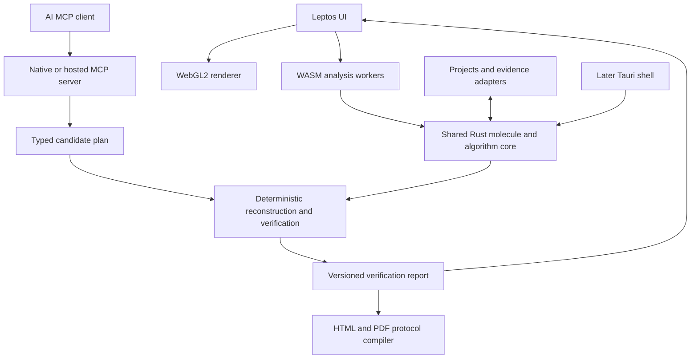

# Collagene 2 product and architecture plan

Planning baseline: 23 November 2026.

Related research: [Open source molecular cloning software comparison](OPEN_SOURCE_LANDSCAPE.md). The survey is retained for context; its projects are not implementation foundations.

Current progress: [Implementation status](IMPLEMENTATION_STATUS.md). Local build and example workflows are described in [README](../README.md).

Collagene 2 will be a Rust molecular cloning and sequence design application, delivered first through Leptos and WebAssembly in the browser, followed by a Tauri desktop application. Its distinguishing workflow is to let an AI propose a design through MCP, reconstruct that design with deterministic algorithms, inspect the evidence interactively, and export reproducible cloning instructions as HTML and PDF.

The foundation comprises shared `collagene-model` document/location types, a Rust scientific core, a WebGL2 sequence renderer, background analysis workers and versioned binary application messages. Existing libraries supply parsing, alignment primitives, UI infrastructure, and serialization. The molecule model, cloning chemistry, annotation transformations, design verification, and interactive sequence layout require substantial application code.

This is a target specification and implementation proposal. Priority controls delivery order within the agreed scope. Library candidates below need dependency, license, target-build, and correctness checks before adoption.

## Implementation workflow — user instruction, 24 November 2026

Keep the full product objective and all existing scope constraints. Change the
execution order and validation workflow as follows:

- **Do not run browser checks until the in-scope code is complete.** This applies
  to automated browser suites, browser smoke checks, screenshots, browser
  performance checks and GUI acceptance runs during implementation. Completion
  means the full in-scope product implementation, not an individual checkpoint.
- Run compiler checks in the background while continuing useful coding. Do not
  stop implementation to wait or poll for compilation, or repeatedly rebuild
  optimized WASM after individual fixes. Batch release compilation and broad regression
  validation after implementation; final scientific/native/WASM verification
  remains part of completion.
- Prefer focused, quick scientific checks for new algorithms over repeated full
  regression runs. Existing passing checks are evidence for unchanged code;
  compilation and testing must not displace feature implementation.
- Prioritize usable editor functionality over further pane/layout polish:
  visible restriction-enzyme recognition ranges and strand-cut positions in
  sequence and circular/linear maps; enzyme filtering by site count; pointer
  range selection; keyboard selection and direct sequence typing/deletion with
  undo/redo and annotation updates. Share the selected enzymes and site evidence
  across the editor views. Keep uncertainty and incomplete scans explicit.

These instructions change the working method and immediate priorities; they do
not remove outstanding features or weaken the final completion requirements.

## Current execution order — cloning first, 24 November 2026

This order supersedes the older milestone order and any format-first expansion.
Keep the full agreed scope, existing feature IDs and scientific architecture;
finish the cloning application before extending peripheral analysis. Existing
modules remain available, but their presence does not give them priority.

| Order | Work to finish | Concrete outcome |
| --- | --- | --- |
| 1 | Everyday sequence workspace: F01–F06, F19 and the simple document library in F29 | Open, find, edit and annotate constructs; choose enzymes; inspect recognition/cut sites, fragments and ends in synchronized sequence/circular/linear views; preserve edits and history |
| 2 | Complete ordinary cloning design: F07, F08, F12, F14 and relevant F21 conditions | Select actual source fragments, choose orientations, define PCR primers/tails/mismatches, assemble by restriction/ligation or overlap, inspect junctions and reconstructed products, and check against the intended target |
| 3 | Finish the end-to-end design workflow: F09–F11, F22 and F23 | Manually authored and AI-proposed designs use the same deterministic verifier; source revisions, intermediate products, alternatives and unresolved assumptions are inspectable; save/reopen and HTML/PDF instructions retain the same design and evidence |
| 4 | Complete cloning methods and cloning libraries: F13, F15 and cloning-related F27 | Finish Golden Gate, Gateway/TOPO, TA/GC, end repair and method-specific preparation/composition; support practical multi-part and batch cloning with explicit physical rules and product alternatives |
| 5 | Finish supporting molecular-biology workflows: F16–F20 and cloning-related F33 | Sanger traces, pairwise construct verification, translations/fusion frames, feature/primer reuse, diagnostic digests/gels and Addgene/NCBI imports support a coherent cloning workflow |
| 6 | Deliver the portable application and remaining agreed features | Finish native/offline Tauri delivery on Windows/macOS/Linux, remaining sharing/review, CRISPR, codon design and other agreed advanced work after the cloning workflows above; keep existing exclusions and deferrals |
| Last | Further BAM/BAI work and related high-throughput alignment/index expansion | Resume only after the rest of the software is implemented; do not start more BAM/BAI features, indexed browsing, index formats or alignment-host integration now |

The next implementation work must close a concrete gap in source selection,
cloning preparation/assembly, product/junction inspection, deterministic checking
or retained protocol/history. Prefer complete user workflows over accumulating
standalone scientific crates or additional file formats. Keep common cloning
controls accessible in the main workspace and advanced analyses secondary.
Parallel workers should work on independent cloning deliverables in this queue;
spare workers are not a reason to expand deferred BAM/index work.

BAM/BAI is explicitly postponed by the user until the rest of the software is
done. Existing BAM/BAI/CSI code is retained without further feature development.
Other NGS/large-reference/variant expansions also sit behind the cloning work;
necessary fixes to shared code that blocks cloning remain permitted. This changes
execution priority, not the full goal's completion criteria. Browser checks stay
deferred until all in-scope implementation is complete, and compiler checks run
in the background while coding continues.

## Workflow review follow-up — 25 November 2026

The user's requested parallel checks of official Benchling workflows are recorded
in [assembly](BENCHLING_ASSEMBLY_WORKFLOW_CHECK.md),
[PCR/primers](BENCHLING_PCR_WORKFLOW_CHECK.md) and
[editor/supporting workflows](BENCHLING_EDITOR_FOLLOWUP_CHECK.md).
Use documented interaction patterns as references while keeping our document/workspace
organization simple. These are static source/documentation comparisons; usability
acceptance remains deferred, and undocumented Benchling behavior is not a requirement.

For remaining uncertain interactions, delegate independent public-documentation
reviews in parallel before designing another workflow. Start from the current
implementation and prior reviews so completed connections are not reopened as
gaps. Record the documented user actions, unresolved questions and our adaptation
separately, with primary links. Prefer the existing sequence-centred dock, source
selection, preparation, product review and output routes over another wizard.
This reference work does not introduce Benchling's project hierarchy or excluded
laboratory administration, nor does it authorize borrowing implementation code.

The latest parallel follow-ups cover [remaining cloning methods](BENCHLING_METHODS_FOLLOWUP.md),
[editing and translation semantics](BENCHLING_EDITING_FOLLOWUP.md) and
[verification/output continuity](BENCHLING_VERIFICATION_FOLLOWUP.md).
They preserve existing engines and identify public-evidence limits rather than
turning undocumented behavior into requirements. Their decisions are consolidated
in [workflow follow-up](BENCHLING_WORKFLOW_DECISIONS.md#latest-review-policy).

Three further parallel reviews consolidate the remaining decisions in
[workflow follow-up](BENCHLING_WORKFLOW_DECISIONS.md): distinguish creating a primer
from attaching/comparing an existing oligo, keep failure recovery local, complete
computed-comparison context/exports, and add genuine source-alternative bins after
the ordinary route. Saved read checks and explicit discrepancy review are already
implemented; old gap tables must not reopen them.

Recent implementation closes annotated reference transfer, saved paginated pairwise
comparisons, exact historical-event navigation, selection-relative restriction
filtering and persistent named enzyme choices. Older review tables describing those
as absent are historical. Continue the existing cloning-first queue through these
concrete connections:

- Golden Gate reaction pool/substrate/topology/search settings are now retained in
  assembly drafts without restoring stale successful evidence
  ([implementation](GOLDEN_GATE_POOL_SETTINGS.md)). Continue with the connected
  preparation and product review work below.
- Keep ordinary source capture, preparation, junction/product review and named outputs
  continuous in the existing assembly dock. Preserve explicit Apply and selective
  regeneration rather than silently replacing intentional primers/edits.
- Applied pair comparisons and selected exact/mismatch PCR geometries now feed
  synchronized source overlays ([details](PCR_OVERLAYS.md)). Explicit domain/tail
  boundary preview/accept and circular anchor migration are now implemented
  ([details](PRIMER_DOMAIN_EDITS.md)); continue local binding-failure recovery and
  the remaining ordinary cloning interactions. Literal-preserving reference capture,
  explicit selected-hit transfer to either pair slot, full returned-hit paging and
  local domain/policy/rerun controls are now connected
  ([details](PRIMER_REFERENCE_RECOVERY.md)). Continue the remaining ordinary cloning
  connections without adding a second primer or assembly workflow.
- Annotation list/bulk operations and exact-event display preferences are now
  implemented ([details](ANNOTATION_MANAGEMENT.md)). Exact selected translation,
  source-linked protein outputs, review-required CDS proposals and full ORF
  selection are now connected ([details](TRANSLATION_REFERENCE.md)). Named digest
  setup/history and a pinned-source gel route are now implemented
  ([details](NAMED_DIGESTS.md)). Computed pairwise search, mapped annotation/CDS
  context and direct aligned/printable outputs are now connected
  ([details](PAIRWISE_PRESENTATION.md)); continue remaining ordinary cloning
  interaction work and the alternative-source design layer below.
- Genuine alternative source bins, selected construct rows, stable recipe identities
  and per-construct editable preparation/junction state now extend the same dock
  ([details](COMBINATORIAL_SOURCE_DESIGN.md)). Selected batch evaluation/cancellation,
  immutable historical evidence and six MCP operations are now connected
  ([details](COMBINATORIAL_BATCHES.md)). Continue matrix-owned run/output provenance,
  fresh bulk release, product inspection, reaction-pool composition and library
  topology editing.
  Reaction-product enumeration alone does not complete combinatorial cloning.
  Inspectable fusion-end proposals and intentional
  domestication remain distinct planned work.

The named-digest/gel connection now retains complete catalog geometry/options
and exact source events ([implementation](NAMED_DIGESTS.md)). The preimplementation
constraints below remain the design contract: Current gel digest lanes resolve starter-enzyme names and
current document indices; adapting saved setups through those names would silently
lose identity. Add a pinned-catalog lane that freshly inspects the retained event,
uses fragments only when the scan is complete/products determined, and explicitly
keeps the gel's 1,024-fragment bound. Reopen historical evidence without moving heads;
mutable continuation uses an explicit fork. Do not silently repin an old catalog
selection or alter saved digest options to fit a gel.

No new wizard, parser, primer engine or export engine is implied by these findings.
Broader kinetic/mixture modeling mentioned in research is not an added delivery gate.
Keep the current scientific contracts, independent target checking, source-event
identity, uncertainty and explicit resource limits. ELN, inventory and organizational
workflow remain excluded; deferred tools and browser checks stay deferred.

## Scope constraints

Collagene 2 is licensed under [MIT](../LICENSE). Implement its application, UI, cloning algorithms and verification engine independently. Do not fork, copy, translate or borrow application/scientific code from the surveyed cloning projects, or treat their output as an authoritative correctness oracle.

Existing format specifications and representative files are the primary sources for interoperability. When a format is undocumented, narrowly inspect another project's parser to understand byte layout, fields or compatibility quirks. Record the source and observations, then write our own implementation and validate it against independently constructed fixtures and real files. This exception does not authorize copying parser code or importing unrelated algorithms or UI designs.

Established standalone libraries for infrastructure and bioinformatics primitives remain candidates, subject to review of license compatibility, implementation correctness and native/WASM portability. Their use does not replace independent validation of Collagene's scientific behavior. New UI and interaction design should follow Collagene's requirements rather than the surveyed applications.

Benchling screenshots and public UI documentation are an approved visual and interaction reference. Use its sequence workspace as inspiration while implementing our own UI and simplifying document organization as described below.

Support Windows, macOS and Linux. Deliver the browser application first and the Tauri desktop application later; keep the scientific core portable across all three operating systems and browser WASM.

Prioritize the desktop browser interface and desktop workflows. Mobile product design, feature scope, dedicated controls and acceptance testing are deferred until the desktop product is finished and the user has reviewed and edited it. Decide a limited set of mobile workflows then; full control parity is not a mobile requirement. Existing responsive behavior is incidental support, not a current delivery gate.

All scientific processing and report generation must use embedded libraries or application code. Do not invoke external executables, shell commands, sidecars or installed scientific tools. Native/server execution means running the shared code in that process. Browser print-to-PDF uses the browser's built-in print facility; deterministic PDF export uses an embedded library. MCP exposes Collagene functionality to AI clients without launching those clients. Network data sources and MCP clients are integration boundaries, not substitutes for embedded scientific algorithms.

Excluded from the product scope: ELN, inventory/freezers, sample management, barcodes, reagent stocks, instrument/automation interfaces, workflow scheduling and organizational reporting. Protocol material lists and reagent quantities remain part of cloning instructions, without stock tracking.

Deferred pending a future scope decision:

- Mobile product scope, dedicated interaction/layout work and mobile acceptance testing, until desktop completion followed by user review and edits; select limited mobile workflows afterward.
- OpenGel integration, predicted-versus-observed comparison, and OpenGel file formats including `.gel.zip`.
- Primer3 integration or translation, including its bindings and derived thermodynamics ports. Basic primer annotation, PCR simulation and independently implemented calculations remain in scope; advanced design/thermodynamics requiring this work are deferred.
- MAFFT/MUSCLE/Clustal-style multiple alignment engines or translations. Pairwise alignment and alignment file exchange remain in scope. Future Rust translations can be evaluated separately and must satisfy the embedded-code requirement.

## Product baseline and scope

[Benchling molecular biology](https://www.benchling.com/molecular-biology) establishes expectations for DNA/RNA/protein design, bulk assemblies, CRISPR, alignment, registration, traceability, and collaboration. The comparison targets molecular biology functionality within the scope constraints above.

[SnapGene](https://www.snapgene.com/features) establishes expectations for cloning simulations, primer design, sequence verification, gel visualization, and retained experimental history. Support should ultimately cover restriction/ligation, overlap assembly, Golden Gate, recombination-based cloning, TA/GC and TOPO workflows, mutagenesis, and oligo assembly. Pairwise alignment, Sanger contigs, methylation/end-state checks, and clear graphical provenance belong in the target as well; deferred engines are listed above.

The [original Collagene README](https://github.com/mahogny/collagene#readme) provides the legacy baseline: smooth linear/circular views, rotation/zoom, origin-spanning features and sites, origin relocation, translation, ORFs, primer attachment and PCR products, restriction digests, buffer suggestions, gels, and sequence properties. It lists GenBank/ApE, FASTA, DNA Strider/Serial Cloner, native XML, and SCF support. Several advanced cloning wizards and PDF export are marked TODO; they must not be treated as completed legacy behavior. Migration needs a source/schema audit and representative original documents in addition to this README-level inventory.

## Immediate desktop MVP delivery gate

The desktop MVP baseline is viewer, GenBank import and virtual restriction digest. The cloning-first execution order above now controls further implementation. [Architecture and scientific interpretation](MVP_DESKTOP.md). Complete remaining editor/digest gaps and proceed through the cloning workflows above; defer browser validation under the current implementation instruction. Existing implemented modules remain available behind a secondary tools entry; the main workflow should not require users to navigate them. The complete feature inventory remains the long-term target.

The user has reviewed the early preview and considers the GUI unfinished, particularly the left side. Complete the functional desktop workspace alongside cloning controls before requesting another GUI review: compact functional navigation, a searchable document explorer, document switching tabs, and a coherent editor toolbar and inspector. Use Benchling's navigation and sequence workspace as visual references while retaining simple document organization. A working viewer and passing scientific tests alone do not establish GUI readiness. Keep mobile design deferred.

The cloning interaction should follow the sequence-centred Benchling assembly pattern: method, backbone/insert slots populated from source selections, preparation and primer review, junction/product preview, then outputs. The dedicated draft and source-view connections remain required; numeric forms alone do not satisfy this workflow. [Interaction design and reviewed reference sources](CLONING_INTERACTION_DESIGN.md).

The MVP must satisfy these acceptance conditions:

1. Open a real GenBank sequence directly, with explicit import errors and retained original evidence. Preserve topology, IUPAC calls, both strands, compound/origin-spanning annotations and supported qualifiers through native save/reopen and declared-loss exports.
2. Inspect circular and linear maps and a virtualized sequence view with consistent feature/base selection, visible coordinates, rotation, zoom and smooth scrolling. Scientific coordinates remain integer-based and independent of rendering geometry.
3. Choose enzymes from a data-driven catalog and run a virtual digest against the exact current document. Show recognition sites, both strand cut boundaries, fragment sizes and supported end structures. Distinguish uncut molecules, one-cut circles, multiple cuts, ambiguous sites and unsupported cleavage geometry. Laboratory cleavage and methylation assumptions stay explicit.
4. Keep analysis source/role/revision bound. Document switches, edits or enzyme changes invalidate obsolete results. A preview does not modify its source; opening/exporting a derived fragment is explicit and preserves its source relationship and supported annotation/evidence semantics.
5. Retain native save/load, autosave/recovery, cancellation and useful failure feedback. Validate the workflow in native scientific fixtures and the actual desktop WASM application, including deliberately wrong inputs and stale asynchronous responses.
6. Preserve architectural extension points: the scientific document/location model, format adapters, enzyme data, restriction/physical algorithms, typed worker jobs/results, renderer scenes/cameras and UI workflow components remain separate. Reuse those foundations for later cloning, other formats, catalogs and MCP/Tauri. Do not hardcode demo coordinates, couple biology to display pixels, fabricate certainty or introduce MVP-only data types that require replacing the core later.

Mobile design, feature selection and acceptance remain deferred until the finished desktop product has been reviewed and edited by the user. Broader P0/P1/P2 work resumes after this MVP gate; passing it does not complete the full product goal.

The current prepared-overlap implementation connects original source documents to
explicit PCR/digest/end-repair steps and ordered Gibson/HiFi/In-Fusion profiles in
both the UI and MCP. Existing deterministic plan verification and HTML/PDF exports
consume that same graph. [Current workflow](ASSEMBLY_WORKFLOW.md). This is progress
on cloning priorities 2–3 above; broader physical preparation/composition,
alternative-product handling and the remaining product scope are still required.

Ordered multi-fragment ligation now shares the same original-source preparation
compiler, adding explicit terminal treatments, orientation and nick policy. Fresh
physical ends/junctions come from the verifier's live material state, and method
candidates retain exact source-event bindings for later history capture.
[Current ligation workflow](LIGATION_WORKFLOW.md). These ordinary cloning paths
remain the priority over deferred alignment/index expansion.

Explicit junction review now reconstructs the actual plan before displaying DNA
flanks, shared homology, requested local reading frames and available CDS coding
windows. Independent-target mismatch, retained physical nicks and uncertain
annotation/function remain separate findings. [Junction review](ASSEMBLY_JUNCTION_REVIEW.md).
Clipped display flanks at known sequence ends are a normal bounded view, not a
reason to fail otherwise complete junction inspection.

An explicit original-source terminal hypothesis is now available for eligible
intact linear duplex references. It is a recorded preparation step, not a default
inference from files or imported physical summaries, and it enables ordinary
whole-fragment ligation when the operator supplies the required terminal groups.
[Declaration scope](DECLARED_SOURCE_TERMINI.md). Existing unknown inputs and
unsupported physical intermediates keep their previous restrictions.

Source-derived overlap-primer suggestions now select anchored domains from explicit
original-source intervals and synthesize only the requested neighboring homology.
The web route includes source-selection capture, separate oligo review and explicit
application before fresh verification; MCP uses the same engine. This advances
ordinary assembly setup while the dedicated sequence-centred assembly workspace
and region-defined intent remain required. [Planner model](OVERLAP_PRIMER_DESIGN.md).

The first dedicated assembly dock now pins exact source events, captures selected
regions or circular complements into named slots, builds an expected reference
independently of reaction simulation, and connects existing preparation/primer
controls to that fixed target. Draft declarations survive document switching and
native workspace/autosave restore; fresh evidence is recomputed. Integrated actual-product/junction editing remains required; direct cut-pair
selection and atomic output choices are now connected. [Interaction state](CLONING_INTERACTION_DESIGN.md).

Fresh catalog digest fragments can now populate the active assembly slot with
original-source event, full enzyme identity/geometry pin and explicit preparation.
Reversed sticky fragments use the actual bottom-strand source interval for intended
top DNA. Fresh overlap/ligation evidence also has an actual-product sequence/map
view with local selection and optional fresh junction inspection. Integrated primer/junction editing remains required. Direct cut selection and
atomic output choices are now implemented.
[Catalog preparation](CATALOG_DIGEST_PREPARATION.md) · [Actual product review](ASSEMBLY_PRODUCT_REVIEW.md).

Direct restriction-boundary choices now connect the sequence/map viewer to fresh
physical-fragment selection, including circular complement and linear source-end
cases. Reviewed assemblies can export exact primer order sheets and HTML/PDF
steps without leaving product review. Source/event/choice and plan/target/options
remain bound; partial or unavailable orders are explicit. [Cut choice model](DIGEST_CUT_SELECTION.md) · [Order extraction](PLAN_OLIGOS.md).

Parallel reviews of Benchling's public restriction/Golden Gate, primer/mutagenesis
and verification/history workflows are complete. The immediate UI work is the
persistent assembly draft, source-selection/slot connection and central product/
junction/primer review; reuse the existing engines. Supporting review and history
connections follow in the cloning-first queue. The reviewed patterns and exact
source links are consolidated in [the interaction design](CLONING_INTERACTION_DESIGN.md#implementation-order).

## Feature inventory and delivery priorities

P0 is the foundation and first usable cloning release. P1 supplies everyday molecular biology workflows. P2 extends scale, specialized workflows, collaboration, and desktop delivery. P3 covers advanced molecular analysis. Each row is an implementation backlog item, not a claim about an existing Collagene 2 feature. Feature IDs are retained when rows are removed.

| ID | Priority | Expected capability | Acceptance evidence |
| --- | --- | --- | --- |
| F01 | P0 | DNA/RNA/protein documents; circular/linear topology; IUPAC ambiguity; strand identity | Alphabet validation; ambiguity is retained; topology survives save/reopen |
| F02 | P0 | Sequence editor with insertion/deletion/replacement, reverse complement, undo/redo and clipboard | Editing remaps features and selections correctly; operation history replays |
| F03 | P0 | Circular map, linear map and virtualized sequence view with synchronized selection | Rotation, scrolling, zoom and selection remain responsive on benchmark fixtures |
| F04 | P0 | Features, primers, enzymes, translations and ORFs as configurable tracks | Origin-crossing and compound features select and render correctly on both strands |
| F05 | P0 | Search by sequence, reverse complement, ambiguity, annotation, enzyme and primer | Both strands and circular origin are searched; results give stable coordinates |
| F06 | P0 | Restriction analysis, single/double digests, end structures and fragment sizes | Independent small examples confirm cut coordinates, ends and fragment lengths |
| F07 | P0 | PCR simulation and primer collection with tails and intentional mismatches | Products include introduced sequence; alternative binding sites are reported |
| F08 | P0 | Restriction/ligation and Gibson-style overlap assembly with an inspectable intermediate graph | Exact reconstructed products, junctions, topology and alternatives are available |
| F09 | P0 | MCP tools for reading documents, proposing plans and running deterministic checks | An external MCP client can propose, inspect and verify without bypassing checks |
| F10 | P0 | HTML protocol export and browser print-to-PDF | Every step and product links to the same plan revision and verification report |
| F11 | P0 | Native project save/load, import/export, autosave and recovery | Reload preserves all supported semantics; format loss produces an explicit report |
| F12 | P1 | Basic primer selection/reuse, annealing oligos, GC/Tm calculations and binding checks | Embedded calculations have reference cases and recorded conditions; advanced thermodynamics/design engines remain deferred |
| F13 | P1 | Golden Gate/Type IIS and combinatorial assembly libraries | Cleavage outside recognition sites, overhang orientation and recutting are checked |
| F14 | P1 | Site-directed, inverse-PCR and overlap-extension mutagenesis | Intended substitutions/indels and junction translations match the target |
| F15 | P1 | Gateway, In-Fusion/HiFi-style overlaps, TA/GC, TOPO and end repair | Each method has explicit rules, test fixtures and unsupported-state diagnostics |
| F16 | P1 | Sanger chromatograms, quality trimming, reference alignment and consensus | Trace peaks and quality align to calls; low-quality and uncovered regions stay visible |
| F17 | P1 | Pairwise alignments, whole-plasmid verification and sequence differences | Rotation and reverse-complement equivalence are handled; coverage gaps are reported |
| F18 | P1 | Translation, alternative genetic codes, fusion frames and protein properties | CDS phase, stop codons and compound locations are respected |
| F19 | P1 | Automatic annotation and reusable feature/part libraries | Matches carry source, version, identity and coverage; uncertain calls remain distinct |
| F20 | P1 | Gel simulation, diagnostic digest selection, ladders and predicted PCR bands | Band sizes derive from products; co-migration and topology assumptions are visible |
| F21 | P1 | Enzyme catalog, supplier sets, methylation sensitivity and digest compatibility | Versioned data supports unknown methylation and supplier-condition provenance |
| F22 | P1 | Graphical cloning history, branching designs and sequence/plan comparison | Any retained product can be traced to inputs, edits and transformations |
| F23 | P1 | Deterministic PDF generation and publication-quality map exports | Pagination, vector maps, fonts and report contents pass export fixtures |
| F24 | P2 | Sanger contig assembly and dot plots using embedded algorithms | Algorithm/version/options and consensus evidence are retained; multiple alignment engines remain deferred |
| F25 | P2 | CRISPR guide design, nuclease rules, off-target search and editing templates | Reference genome/build, search completeness and scoring model are explicit |
| F26 | P2 | Codon optimization, reverse translation and synthesis constraints | Optimized DNA translates to the required protein and satisfies declared constraints |
| F27 | P2 | Bulk cloning, batch analysis, plate layouts and combinatorial libraries | Jobs are cancellable; stable identifiers connect designs, oligos and outputs |
| F28 | P2 | Whole-plasmid/NGS/long-read validation and large reference browsing | Coverage, variants and structural discrepancies are distinguishable from consensus |
| F29 | P2 | Searchable sequence library, tags and optional shallow collections | Open/edit/export without creating a project; biological equivalence and document identity are handled separately |
| F30 | P2 | Sharing, permissions, comments, review and concurrent editing | Revision conflicts are explicit; scientific verification survives only valid revisions |
| F31 | P2 | Tauri desktop, offline files, embedded native compute and local MCP on Windows/macOS/Linux | Shared fixtures give equivalent native/WASM results; all three OS webviews are tested; no external software is invoked |
| F33 | P2 | Remote/local sequence sources, embedded sequence similarity search and data connectors | Accession/version, source and retrieval time accompany imports; search uses embedded algorithms |
| F34 | P3 | RNA modifications, antibody/protein analysis and structure visualization | Specialized semantics and imported structure data have explicit provenance; computation uses embedded code |
| F35 | P1 | Import by Addgene plasmid URL/ID, NCBI nucleotide/GenBank URL or accession.version, and direct sequence-file URLs through source adapters | Imported sequence/topology/features are validated by the same parsers; canonical source, accession/version, retrieval timestamp and evidence hash survive save/export; missing authentication, multiple sequence choices and fetch failures remain explicit |

Accessibility is a cross-cutting requirement: keyboard navigation, readable labels, a DOM representation of selected sequence/features, high contrast, and reduced motion. Browser storage limitations, interrupted tasks and unsaved changes need clear recovery behavior.

## File formats and migration

Import and export must be tracked separately. A format parser is only one part of support: feature locations, chemistry, primers, history and metadata need explicit fidelity tests. [SnapGene's supported extensions](https://support.snapgene.com/hc/en-us/articles/10242726896020-What-File-Extensions-does-SnapGene-support) show the breadth of migration users may expect, while its [developer guidance](https://www.snapgene.com/features/convert-file-formats) offers a route to information on native SnapGene files.

| Format family | Delivery | Read | Write | Fidelity and implementation plan |
| --- | --- | --- | --- | --- |
| GenBank/DDBJ `.gb`, `.gbk`, `.gbff`, `.genbank` | P0 | Yes | Yes | Primary annotated exchange; use `gb-io` behind adapters; multi-record, topology, qualifiers and locations |
| ApE `.ape` and GenBank application qualifiers | P0 | Yes | Yes | Preserve feature colors, labels and unknown qualifiers; test against actual files |
| FASTA `.fa`, `.fasta`, `.fna`, `.faa` and plain sequence | P0 | Yes | Yes | DNA/RNA/protein and multiple records; no claim to preserve annotations or history |
| Native Collagene 2 `.cg2workspace` archive; `.cg2` single document | P0 | Yes | Yes | Versioned archive of sequences, metadata, plans, revisions and original attachments; single-document export is distinct from the full workspace |
| Oligo/primer CSV and TSV | P0 | Yes | Yes | Column mapping, units, modifications, names, 5′→3′ sequence and order sheets |
| SnapGene `.dna`, later `.prot` | P0 import spike; P1 robust import | Target | Later | Evaluate `bio_files`; retain original bytes and report unsupported chunks/history; do not equate partial parsing with full fidelity |
| Original Collagene native XML | P1 | Yes | Optional | Audit Java serializers and real documents; convert chemistry, annotations and retained workflow data |
| DNA Strider/Serial Cloner `.xdna`, `.xdgn`, `.xprt` variants | P1 | Yes | Later | Legacy migration; sniff content and validate exact variants against original parsers |
| ABI/ABIF `.ab1`, `.abi`; SCF `.scf` | P1 | Yes | Original attachment; derived FASTA/FASTQ | Four channels, calls, qualities, peak positions, orientation and trimming; SCF required for legacy parity |
| FASTQ `.fq`, `.fastq` | P1 small data; P2 scale | Yes | Yes | Preserve quality encoding; stream larger datasets and keep import limits visible |
| EMBL/ENA `.embl`, `.emb`; GenPept/UniProt text | P1/P2 | Yes | Target | Map feature/translation semantics; GenBank parser alone does not supply these adapters |
| Aligned FASTA, CLUSTAL `.aln`, Stockholm; native `.cg2aln` | P1/P2 | Yes | Yes | Preserve gaps, identifiers and alignment metadata where expressible; explicit alphabet, original bytes, typed retained collections and export-loss review; no alignment engine |
| PHYLIP, MSF, NEXUS, PIR, GDE, Selex | P2 | Target | Selected formats | Add by migration demand; document truncation or loss of names/metadata |
| GFF3, GTF, BED | P2 | Yes | Yes | Independent GFF3/GTF/BED profiles implemented; explicit reference identity and coordinate conversion are mandatory; GTF rows retain attributes without inferred transcript assembly |
| Large reference `.cgref` | P2 foundation | Yes | Yes | Separate streamed packed IUPAC blocks and bounded hash manifest; canonical DNA/readback verification, global coordinates and portable links; no imported coverage authority |
| SAM/BAM/CRAM, VCF/BCF and their indexes | P2 | Yes | Selected/derived | Independent bounded SAM/BAM exchange and source-bound inspection implemented; VCF/BCF exchange, bounded browser/MCP inspection and explicit REF/ALT-to-DNA design checking implemented; bounded BAI/CSI readers and source-bound retained-BAM selection are implemented; CRAM and streamed indexed browsing remain pending; [workflow](READ_ALIGNMENT_WORKFLOW.md) |
| SBOL | P2 | Target | Target | Select a specific SBOL version/profile; components and design relationships exceed GenBank semantics |
| Benchling sequence exports and API data | P1 files; P2 connector | Yes | Standard exchange/API later | GenBank/FASTA for sequence transfer; permissioned API adapter for richer records; do not assume a complete workspace export |
| Clone Manager, Vector NTI, Geneious, CLC, Lasergene, MacVector and other legacy containers | P2 migration backlog | Target by demand | Usually standard exchange | Classify exact format/version; accept intermediate GenBank/FASTA when native fidelity is unavailable |
| HTML, PDF | P0 HTML/print; P1 native PDF | Attachments | Yes | Human-readable cloning plans, evidence, step sheets and material lists |
| SVG, PNG; gel/photo TIFF/JPEG | P1/P2 | Attachments | SVG/PNG maps and gels | Vector maps for publication; image input is evidence rather than sequence data |
| gzip and ZIP | P0/P1 | Yes | Native archive/batch exports | Bound decompression, entry counts and nesting; distinguish container support from its contents |

The [INSDC feature table specification](https://www.insdc.org/submitting-standards/feature-table/) is the reference for location and qualifier semantics. The [SBOL specification](https://github.com/SynBioDex/SBOL-specification) is a separate design-exchange target.

Every import returns a structured report: supported fields, preserved opaque data, normalized values, unsupported constructs and potential loss. Preserve the original attachment and its hash. Never silently flatten `join`/`complement`, discard ambiguous bases, invent circular topology, or treat a filename extension as definitive. Recognize that `.dna`, `.seq` and `.xml` are ambiguous extensions.

Round-trip acceptance compares molecule/annotation semantics, not whitespace or field ordering. When a destination cannot express information, show an export loss summary. Original opaque chunks may be retained as attachments, but must not be emitted as current sequence-linked metadata after edits without validating them.

The proposed native archive contains a small JSON manifest with schema versions and hashes, binary sequence/analysis chunks, versioned document metadata and plan records, and original evidence files. Sequence bytes can initially be IUPAC ASCII; packing can follow profiling. Keep durable schemas independently migratable from transient RPC types. Browser IndexedDB and native/server databases store the same logical records through platform adapters.

## Rust libraries and implementation ownership

The entries are candidates, not a dependency lockfile. Pure Rust does not by itself establish browser compatibility: filesystem APIs, random-number sources, native compression, threading and transitive dependencies must be checked under `wasm32-unknown-unknown`. Keep native dependencies out of the scientific core through crate boundaries and feature flags.

| Area | Candidate and primary reference | Reuse and remaining work |
| --- | --- | --- |
| Application UI | [Leptos](https://docs.rs/leptos/latest/leptos/) | Use client-side rendering initially; implement scientific panels, state transitions, shortcuts and virtualization |
| Browser bindings | [web-sys WebGL2](https://docs.rs/web-sys/latest/web_sys/struct.WebGl2RenderingContext.html), `wasm-bindgen`, `js-sys` | Rust access to canvas and browser APIs; small generated/bootstrap JS is expected; handwritten TS should be exceptional |
| Background compute | [gloo-worker](https://docs.rs/gloo-worker/latest/gloo_worker/) or direct `web-sys` workers | Worker lifecycle, typed jobs and cancellation; measure serialization/copies for large buffers |
| Graphics | Direct WebGL2 first; [lyon](https://docs.rs/lyon/latest/lyon/) for tessellation | Build map/sequence/trace scene layout, text atlas, batching, selection and hit testing |
| Alternative graphics backend | [wgpu](https://docs.rs/wgpu/latest/wgpu/) | Supports WASM WebGL2/WebGPU and native APIs; benchmark complexity and bundle size before replacing the direct backend |
| Bioinformatics primitives | [Rust-Bio `bio`](https://docs.rs/bio/latest/bio/) | Pairwise alignment, alphabets, pattern search, indexing and ORF primitives; wrap with circular/strand-aware semantics |
| Annotated exchange | [gb-io](https://docs.rs/gb-io/latest/gb_io/) | GenBank reading/writing and annotated extraction; adapt to richer internal molecule semantics |
| High-throughput formats | [noodles](https://docs.rs/noodles/latest/noodles/) | Select only required format crates; indexed readers and compression require browser-specific I/O adapters |
| FASTA/FASTQ performance alternatives | [seq_io](https://docs.rs/seq_io/latest/seq_io/), [needletail](https://docs.rs/needletail/latest/needletail/) | Benchmark only if existing parsers become a bottleneck; avoid maintaining duplicate default stacks |
| SnapGene and traces | Independent adapters using format specifications and fixtures; narrow format references: [bio_files source](https://docs.rs/crate/bio_files/latest/source/src/lib.rs), [openreadout-ce](https://docs.rs/openreadout-ce/latest/openreadout_ce/) | Consult existing parsers only for undocumented format details; implement and validate our own adapters without borrowing parser/application code |
| XML migration | [quick-xml](https://docs.rs/quick-xml/latest/quick_xml/) | Parse original Collagene XML; write schema-specific conversion and diagnostics |
| Basic primer calculations | Custom Rust code based on published equations and independently checked fixtures | Implement basic GC/Tm and binding checks with explicit assumptions; advanced Primer3-related work is deferred |
| Graphs | [petgraph](https://docs.rs/petgraph/latest/petgraph/) | Graph representation/traversal; chemical transformations and constrained assembly enumeration remain ours |
| Serialization | [Serde](https://docs.rs/serde/latest/serde/), [Postcard](https://docs.rs/postcard/latest/postcard/) | Shared Rust DTOs and binary serialization; envelope, compatibility and bounded decoding remain ours |
| MCP | [official `rmcp` SDK](https://github.com/modelcontextprotocol/rust-sdk) and `schemars` | Native server, tools, resources and schema generation; implement scientific contracts and authorization |
| HTTP service | [Axum](https://docs.rs/axum/latest/axum/), Tokio | Optional hosted projects, MCP, job execution and connectors; CPU work needs bounded background execution |
| Browser persistence | [rexie](https://docs.rs/rexie/latest/rexie/) | IndexedDB adapter; implement autosave, migration, quota errors, recovery and export |
| Desktop | [Tauri Leptos integration](https://v2.tauri.app/start/frontend/leptos/) | Reuse Leptos assets and core; add native files, local MCP and embedded compute on Windows/macOS/Linux |
| Reports | Rust HTML templates; [typst](https://docs.rs/typst/latest/typst/) and [typst-pdf](https://docs.rs/typst-pdf/latest/typst_pdf/) | Shared report data with separate HTML/PDF renderers; native PDF initially avoids increasing the browser bundle |

Additional infrastructure candidates are `blake3` for content hashes, `uuid` for identities, `thiserror` for typed errors, `tracing` for diagnostics, `zip`/`flate2` for containers, and `proptest`, `cargo-fuzz` and `wasm-bindgen-test` for validation. Evaluate these when the relevant crate is introduced.

Enzyme, vector, feature, ladder and supplier-condition databases require versioned provenance and redistribution terms; a library license does not license its underlying datasets. Do not freeze supplier buffer/temperature recommendations into unversioned code.

Sequence similarity search and specialized guide/off-target analysis require embedded Rust implementations or suitable embedded libraries. Do not provide subprocess or remote executable wrappers as a fallback. Record algorithm versions, options, reference data and job limits. Defer any capability whose embedded implementation is unavailable.

### Components to implement

The largest custom components are the molecule/coordinate model, sequence editor, annotation remapping, end chemistry, restriction/PCR/assembly engines, verification rules, constrained plan search, graphical scientific renderer, import fidelity layer, history graph, and protocol compiler. There is no assumption that a general bioinformatics crate supplies these as a coherent cloning application.

The original Collagene Java serializers can provide migration knowledge for its native files. Implement the new application and scientific behavior independently, using documented requirements, published algorithms and independently checked fixtures.

## Shared data model and crate boundaries

Use internal zero-based half-open ranges, with UI/export conversion at boundaries. Preserve explicit circular spans and compound location trees; a whole circle, an empty interval and a range crossing the origin must be distinguishable. Separate display rotation from actually changing the molecule's sequence origin. This follows the indexing convention described in the original Collagene README while giving users familiar one-based displays.

Core entities:

- `MoleculeRevision`: immutable sequence, alphabet, topology, strand structure, annotations, provenance and revision hash. Stable document IDs remain distinct from content hashes.
- `FeatureLocation`: range/compound/complement semantics, fuzzy endpoints and remote references; unsupported extraction returns a diagnostic rather than an invented range.
- `Fragment`: paired strand content, explicit ends/overhangs, nicks, phosphorylation and methylation/other modifications, including unknown state. One string plus a circular flag is insufficient for all intermediates.
- `Primer`: full ordered sequence, annealing domain, tail, modifications, binding evidence and calculation conditions; all reported oligos have a clear 5′→3′ orientation.
- `Operation`: typed inputs, parameters, outputs and assumptions. Operations include PCR, digest, ligation, overlap assembly, mutagenesis, end treatment and verification.
- `DesignPlan`: a directed acyclic graph of material transformations with intended targets, constraints and scoring preferences. Experimental cycles can be expanded into separate planned operations.
- `VerificationReport`: input/plan hashes, engine/rule/data versions, findings, reconstructed products, alternatives, completeness and assumptions.
- `Evidence`: sequencing reads, gels and other observations linked to a design revision and optional user-provided labels. Physical sample management is outside scope.

Start with clear module boundaries; split crates when dependencies or target builds justify it. Proposed eventual layout:

```text
crates/
  model/       molecule, locations, revisions, chemistry, plan types
  algorithms/  embedded search, digest, PCR, assembly, translation, alignment
  verify/      independent checks, rule profiles, evidence reports
  formats/     import/export adapters and fidelity diagnostics
  protocol/    versioned application messages and job contracts
  scene/       map/sequence/trace layout shared with static export
  render-web/  WebGL2 backend and browser interaction
  reports/     protocol data and HTML/PDF adapters
  app-web/     Leptos application and platform adapters
  worker/      WASM analysis worker entry point
  service/     optional HTTP, hosted jobs and project synchronization
  mcp/         native rmcp server and tool contracts
  desktop/     later Tauri shell and native adapters
```

The scientific crates must compile and run without Leptos, WebGL, Tokio or Tauri. The same core is invoked by UI actions, native jobs, CLI fixtures and MCP tools. Shared verification runs locally for feedback and again at any trusted persistence/verified-export boundary.

Native filesystem access must be confined to operator-configured folders through directory capabilities, with no tool-controlled scope expansion or unchecked ambient paths. Managed MCP data now uses an existing `--storage-root` and a private generated session child; future Tauri file-open/save operations must reuse the same boundary and declare read/write permissions explicitly. Test traversal, symlinks/junctions, replacement and cleanup ownership on Windows/macOS/Linux. Public web previews serve only a read-only compiled-asset snapshot and expose no host filesystem API; browser file selection remains an explicit client-side action. [Current storage policy](LOCAL_STORAGE.md).



## AI design planning and deterministic verification

AI translates goals into candidate parts, constraints and operations. It may propose alternatives and interpret diagnostics. The authoritative sequence and material outputs are computed by algorithms using referenced source revisions; model prose and model-supplied checksums cannot establish correctness.

The intended target must be bound separately from the proposed plan. For an exact target, retain its sequence revision/hash; for a declarative goal, retain independently reviewable constraints. A candidate cannot redefine its own target to obtain a pass. Any new synthesized sequence is an explicit input with provenance and constraints.

Retaining a reconstruction records an immutable plan, separately bound target event, explicit source-event choices and one product event per step. Parent edges follow actual operation inputs; identical sequence content never selects a causal source implicitly. Capture replays the complete plan and requires a matching target, with explicit consent for incomplete assessments. Archive loading preserves historical producer claims without restoring verification authority; a current replay compares products, engine and status. This is computational design history, not an ELN. [Implemented profile](RUN_LINEAGE.md).

### Verification pipeline

1. Resolve every input by ID and immutable revision. Reject missing or changed inputs, malformed sequences, impossible coordinates, invalid units and cyclic material dependencies.
2. Reconstruct each operation from its inputs. The caller's claimed product is only a comparison target. Enumerate competing products where the model supports doing so.
3. Check physical sequence consistency: both strands, cuts, compatible ends, overlap identity, consumed/reused sequence, fragment orientation and product topology. Synthesis and end treatment must be explicit transformations.
4. Check method rules. PCR includes annealing domains, 3′ matching policy, tails, intentional mismatches and alternative priming; restriction includes staggered cuts, methylation assumptions and origin-spanning sites; ligation includes phosphorylation/nicks; Type IIS includes recognition-site survival and recutting; overlap assembly includes ambiguous overlaps and orientation.
5. Check the intended target. Compare exact sequence or declared constraints, expected features, coding frames, scars, orientation and forbidden motifs. Circular targets are compared modulo rotation; reverse-complement equivalence is allowed only when the goal's orientation semantics permit it. Report coordinate mappings back to the displayed target.
6. Evaluate empirical feasibility separately: Tm/secondary structures under recorded conditions, repeat/GC constraints, supplier compatibility, off-target reference coverage and material availability. Unknown evidence is retained as unknown.
7. Produce an explanation with precise locations, intermediate products, alternative products, diagnostic digests and suggested sequencing coverage. Bind it to engine, data and rule-profile versions.

Checks return `pass`, `fail` or `unknown`, with severity and evidence. Overall states distinguish `invalid`, `consistent_under_assumptions`, and `incomplete`; experimental confirmation is recorded separately. Passing sequence checks does not guarantee an experimental result. Unsupported chemistry, unknown methylation and unavailable reference data must never be converted to silent passes.

Assembly enumeration uses directed end/overlap graphs with deterministic traversal, pruning and bounded search. A targeted reconstruction may prove that a desired product is reachable; it cannot establish uniqueness if alternatives were not exhaustively searched. Search budgets, truncation, explored states and completeness belong in the report. Use explicit mismatch and off-target policies instead of implicit assumptions of perfect specificity.

The planner and verifier share the molecule model but should not simply invoke the same unchecked product-builder and compare its output to itself. Retain small independent reference implementations and external reference cases for cuts, sequence reconstruction, circular equivalence and thermodynamics. Test adversarial plans with plausible descriptions and deliberately incorrect junctions.

A deterministic planner should also generate/rank simple candidate strategies without AI: enumerate permitted methods, search reusable parts/primers, solve overlap/end compatibility, and score material cost, oligo length, number of steps and diagnostic strength. This supplies a baseline and makes the core useful offline.

### Sequence comparison and dot plots

F24 dot plots complement the existing pairwise aligner with source-bound window comparisons across the full reference/query coordinate grid. Retain both nucleotide orientations, original query coordinates, circular-origin spans and separate compatible-versus-certain identity counts. A complete exact-word index may prove nonmatches without visiting every cell; hash collisions must still receive full-window checks. Threshold or ambiguous-residue cases must not silently lose possible matches. Sampling and every work/index/hit/output limit remain explicit; incomplete output cannot establish absence.

The interactive view retains the full returned hit set for GPU pan/zoom and exposes exact accessible hit inspection, original-coordinate navigation and JSON/vector export. Rendering aggregation never changes the scientific report. Window similarity does not establish an alignment path, assembly, ancestral relationship or experimental correctness. [Implemented profile](DOTPLOT.md).

The initial reference-free F24 read-assembly profile now has an independent affine overlap/layout/consensus engine, quality-derived call/gap evidence, duplicate-group support, explicit branch/repeat alternatives, bounded interactive inspection, exact multi-source history and fresh replay of retained evidence. It does not require a reference or a multiple-alignment engine. The bounded model does not establish biological uniqueness, calibrated probabilities or general assembler parity; larger real caller corpora and more complex repeat/layout handling remain delivery work. [Scientific model](CONTIGS.md) · [Web workflow](CONTIGS_UI.md) · [Native evidence](CONTIG_HISTORY.md). Multiple-alignment engine ports retain their explicit deferral.

### Codon design and synthesis constraints

Reverse translation and synonymous optimization bind an exact protein or concrete complete coding-DNA source to an explicit genetic code. The checker derives the required amino-acid sequence from that source; a generated candidate cannot replace it. Initial support uses the audited internal-codon assignments for codes 1, 2 and 11, without silently recoding initiation or discarding terminal stops. Unresolved residues and unsupported translation exceptions need explicit diagnostics.

Versioned synthesis options include declared integer codon preferences, forbidden IUPAC motifs on both strands, fixed junction contexts, whole-CDS GC bounds, homopolymer limits and optional full-window GC bounds. Context is checked at junctions and remains separate from the coding output. Codon preference is a declared mathematical objective, not evidence of expression or organism fitness. An independent candidate checker validates translation and every declared constraint before output is usable.

Embedded deterministic search reports work/beam limits and distinguishes a feasible candidate, an exhaustively impossible constraint set and an incomplete search. A pruned search must not claim global optimality or prove unsatisfiability. Retain source/options/candidate revisions and model identity in portable evidence. Broader constraint types, curated host data and expression models remain part of F26 rather than implicit properties of this initial profile. [Implemented model and limits](CODON_DESIGN.md).

### Restriction catalogs, methylation and conditions

The independent `collagene-enzyme-catalog` crate now supplies the versioned geometry/documentary-evidence foundation; the established digest model remains separate. `collagene-protocol-units` supplies exact typed reaction-volume and declared-model DNA-ratio arithmetic for later protocol planning. These libraries do not establish supplier compatibility or experimental reaction success. See their workspace READMEs for bounds, sources and independently checked fixtures.

F21 requires versioned enzyme facts and supplier identities, explicit source-bound methylation assumptions and condition provenance. Recognition alone cannot establish cleavage. Dam, Dcm and CpG states remain separate; unknown, hemi-modified or mixed material cannot silently become unmodified. Context-dependent effects must inspect actual flanks, both strands and circular origins. A profile may conclude permitted under its declared methylation rules, blocked, impaired or unknown; permission is not experimental success or complete reaction compatibility.

The initial assessment profile covers the starter enzyme set with independently curated supplier citations and explicit unsupported combinations. It must not substitute HF/v2 formulations for an ordinary enzyme name. Published “some overlapping combinations” are insufficient to predict a particular context unless that context is supported. Each report binds source revision, options, profile/version/hash, per-site recognition/cut coordinates, overlapping motifs and potential modified-base strand/positions. Limits cannot establish absence. Imported producer reports require fresh computation for scientific use.

The assessment remains a source-generation context model. The implemented tracked-strand foundation separately binds positional N6-methyladenine and 5-methylcytosine states and retains them through supported physical operations. Rescanning a product for complete methylase motifs cannot recover modifications that survived after a motif was cut. Legacy assumed-complete digest operations and gel predictions remain explicitly conditional; declared modified/uncertain material cannot silently inherit a fresh complete-cleavage conclusion through legacy plan steps. Supplier buffer/temperature/star-activity compatibility, richer catalogs, source strain presets and empirical condition validation remain required F21 work.

The physical implementation now wraps the existing serialized `Duplex` in `TrackedDuplex`, preserving old payload layouts. It stores chemical identities and explicit modified/unmodified/unknown coverage in bounded strand-local 5′→3′ coordinates. Generation assumptions expand once against the original immutable input and retain that provenance. Geometry mappings must slice/concatenate/rotate modification coverage with each actual strand; annotation projection is not a substitute. Existing end-repair `StrandMapping` provides a useful copy-versus-synthesis primitive.

Propagation coverage includes reverse, circular and linear digest, ligation with bottom-strand order/origin realignment, terminal treatments, retained versus synthesized repair bases, tailing, PCR and supplied oligo annealing. Newly synthesized bases require explicit nucleotide/primer assumptions and do not inherit template methylation. Newly formed ligation motifs are not automatically methylated. Sequence-only overlap products retain unavailable physical state until a supported mechanism supplies strand mappings. Independent cases must retain a modified base after its original motif is split and then assess a newly formed junction.

Checked digestion requires curated positional chemical susceptibility predicates, not reuse of source-generation motif results as descendant authority. It must retain blocked sites, cut permitted sites, preserve an entirely blocked circular substrate as circular, and treat unknown/impaired sites as incomplete without choosing an arbitrary partial-digest mixture. Keep per-enzyme evidence at coincident cuts. The appended `DeclareSourceModifications` and `CheckedDigest` operations use science-8, plan schema 4, candidate 6 and worker 17, with historical layouts preserved. Legacy `Digest` remains its recorded assumption. Reconstruction binds every public sequence product to its private tracked physical product; producer metadata never substitutes for that state. Golden Gate selected fragment paths preserve strand state while methylation-aware cycling/recutting remains unfinished. Retained runs, MCP, protocols and workspace gates preserve exact source/history and current-engine replay checks. [Implemented positional profile](MODIFIED_DUPLEX.md) · [Checked web workflow](CHECKED_RESTRICTION_UI.md).

### CRISPR guides, reference scope and editing templates

F25 requires source-bound guide/PAM geometry, explicit nuclease rules, reference genome/build provenance, off-target search completeness and editing-template checks. The initial embedded profile provides SpCas9 NGG/20-nt and a declared Cas12a TTTV/23-nt planning profile, plus explicit custom sequence geometry. Nominal cut coordinates are advisory; heterogeneous cleavage and physical products are not inferred. GC/homopolymer rules are declared filters rather than empirical efficiency scores.

Off-target evidence searches both orientations and circular origins using bounded ungapped Hamming distance and the selected PAM. A pigeonhole seed index must preserve all supported matches; ambiguous reference sequences require a complete compatible fallback rather than seed-based omission. Reports retain min/max mismatch counts, PAM certainty, every original span, exact reference roles/revisions, build/accession labels and work/index/output limits. Intended-site tagging requires the exact named reference, revision, guide/PAM coordinate vectors and orientation. Identical DNA elsewhere remains evidence. Complete search of selected records does not establish whole-genome coverage or biological specificity.

Editing donors derive from the original source and literal replacement, with nonoverlapping homology arms, explicit strand/origin rules and a separately supplied intended target. An independent supplied-donor checker must reconstruct the edit without copying the target or invoking the designer. Source events are design parents; target requirements are bound separately. Fresh source/target/guide checks are required before release, and restored metadata cannot restore a positive check. [Guide/search profile](CRISPR.md) · [Donor model](EDIT_TEMPLATE.md).

The initial F25/F28 large-reference foundation uses separate streamed `.cgref` stores with packed IUPAC blocks, exact manifest and canonical content identities, global `u64` coordinates, bounded interval targeting and cooperative whole-manifest Hamming/PAM search. Native and browser hosts retain bulk data outside plasmid documents and workspace archives. Every owner block and full canonical contig hash must pass a private live cursor before exhaustive manifest coverage; a complete declared expected-component set is a separate requirement. A serialized checkpoint or build name cannot grant coverage authority. [Reference format](GENOME_FORMAT.md) · [Genomic guide/search model](GENOME_CRISPR.md).

The full F25 scope still requires provider-derived assembly manifests and streamed remote references, persistent scalable whole-genome indexes and larger real build/performance corpora, variant/bulge models, additional nuclease profiles, calibrated scoring datasets with appropriate licenses, global edit-patch validation and broader editing mechanisms/templates. Selected-record searches, streamed ungapped manifest searches and literal local homology designs are initial deliverables, not substitutes for these later capabilities. Genome names or accession labels alone cannot prove coverage.

### MCP contract

Use `rmcp` for a native server: stdio for local AI clients and Streamable HTTP for hosted clients. A browser tab cannot act as a normally reachable external MCP server by itself. Web-only projects need a hosted service or an authenticated local bridge; browser-local edits must be synchronized to an explicit revision before external planning, and returned plans must be checked against the tab's current revisions.

Suggested tools and resources:

| Tool | Contract |
| --- | --- |
| `search_parts`, `list_primers`, `read_sequence_region` | Bounded reads returning source IDs, revisions and coordinates |
| `analyze_restriction`, `simulate_pcr`, `simulate_assembly` | Typed scientific jobs returning computed products and diagnostics |
| `propose_plan` | Save a candidate operation graph and separately bound target; no verified status |
| `verify_plan` | Reconstruct/check a specified plan revision and return structured findings |
| `compare_to_target`, `design_diagnostic_digest` | Return exact differences or discriminating fragment predictions |
| `render_map`, `export_protocol` | Produce artifacts from an explicit revision/report; drafts remain visibly marked |
| `apply_plan` | Transactional project mutation under scoped write authorization and expected base revision |

Resources expose immutable molecule revisions, plans, catalogs and verification reports by URI. Large sequences/alignments use paginated regions and artifact references, rather than filling model context. Long-running jobs expose cancellation/status. Treat imported feature notes as data; they cannot grant tool privileges. Remote service access requires project authorization; local bridges require origin checks and scoped authentication. Apply stale-revision checks and idempotency keys to writes.

MCP uses standard UTF-8 JSON-RPC over its standard transports, as specified in the [MCP transport documentation](https://modelcontextprotocol.io/specification/2025-11-25/basic/transports). The application's binary protocol is a separate interface.

## Sequence import from URLs

URL import is an explicit required everyday workflow (F35), brought forward from the broader F33 connector work. Support Addgene plasmid page URLs/IDs, NCBI nuccore/GenBank URLs and accession.version identifiers, then direct supported sequence-file URLs and additional provider adapters. Resolve catalog pages to actual sequence records; never feed HTML or a login page into a DNA parser. A plasmid with multiple deposited/Addgene-verified sequence records presents those choices and their provenance instead of silently picking one. Incomplete or partial sequences stay visibly distinct from complete plasmids.

Use embedded Rust HTTP/adapters in native/server builds and browser fetch where CORS permits. Web imports that need protected provider access or lack CORS use an authenticated local/native or hosted adapter. Tauri later reuses the same adapters; no external downloader, shell command or installed scientific tool is invoked. Keep credentials in the relevant credential store/session, never in molecule metadata, exported URLs, logs or shared snapshots. Bound downloads, enforce timeouts/rate limits, respect retry hints and cache by canonical identifier plus content hash. Test redirects, expired links, absent records, multiple sequences, partial downloads and provider schema/page changes.

Every imported document records the canonical provider URL, provider identifier, accession/version or provider sequence ID, retrieval time, actual file format and fetched-content hash. Retain the original sequence evidence. Re-import creates a new revision rather than overwriting an existing design without review.

Addgene currently provides a [documented read-only catalog API](https://developers.addgene.org/access-options/) with approved scoped access tokens and JSON sequence data, plus an [official MCP connector](https://help.addgene.org/hc/en-us/articles/48534756585869-How-do-I-use-the-Addgene-MCP-Connector) that can issue temporary GenBank download URLs. Prefer these interfaces, including user-supplied credentials where required. Its website currently [requires login for sequence access](https://help.addgene.org/hc/en-us/articles/44210206209549-Are-there-any-requirements-for-viewing-plasmid-sequence-data-on-the-Addgene-website). A compatibility page adapter may be independently implemented if a required format/route is undocumented; isolate it behind fixture-tested provider code, keep normal authentication intact, and report changes explicitly.

NCBI retrieval uses documented [E-utilities EFetch](https://www.ncbi.nlm.nih.gov/sites/books/NBK25499/) for `nuccore`, requesting GenBank records rather than scraping rendered nucleotide pages. Keep versioned accessions when supplied and record the actual returned accession/version. Accept an optional per-user API key/contact identity, throttle within the documented limits and avoid persisting credential-bearing request URLs. Broader sources remain extensible through typed adapters rather than assumptions about arbitrary website layouts. Subsequent provider candidates include ENA/DDBJ accession records and public plasmid collections such as iGEM and SEVA, using documented APIs or published sequence exports where available. Large chromosome/build imports must stream into the separate reference store rather than raise plasmid-document limits; add a streamed remote-reference adapter after the bounded local-store workflow is validated.

F35 acceptance includes pasting a provider page URL directly into the application, resolving it to a selectable sequence record, and opening that record as an ordinary editable document. Exercise the same workflow through MCP and the later native application. Test Addgene records with both deposited and verified sequences, complete versus partial records, missing/expired access, and a provider response that changes between imports. Test NCBI versioned and unversioned accessions, replacement/withdrawal responses and accession mismatches. Additional repositories can add adapters without changing the scientific document model; supporting a file format alone does not imply that arbitrary catalog pages for that format can be imported.

## Binary application communication and persistence

Start with Serde and Postcard for Rust-to-Rust worker and application service messages. Postcard has a [documented stable wire format](https://docs.rs/postcard/latest/postcard/); our DTO schema still needs its own compatibility policy. This is an initial engineering choice, not an established speed advantage on Collagene workloads.

Use explicit versioned message types with a header containing protocol major/minor, request ID, message kind, document revision and payload length. Negotiate supported versions/capabilities and reject unsupported major versions. Do not reorder fields or enum variants within an existing Postcard schema. Introduce new versioned types and migrations; test old/new clients explicitly.

Use binary HTTP request/response bodies for ordinary operations and binary WebSocket frames when bidirectional synchronization/progress justifies a socket. Worker messages carry compact job metadata and transferable buffers. Sequence chunks, quality arrays and traces should stay binary; avoid base64 and retransmitting whole documents after edits. Bound payload sizes, allocations, decompression and concurrent jobs; support chunking, cancellation, backpressure and stale-result rejection.

Transferable `ArrayBuffer`s can avoid browser message cloning, but WASM memory extraction and ownership changes may still copy. Measure end-to-end costs. Shared memory and multithreaded WASM are later options requiring cross-origin isolation and deployment/browser validation. A single dedicated analysis worker is the baseline.

Serialization alternatives to benchmark:

| Option | Fit | Decision criterion |
| --- | --- | --- |
| Postcard | Compact shared Rust schemas; little integration code | Default if realistic parse/allocation and transfer costs meet budgets |
| [FlatBuffers](https://flatbuffers.dev/) | Schema evolution and access without unpacking | Prefer if large random-access payloads or other-language clients justify generated schemas |
| [rkyv](https://docs.rs/rkyv/latest/rkyv/) | Rust archived data with validated direct access | Evaluate for versioned caches; alignment/layout and validation need explicit handling |
| JSON | MCP, diagnostics and interoperable administrative APIs | Retain where standards/readability require it; exclude from bulk sequence traffic |

Benchmark representative sequence documents, feature arrays, trace arrays, plan graphs and alignment blocks. Measure encoded bytes, encode/decode time, allocations, peak memory, compression cost and full browser round-trip latency. Neither binary encoding nor GPU rendering alone guarantees a responsive interface.

## GUI direction and simple document organization

Benchling is the preferred GUI reference for molecular editing. Its [official product sheet](https://assets.ctfassets.net/kzeezny59h5p/3okzYhjHMd4YqQXA0Zp3QP/faba7fac36596b05ed04d933b10b598e/Benchling_MolBio_ProductSheet.pdf) includes molecular biology interface screenshots, and its [educator page](https://www.benchling.com/educators) provides additional screenshot references. These illustrate a scientific workspace rather than a requirement to reproduce Benchling's appearance exactly. Public screenshots may show different product versions.

Benchling's [sequence-view documentation](https://help.benchling.com/hc/en-us/articles/39110680274189-DNA-and-RNA-sequence-overview) describes split workspaces, movable view tabs, selection statistics and toggles for annotations, primers, cut sites, complement and translations. Adapt these interaction patterns to Collagene's simpler document model.

Proposed workspace:

- A compact top bar for opening/importing, saving/exporting, undo/redo and sequence search. Show the active document's name and save state clearly.
- Document tabs above the main scientific canvas. Within a document, switch between sequence, linear map and circular map, with a resizable split view for simultaneous inspection.
- Synchronized selections and feature colors across views. Selecting a feature should reveal its sequence and relevant details without navigating away from the construct.
- One contextual inspector for annotations, primers, restriction analysis, alignments and document information. Provide visible labels or tooltips and keep uncommon settings out of the main canvas.
- A compact status bar for coordinates, selection length, GC content and applicable calculated properties. Maintain readable typography, generous canvas space and clear track hierarchy.
- A collapsible recent-files/library panel. Keep the active editing workspace useful with that panel closed.

Opening a sequence must immediately open the editor. Do not require creating an organization, workspace, project, registry entry or folder first. Documents can stand alone; tags and shallow collections are optional conveniences. Saving a cloning plan should retain its inputs and provenance without asking users to recreate the operation graph as folders.

Keep documents, cloning plans and view layout as distinct concepts. Users can open several constructs, compare them, save a plan and export protocols through direct actions. Any later collaboration model should preserve this simple local workflow. Avoid dashboard-first navigation and repeated metadata dialogs for ordinary sequence work.

Initial GUI acceptance: a user can open a GenBank file, inspect its map and bases together, select a feature, find a restriction site and export the document without configuring a project. A cloning workflow can add inputs directly from open documents or files. Remember panel sizes and view preferences without making them scientific document edits.

## Smooth scrolling and scientific rendering

Use Leptos for controls, forms, document navigation and accessible inspectors. Render dense maps, sequence glyphs, annotation tracks, alignments, chromatograms and gel views through a dedicated scene/renderer interface. Avoid a DOM node per base and avoid routing each animation-frame transform through application reactivity.

The first renderer uses WebGL2 through Rust browser bindings. Keep scene geometry independent of the backend so `wgpu` or static SVG/PDF adapters can reuse layout. Tauri initially uses the same canvas in its webview; a native GPU surface is a separate architectural choice.

Interaction implementation:

- Draw using `requestAnimationFrame`; pan, zoom and rotate by updating view transforms and uniforms. Rotating a plasmid does not trigger restriction analysis or sequence mutation.
- Virtualize sequence rows and annotation tracks; cull invisible geometry and cache meshes. Use interval indexes for visible features and IUPAC-aware indexes for sequence queries.
- Use instanced glyphs/marks and a cached text atlas. Recompute label placement after structural changes; preserve stable labels during dragging to avoid jitter.
- Switch detail by zoom: summary arcs and feature density at wide views, bases/translations only when legible. Keep a linear sequence viewport for readable detailed inspection.
- Use document offsets and local viewport coordinates to avoid loss of GPU float precision on chromosome-scale sequences. Perform authoritative coordinate calculations with integers on the CPU.
- Handle device-pixel ratio, resize, pointer capture, desktop pointer/wheel input, canvas context loss/restoration, and selection around the origin. Provide a reduced-detail fallback when WebGL2 is unavailable.
- Keep analysis in workers, coalesce incremental edits, cancel superseded work and attach revision IDs to results. Preview movement stays local; expensive layout/analysis never runs per pointer event.
- Begin with the canvas on the main thread and analysis in workers. Move rendering to an OffscreenCanvas worker only after profiling and browser/webview support checks.

Proposed performance acceptance targets, to be measured on named reference hardware and browsers:

| Workload | Initial budget |
| --- | --- |
| 20 kb plasmid with 200 features and multiple tracks | Continuous pan/zoom/rotation at 60 Hz with p95 frame duration at most 16.7 ms |
| 1 Mb sequence with 10,000 features | 60 Hz viewport interaction using culling/virtualization; analysis can finish asynchronously |
| Pointer movement to visible selection/transform update | p95 below 50 ms while analysis is running |
| Ordinary plasmid restriction/PCR job | Aim below 100 ms worker time after warmup; larger jobs show progress/cancellation |
| Supported 10 Mb fixture | Bounded memory through chunking/virtualization; no promise of rendering every base at once |

Benchmark Chrome, Firefox and Safari, then WebView2/WKWebView/WebKitGTK for Tauri. Record bundle download/compile/startup cost, long tasks, GPU memory and heap as well as frame times. Report cold-start and steady-state results separately. These are targets, not measured claims.

## HTML and PDF cloning protocols

Compile a typed `ProtocolDocument` from a saved plan, its reconstructed products and a bound verification report. Both HTML and PDF consume that data model, so step order, names, sequences and evidence agree. AI may help explain rationale; computed material lists, lengths, units and junctions come from the core.

Each export includes the goal and target revision; input constructs and provenance; an assembly diagram; numbered transformation steps; oligos with tails/annealing regions; materials and quantities with units; expected products, fragment sizes and gel lanes; junction/frame checks; validation strategy; unresolved assumptions; and engine/data/report versions. Link recorded experimental evidence to the design when available.

Separate sequence transformations from laboratory execution details. Reagent-specific conditions come from versioned protocol templates or explicit user settings. Missing concentrations, volumes or supplier conditions remain marked as missing; the software must not fabricate them. Unit-aware calculations should catch inconsistent totals and impossible dilutions.

P0 generates standalone escaped HTML with embedded SVG maps, print styles and browser print-to-PDF. P1 requires embedded deterministic PDF rendering with fixed fonts/assets and reproducible pagination on native and WASM targets. The initial implementation uses pdf-writer and bundled font metrics to provide this directly, rather than requiring a native-only Typst path. Richer document layout/shaping, including an embedded Typst option, can be evaluated against bundle and memory costs. Keep fonts and assets bundled or hash-addressed; disable arbitrary file/network access from report templates.

Draft exports are allowed with visible unresolved findings. A verified export requires a current report for the exact plan, inputs and target under a named rule profile. Any relevant edit invalidates that status. Never use a WebGL screenshot as the sole publication-quality map representation.

## Validation strategy

Scientific correctness needs stronger checks than UI snapshots. Build a licensed fixture corpus with known sequences, manually derived cuts and junctions, legacy documents, origin-crossing features, ambiguous bases, staggered ends, methylation states, repeats, mutated primers and multiple assembly products.

Use property tests for reverse-complement involution, circular rotation equivalence, coordinate conversion, extraction/annotation remapping, and sequence accounting across chemical transformations. Use independently calculated reference cases and checked-in reference outputs with documented provenance and settings. Validation must not require invoking external scientific tools. Thermodynamic results require numerical tolerances and recorded parameter tables; sequence/coordinate results should be exact.

Run the same scientific fixtures natively on Windows, macOS and Linux and in browser WASM. Add a CI build/test matrix for all three operating systems and the WASM target; verify desktop installation and OS webview behavior on each supported platform. Fuzz parsers and binary decoders with limits on memory, input sizes and decompression. Add migration and export loss tests, malformed plan tests, cancellation/stale-result tests and graphics interaction benchmarks. Test the verifier against wrong AI plans as well as correct ones. Desktop browser workflows are the current UI acceptance target; mobile-specific validation follows the deferred scope decision after desktop completion and user review.

## Delivery sequence and completion gates

| Milestone | Deliverable | Gate before expanding |
| --- | --- | --- |
| M0 | Independent model/algorithm design, dependency/format/renderer spikes and legacy format audit | Confirm MIT-compatible dependencies, target builds, independently checked scientific fixtures, parser fidelity and performance |
| M1 | Shared molecule model, GenBank/FASTA/native I/O, Leptos viewer and autosave | Origin-crossing fixtures survive edit/save/reopen; rotation and scrolling meet the initial plasmid budget |
| M2 | Restriction, PCR, ligation/overlap operations and verification reports | Exact products and deliberate error cases pass native/WASM reference tests; alternative/incomplete results stay explicit |
| M3 | MCP design workflow and HTML/print reports | External client proposes a plan; core verifies it; UI inspects it; export records the same revisions end to end |
| M4 | Everyday workflows: Addgene/NCBI URL import, basic primer tools, Golden Gate, mutagenesis, traces, pairwise alignment, gel prediction and embedded PDF | Migration corpus and representative laboratory workflows work without undocumented loss or manual sequence repair |
| M5 | Remaining cloning methods and bulk design first; CRISPR, optimization, NGS and collaboration follow the execution queue above | Method-specific validation and bounded large-job execution are established; further BAM/BAI work waits until the rest of the software is implemented |
| M6 | Tauri and offline workflows on Windows/macOS/Linux | Cross-platform parity fixtures and real installation/recovery tests pass; scientific processing invokes no external software |

M0 spikes should produce concrete measurements: a GenBank/ApE origin-spanning round trip; SnapGene and trace parser fidelity reports; a rotating/scrolling Leptos-WebGL2 stress view; binary protocol comparisons; portable core builds on Windows/macOS/Linux and WASM; and one typed MCP plan checked by a small deterministic simulator. Audit runtime dependencies for external executable calls. These are bounded experiments before committing to the full dependency stack.

The desktop viewer/GenBank/virtual-digest MVP remains the foundation. The current cloning-first execution queue governs implementation across M1–M6, with browser validation deferred until implementation is complete. M1–M3 expand the end-to-end workflow to target definition, proposed or manually authored cloning plans, deterministic reconstruction/checking and inspectable protocols. These later milestones retain their original scope and build on the same scientific and architectural boundaries.

Open product decisions for implementation are the supported browser/device baseline, minimum supported Windows/macOS/Linux versions, initial hosted-versus-local project model, availability of representative legacy files, and database redistribution sources. Until those are resolved, favor portable scientific crates, local browser editing, optional hosted services and explicit dataset provenance.

The independent [two-site recombination crate](../crates/recombination/README.md) and [application workflow](RECOMBINATION_UI.md) are an initial F15 increment: explicit BP/LR reference exchanges, versioned full-site contexts, reciprocal products, source annotation projection, typed plans/history, binary workers, MCP and HTML/PDF exports. Fresh reconstruction checks the selected component against the independent target; reference-only chemical incompleteness remains sticky. Completing F15 still requires the remaining physical chemistry, broader Gateway profiles/reactions and method coverage above. These reference designs do not substitute for that scope.

### Reviewed assembly output checkpoint

The dock finalizes a named construct, optional complete primer collection and
optional preparation visibility. Full reconstruction/history is retained, edited
outputs survive repeated creation, and intended-reference/candidate/output changes
publish together after durable storage. Worker 39 / MCP 120 expose the same core
operation. Integrated primer/junction editing, Golden Gate PCR preparation and
remaining cloning workflows remain active priorities. See [outputs](CLONING_OUTPUTS.md).

### Next connected cloning workflows

Ordinary exact-PCR now retains all returned geometries for explicit output review.
Multiple geometries require selection; named product and optional declared oligo
collection creation are separate choices, with CSV/TSV for the literal named pair.
Fresh worker reconstruction checks the original preview revision before the host
atomically installs outputs bound to the exact template event and unchanged draft.
This is reference construction, without an invented independent target or physical
verification claim. Worker50 appends only this output job/result. Inverse-PCR now
also preserves source/target events through review and uses the existing actual
product viewer, shared output chooser and order/protocol exports. Its finalizer
reconstructs from exact original events without creating another expected reference.
Mismatch-PCR now has paged geometry/substitution review, fresh selected-reference
and optional oligo output, while standalone analyzed primers and ranked pairs can
export CSV/TSV or retain collections. Worker51 appends the mismatch output request
and result; no new chemistry operation or independent-target claim is introduced.
Saved cloning runs now open exact target/source/product events in a shared
read-only reference viewer. Explicit forking retains the selected parent event
without rewinding original heads or replacing unfinished drafts. Role membership,
event identity and host epoch are checked separately from DNA equality. Ordinary
pairwise comparison now retains exact source events, pages all columns/differences,
navigates insertion/deletion carets and offers explicit native origin/strand
policy. Reopened records stay historical until recomputed. Integrated
reference/read/trace navigation and remaining core cloning/editor work stay active.
[Run UI contract](RUN_LINEAGE_UI.md) · [Comparison contract](PAIRWISE_REVIEW.md).

The editor now has an annotated reference clipboard with biological ordered-part
copy, explicit paste preview, final-destination feature projection and one
undoable source/destination-parent edit. It does not infer prepared chemistry.
The next everyday-editor connections are selection-relative restriction filters,
named enzyme choices and annotation-list operations, alongside remaining actual
cloning preparation/composition work. Reuse the shared scan/catalog and document
history; avoid another scanner or clipboard chemistry engine.
[Reference transfer](REFERENCE_TRANSFER.md).
[Selected PCR outputs](PCR_OUTPUTS.md).

The latest source-aware workflow reviews supersede older gap lists where those
connections have since been implemented: [PCR and selected outputs](BENCHLING_PCR_OUTPUT_REVIEW.md),
[sequence editing and restriction controls](BENCHLING_EDITOR_WORKFLOW_REVIEW.md),
and [history and sequencing verification](BENCHLING_HISTORY_VERIFICATION_REVIEW.md).
Use public Benchling documentation to resolve interaction questions, with parallel
reviews for independent workflows. Distinguish documented interactions from our
adaptations and unknown scientific semantics; do not introduce project management
or excluded scope merely to mirror its interface.

Keep ordinary PCR's explicit selected-product review and output/order route as
the foundation for the next primer-led output connections, ahead of further
Golden Gate optimization or domestication. Preserve alternative
binding geometries, named oligos, original source events and separate intended-target
checking: a simulator-derived PCR preview is not an independently verified design.
Reuse the existing output and oligo-export machinery where its contracts fit;
do not invent an intended reference merely to satisfy an assembly-only finalizer.
Inverse-PCR now reaches general candidate review with exact source-event
preferences, fresh verification, actual-product inspection and the shared output
chooser/order exports. Keep those bindings through later workflow refinements
rather than duplicating its existing candidate tools. Existing editor selection, keyboard
edits, enzyme cut-count filters, saved read checks and human review decisions
must not be rebuilt from stale gap descriptions.

The follow-up [interaction audits](CLONING_INTERACTION_DESIGN.md#follow-up-workflow-audits-25-november-2026)
prioritize a shared directional primer-pair editor, source-bound mutation handoff,
and Golden Gate preparations that actually emit PCR followed by Type IIS digestion
and assembly. Reuse the persistent dock, fresh product/junction views and output
chooser. Preserve explicit oligo application and independent intended DNA. Supporting
trace verification should attach to exact construct events; this does not reopen
BAM/index, ELN or inventory work.

### Directional primer pair checkpoint

A session-local shared pair editor now connects selection, saved oligos and
mismatch-PCR with explicit Apply, named domains/tails, anchored mismatch display
and exact source-event invalidation. Ordinary primer evidence now retains its
originating event for annotation/navigation. Persisting unfinished pair drafts,
sequence-centered mutation/junction transactions, and Golden Gate PCR→digest
preparation remain required. [Pair draft](PRIMER_PAIR_DRAFT.md).

### Connected Golden Gate preparation checkpoint

The persistent dock now exposes ordered Golden Gate preparation/ligation with
mixed existing pinned Type IIS digests and original-source PCR→catalog digest
rows. Source-bound primer proposals retain inspectable tail segmentation and
require explicit Apply; actual reconstructed ends/product/junctions and the output
chooser reuse the existing route. The shared preparation compiler and MCP expose
the same operations. Reverse rows use actual opposite-strand geometry, SapI uses
three-base ends, and circular source intervals remain explicit. Worker40/MCP121
version transport; scientific operations remain science-14. Automatic fusion/end
optimization, domestication, full prepared-pool alternative enumeration and bulk
cloning remain required beyond this first connected single-design route.
[Scientific scope](GOLDEN_GATE_PRIMER_DESIGN.md).

### Sequence-centered mutagenesis intent checkpoint

A contextual source selection/caret now seeds a declared mutation. Source-only
reference editing previews literal deleted/inserted/intended DNA and circular
origin changes before explicitly opening an independent target. Exact source-event
parentage and native intent evidence are retained without replacing the original
source or manual oligos. Existing inverse PCR then designs and reconstructs against
that reference; a separate imported target remains supported. Worker41/MCP122 expose
the same separation. Integrated assembly junction/oligo edit transactions, native
unfinished-draft persistence and richer mutation geometries remain required.
[Reference intent](MUTATION_INTENT.md).

### Construct-owned sequencing evidence checkpoint

Read validation now pins the construct independently of active read viewing,
requires exact native source events, and navigates paginated discrepancies and
columns to original chromatogram calls/samples. Saved checks retain full options
and exact historical inputs, remain historical on load, and explicitly replay with
the current engine. Capture uses a fresh worker reconstruction and durable atomic
workspace recovery; MCP record/list/replay share the same core. Worker42/MCP125
version transport. Explicit per-discrepancy review decisions and evidence-parented
derived-reference proposals remain required; this does not reopen BAM/index work,
MSA engines or ELN/inventory scope. [Read checks](READ_CHECKS.md).

### Sequencing review and derived-reference checkpoint

Saved checks now support explicit keep/unresolved/observed-allele decisions after
fresh replay, bounded edit preview, durable record-only or derived-reference commit,
and historical decision reopening. Expected alleles/calls/boundaries prevent silent
index reinterpretation. Original reference/read heads remain intact; proposed new
references retain all exact source events and require fresh read checking. Optional
notes receive factual provenance defaults. Worker43/MCP128 expose the same path;
science-14 and native archive1 remain unchanged. Integrated assembly junction/oligo
edit transactions, unfinished-draft persistence and the remaining cloning/bulk
workflows stay in the active queue. [Decision scope](READ_REVIEW.md).

### Coherent junction intent and oligo transaction checkpoint

The assembly dock now previews declared source-core trims plus literal junction DNA
and proposes actual original-source PCR/overlap oligos with complete-tail analysis.
Explicit Apply updates target declarations, primers and overlaps together; safe Undo
will not overwrite later edits and never restores scientific authority. Draft reload
retains declarations/oligos and requires fresh intent/method computation. Edited
intent is typed separately from pure source concatenation and retains exact native
source parents when staged with a candidate. Worker44/MCP130 expose the same model.
This first transaction route regenerates all rows as PCR-overlap preparations;
selective edits preserving unaffected manual/mixed preparations and Golden Gate
junction editing remain required. [Core scope](ASSEMBLY_JUNCTION_EDIT.md).


### Selective preparation and workflow review checkpoint

Junction proposals now preserve every unselected preparation exactly, including
manual oligo names/domains/tails and catalog digest pins/repair. Users choose
which original-source PCR rows to regenerate; each junction retains its explicit
overlap length. Preview and Apply bind the same independent source/edit target,
recipe and retained-row list. Retained incompatible preparations require correction
and fresh complete-recipe verification; preserving a row does not certify it.
Worker45/MCP131 expose this advisory path. Golden Gate junction editing and broader
connected workflow polish remain pending. See [selective design](SELECTIVE_JUNCTION_EDIT.md).

Public Benchling workflow reviews guide interaction priorities without copying
implementation: [assembly](BENCHLING_ASSEMBLY_WORKFLOW_REVIEW.md) and
[primers/mutagenesis/read validation](BENCHLING_PRIMER_VALIDATION_WORKFLOW_REVIEW.md).
Prioritize an ordinary backbone/insert route, contextual row/junction diagnostics,
preserved user choices, and continuity through product review, creation and exports.
Documentation cannot establish undocumented gestures or scientific correctness.
No Collagene browser checks are authorized before in-scope implementation is complete.

The next interaction pass should reuse the existing assembly dock, shared primer
pair draft, actual-product view and output chooser. Localize invalid preparation
and junction feedback before adding more disconnected tool panels. Sequence
validation then needs a shared reference/read/trace cursor and persistent
previous/next discrepancy navigation. Inline primer-domain boundary edits should
feed the same explicit proposal/Apply transaction. These are workflow refinements
using current native engines; they do not reopen Primer3, MSA, inventory or mobile.


### Local preparation recovery and saved primer pairs

The existing preparation evidence now derives typed row, step and junction
locations from the bound current-engine compiler/verifier receipt. It separates a
failed operation, downstream blocked work, a final target mismatch, and complete
operation execution with an overall incomplete assessment. It does not parse human
finding strings or infer ligation compatibility from available end summaries.
The dock provides direct Edit preparation and original-source navigation, preserving
other rows and requiring fresh computation after changes. Existing overlap/ligation
MCP responses include the same additive diagnostic report. See
[diagnostic scope](ASSEMBLY_DIAGNOSTICS.md) and [MCP contract](ASSEMBLY_DIAGNOSTICS_MCP.md).

The shared primer pair now persists unfinished text and exact selection anchors in
the native workspace and browser autosave. Restoration checks retained historical
source events and their actual oriented bases; mismatched edited domains remain
explicit. Applied pairs, PCR results and positive scientific authority are not
restored. [Draft contract](PRIMER_PAIR_DRAFT.md). These changes leave worker45,
MCP131, candidate11, plan9, science14 and archive1 unchanged. Remaining work includes
Golden Gate junction editing/optimization, broader method/form draft persistence,
the synchronized reference/read/trace surface, output continuity and the rest of
the in-scope delivery gates. No browser acceptance is claimed.


### Golden Gate junction edits in the assembly dock

The same junction-edit transaction now supports explicit selected Golden Gate
PCR→Type IIS preparations. Independent trimmed original cores plus literal inserts
remain the target declaration. New tails distinguish clamp, motif, spacer, fusion
and synthetic inserted bases; original-source PCR and real digest/end reconstruction
check the proposed material. Reverse rows retain correct strand geometry, and
three-base SapI and four-base profiles keep their own cut dimensions. Retained
preparations remain exact; Apply updates only selected oligos/pins together with
the target declarations and recipe. Undo does not overwrite subsequent edits.

The edited route reuses the dock's source selection, method configuration,
actual-product/junction review, local diagnostics, output chooser and exports.
Fresh complete-recipe verification remains mandatory; a retained preparation may
be incompatible with the edited intent. Worker46/MCP132 expose the advisory model
without changing existing scientific operations or native schemas. This closes
the explicit single-design Golden Gate junction-edit gap; fusion optimization,
internal-site domestication, exhaustive mixture/cycling and bulk cloning remain
required. [Core contract](GOLDEN_GATE_JUNCTION_EDIT.md).


### Prepared Golden Gate alternatives and candidate handoff

The Golden Gate dock now inspects the declared pool of selected prepared roles
using fresh raw strands from the same native preparation pass. Existing bounded
complete-digest/one-copy enumeration reports self/subset backgrounds, competing
paths, recutting and independent target correspondence. Missing required physical
preparation withholds the pool; state/product limits retain incomplete-search
labels. Candidates and recut sites remain accessible through paging.

An exact parent context/index/key selection preserves original sources and all
preparation/treatment steps, changing only final ordered ligation to the existing
GoldenGate operation. The result goes through the normal fresh verification,
product review, output and protocol routes. The same inspection/selection contract
is available in worker47/MCP134. No saved pool duplex grants physical authority.
This covers the explicitly selected prepared pool; original whole-template/
amplicon one-pot mixtures, discarded material, broader cycling, fusion optimization,
domestication and bulk design remain in scope for subsequent work. See
[prepared pool model](PREPARED_GOLDEN_GATE.md).

The existing actual-product map/sequence and fresh verifier support the selected
GoldenGate plan. The junction-window adapter currently covers ordered ligation
and overlap final steps; adding the selected GoldenGate path's exact junction
windows remains required. Its current unsupported-method result must not be
presented as complete junction inspection.


### Actual selected Golden Gate junction windows

The shared junction inspector now uses the actual selected Golden Gate digest
path captured in the same native verifier pass. It reports true raw source cuts,
reverse-strand contributions, output spans, adjacent ends, circular closure and
actual local DNA/frame/CDS windows. Path positions are distinct from recipe rows.
The existing product review and MCP junction tool expose those records without a
second pool search, target-derived boundaries or recovered metadata authority.
Wrong targets and capped searches retain their original assessments; failed final
assembly supplies no windows. Worker48 adds only a nested method selector.
This closes the previously recorded selected-path junction adapter gap; broader
one-pot reaction, optimization/domestication, bulk cloning and remaining delivery
gates stay active. [Inspection contract](ASSEMBLY_JUNCTIONS.md).


### Explicit whole-reaction Golden Gate substrates

The dock now shares its alternatives viewer between selected prepared pools and
explicit reaction inputs. Users can supply an entire circular/linear original,
a complete PCR amplicon or a selected preparation for each role. Every digest
piece of whole inputs and uncut circular carryover remains represented. The
reaction can be inspected before ordered-method computation; it does not require
inventing an isolated fragment first. Original primer/preparation fields remain
unchanged, while each substrate choice states which operations apply.

One native pass captures preparation and actual enumeration even when diagnostic
probe index0 is unavailable or recuttable. No probe becomes a saved winner. Exact
candidate selection preserves sources/material steps, and fresh verification and
actual-path junction/output/protocol review remain the normal route. Worker49/
MCP136 expose this composition without new physical operations. Complete-cleavage,
one-copy bounds remain explicit; partial/kinetic cycling, repeated-copy mixtures,
fusion optimization, domestication and bulk cloning still require work. Broader
unfinished reaction-form persistence also remains required. [Reaction scope](GOLDEN_GATE_REACTION.md).


### Fresh atomic combinatorial outputs

Selected saved batch declarations now feed a fresh private finalizer, actual
staged product/target review and an all-or-nothing named-output publication.
Immutable manifests retain exact per-construct source, independent target, run,
product and primer links. Saved positive statuses never authorize release.
Selected GenBank/FASTA/primer CSV/TSV and HTML/PDF outputs form a bounded ZIP
with loss/provenance review; protocol requests use current native verification.
Worker58 and four additional MCP tools expose the same contracts. Full reaction
batch composition, library topology editing and remaining delivery work stay
active. [Detailed contract](COMBINATORIAL_RELEASE.md).


### Continued parallel workflow checks

Further official-source reviews clarify bin-local preparation, topology versus
method changes, contribution versus display orientation, construct diagnostics,
review/finalization, output history and selected sequence/primer exports.
[Evidence and adaptation decisions](BENCHLING_WORKFLOW_DECISIONS.md#further-setup-review-preparation-topology-and-recovery)
separate documented interactions from our independent scientific and transaction
contracts. Matrix status filtering and easier construct-to-construct review remain
useful refinements. Public inverse-PCR and detailed BP/LR recovery evidence remains
incomplete; do not invent matching behavior or replace existing scientific models.


### Per-construct whole-reaction candidate checkpoint

The source matrix now composes the existing finite Golden Gate reaction model,
with whole-source/complete exact-PCR/selected-preparation inputs, explicit native
candidate discovery and event/geometry-bound consent. The new key-bound operation
checks the chosen index and both identities during one fresh verifier enumeration.
Independent targets and wrong-target failures remain separate from candidate
choice. Existing batch records, atomic outputs and HTML/PDF/sequence ZIP exports
retain these typed operations end to end. Draft3 and worker59/candidate12/plan10/
science15 isolate new semantics; MCP147 exposes discovery using immutable sources.
[Detailed scope](COMBINATORIAL_POOLS.md).

Library topology editing, further method coverage, optimization/domestication and
remaining delivery/acceptance work stay active. This closes the finite reaction
composition gap, without claiming kinetic cycling, experimental yield or real
mixture exhaustiveness.


### Reviewed library bin editing and recovery checkpoint

Library insertion/removal/reordering now uses explicit before/after proposals,
per-construct impact review and one durable recovery/replacement transaction.
Source IDs, manual preparations and literal settings survive; changed adjacency
invalidates relevant junction/overlap/candidate intent. Raw snapshots retain unsaved
work, and restoration is a new reviewed edit with full event attestation and a
monotonic allocation highwater. MCP149 provides read-only recovery data access.
[Detailed contract](ASSEMBLY_LIBRARY_EDITS.md).

Broader cloning methods, optimization/domestication, recovery retention management
and remaining delivery/acceptance work stay active. Current library restoration
requires the same design identity and never restores scientific verification.

### Signed fusion-placement and supplied-count checkpoint

Golden Gate junction review now searches signed placement windows while retaining
the original independent intended DNA. Explicit candidate materialization uses
original-template PCR, declared primer-added prefixes/suffixes and pinned Type IIS
digests. Fixed manual preparations survive unchanged; circular closing shifts
retain the directed target policy. Native work/candidate caps and incomplete
searches remain visible, and Apply still leads to fresh complete-recipe review.

Optional supplied 3/4-base directed ligation-count matrices carry conditions,
provenance, licensing and canonical revisions. Missing observations remain unknown;
the explicitly named count model is separate from exact compatibility and does
not claim experimental efficiency. Worker60 and MCP152 expose the proposal and
scoring paths. Existing candidate12/plan10/science15 operations remain unchanged.
[Contracts and remaining scope](GOLDEN_GATE_FUSION_DESIGN.md).

Broader biological optimization constraints, curated/licensed empirical data and
ranking, internal-site domestication with physical mutagenic preparation, richer
cycling mixtures, unfinished cloning methods and delivery/acceptance remain part
of the active full plan.

### Source/CDS domestication checkpoint

Internal-site design now composes positional constrained codon search with exact
source, feature and catalog pins. Protected bases and wanted recognition sites
remain distinct from scoped unwanted sites. The independent checker rescans full
physical DNA and affected CDSs, preserving original phase/code/initiation/stop
semantics and annotation coordinates. Uncertain CDS coverage cannot silently
escape protection. Conservative per-feature search does not claim joint optimality.

An explicit original-template inverse-PCR route encodes every selected change
through actual bounded primers, phosphorylation and ligation against a target
frozen beforehand. Reference-only opening and physical-plan opening stay separate,
with exact event ancestry and the existing verification/output/protocol route.
Worker61/MCP156 append these interfaces without changing candidate12/plan10/science15.
[Contracts, limits and remaining scope](DOMESTICATION.md).

Joint overlapping-frame search, broader translation/preparation profiles,
multi-round or other physical routes, curated empirical profiles and all remaining
cloning/delivery/acceptance milestones stay active.


### Published-data ranking and directional preparation checkpoint

Five explicitly attributed Pryor2020 experimental profiles now support conditional
fusion-set ranking and detailed pair review. Both bundled and supplied-data paths
separate intended junctions from literal free-end competitors; linear terminal
orientation is resolved in shared Rust. Explicit selection/materialization and fresh
physical verification remain separate. No empirical profile is inferred from a
generic enzyme name. [Contract and remaining F13 scope](PUBLISHED_LIGATION_PROFILES.md).

Directional CACC TOPO now shares source-backed preparation compilation with TA.
An explicit primer-tail proposal must be reviewed and applied; actual primer/PCR
calls and declared activated vector strands feed the existing physical engine.
A displaced flap remains visible and can withhold a paired contour. This does not
complete repair, graph composition or broader F15 chemistry. MCP160 / worker62
append these interfaces; plan/candidate/science versions remain unchanged.

Focused official Benchling reviews confirm connected preparation/primer/junction/
product review and row-specific diagnostics. Public documentation does not settle
every retained-edit gesture or physical chemistry guarantee. Existing flows should
be refined around those interactions; no project administration is introduced.
The full implementation and deferred final acceptance remain active.


### Explicit TOPO downstream ligase treatment

Source-backed TOPO transfer graphs now support an explicitly requested downstream
nick-sealing step, with actual exposed termini and continuous-template geometry.
Every original source call, displaced flap and coupled component remains accounted
for. The desktop review and MCP use the same fresh native reconstruction; no
imported graph restores physical authority. Worker63/MCP161 append the interfaces
without changing existing plan/candidate/science versions.
[Contract and remaining F15 work](TOPO_NICK_SEALING.md).

Accounted flap processing, graph-to-duplex composition, durable graph-only handoff,
broader methods and remaining delivery/acceptance work remain active.


### Fresh processed contour and faithful duplex bridge

Explicit TOPO nick treatment now feeds a source-seeded contour proof over the
actual treated graph, sharing the private contour algorithm with the original
TOPO path. Native duplex construction preserves representable strand/end/nick
state; unsupported chemistry withholds the bridge, and internal modifications
remain unknown. Source-coordinate annotations and complete parent/treated graphs
stay available. The desktop review, worker64 and MCP162 use fresh reconstruction.
[Contract and remaining end-to-end work](TOPO_PROCESSED_PRODUCT.md).

Typed-plan/run/protocol consumption of processed material, accounted directional
flap processing, broader chemistry and all remaining delivery/acceptance work
remain active. Imported sequence views still cannot restore physical authority.


### Processed material in retained cloning plans

ProcessedTopo now reconstructs original source declarations and supplies actual
private tracked duplex material to downstream operations, while retaining full
typed graphs on success or withholding. GUI opening is declaration-only with
exact source/target events; Verify/stage/finalize retains existing atomic ancestry.
HTML/PDF and MCP expose the same fresh steps and evidence. Retained processed runs
atomically add historical graph attachments without restoring scientific authority.

Worker65/candidate13/plan11/science16 introduce the new operation and typed evidence.
Explicit converters preserve all nine old report-bearing wire paths; prior
operation/StepReport/RunRecord/RunReceipt layouts stay intact.
[Detailed contract and remaining scope](TOPO_PROCESSED_PLAN.md).

Accounted directional flap processing, broader upstream tracked-material recipes,
durable graph-only reviews and all remaining method/delivery/acceptance milestones
remain in scope. No browser checks precede completion of the in-scope code.
